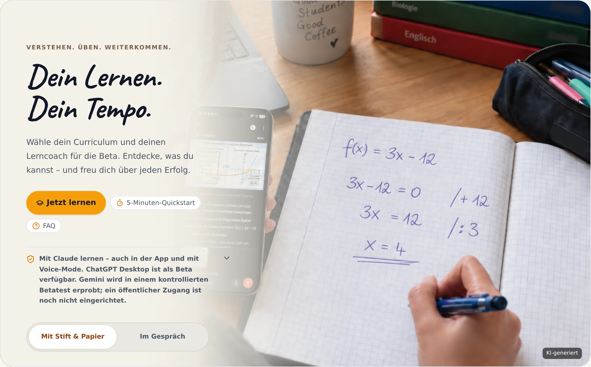
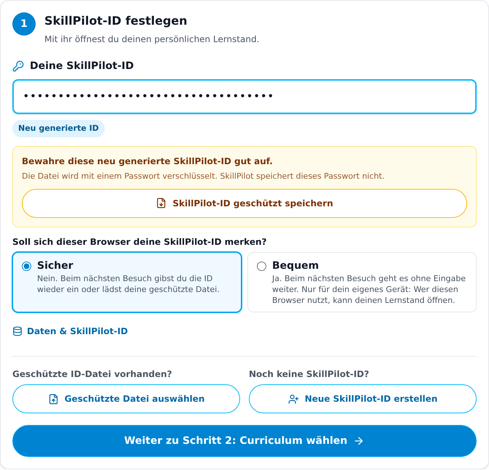
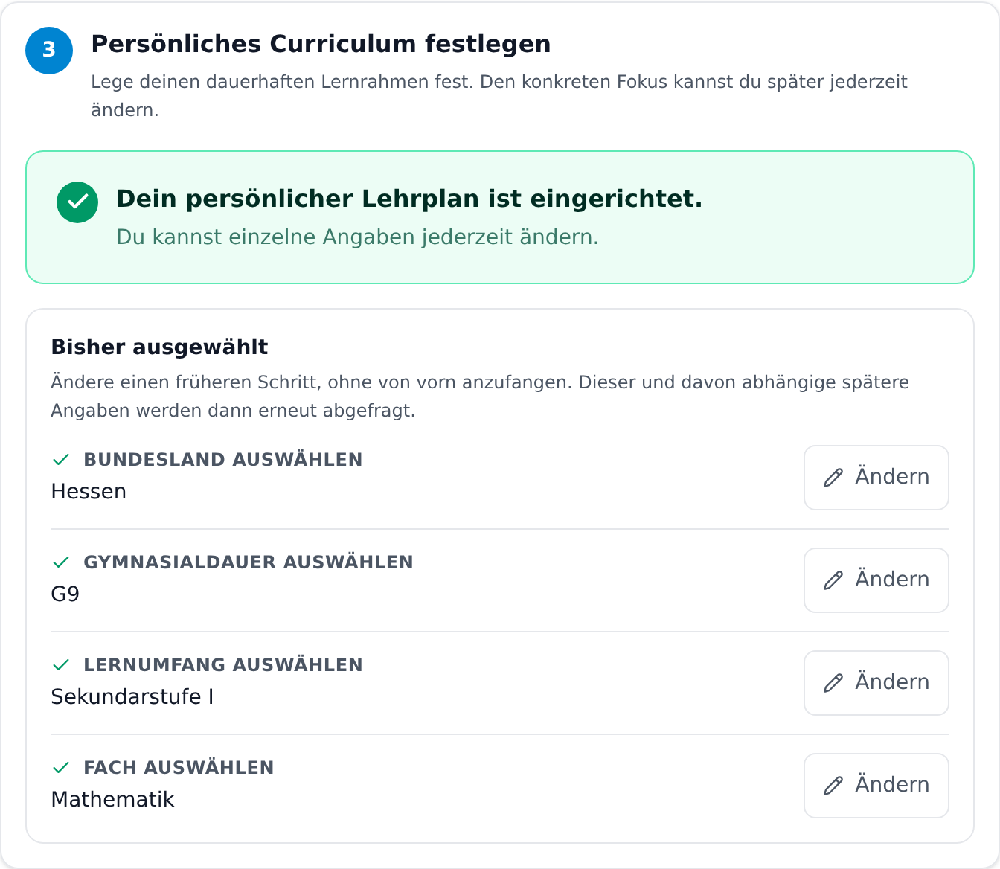
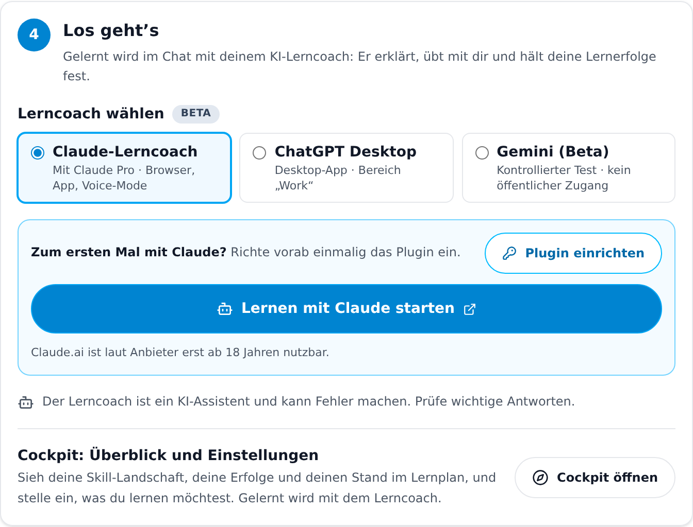
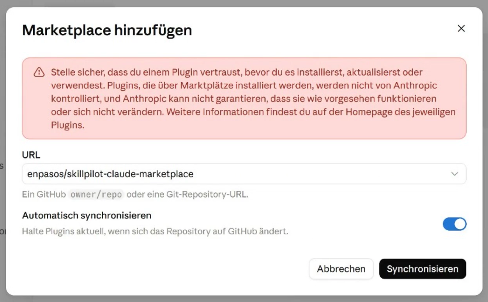
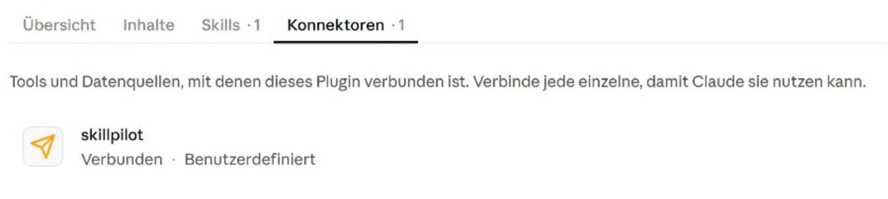
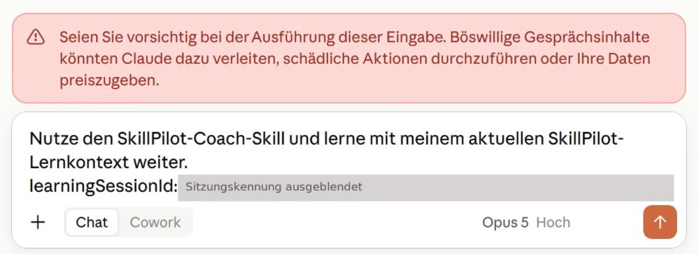
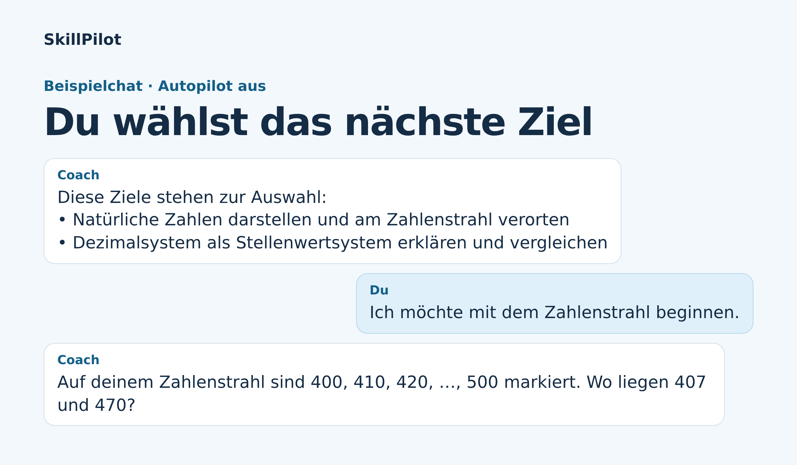

# Von „Jetzt lernen“ zur ersten Aufgabe

Du startest auf der SkillPilot-Webseite und lernst im Chat deines Coaches. Hier siehst du den Weg zur ersten Matheaufgabe mit Claude. Dafür brauchst du ein Claude-Pro-Konto und musst mindestens 18 Jahre alt sein.

[Video zum Lernstart ansehen](https://skillpilot.com/quickstart/de#video)

## 1. Auf der Startseite beginnen

Öffne [skillpilot.com](https://skillpilot.com/) und wähle **Jetzt lernen**. Lies und bestätige die Nutzungsbedingungen.

Wähle **Neue SkillPilot-ID erstellen**. Mit der ID kannst du später genau hier weiterlernen. Über **SkillPilot-ID geschützt speichern** kannst du sie als Datei mit Passwort sichern. Hast du schon eine ID, gib sie ein oder lade deine geschützte Datei.

**Sicher** merkt sich die ID nur im offenen Tab. **Bequem** merkt sie sich für den nächsten Besuch. Wähle **Bequem** nur auf deinem eigenen Gerät, denn wer diesen Browser nutzt, kann deinen Lernstand öffnen.

## 2. Wählen, was du lernen möchtest

Wähle **Weiter zu Schritt 2: Curriculum wählen**. Für unser Beispiel wählst du **Gymnasium (DE)**. Unter **Persönliches Curriculum festlegen** gehst du durch **Hessen → G9 → Sekundarstufe I → Mathematik** und wählst **Diese Auswahl abschließen**. Wenn du mit derselben ID zurückkehrst, ist diese Auswahl schon gespeichert.

## 3. Den Coach einmalig in Claude installieren

Unter **Los geht’s** wählst du **Claude-Lerncoach** und dann **Plugin einrichten**. Die Anleitung öffnet sich in einem neuen Tab. Lass den Tab mit deinem Lernstart offen. Ist dein Coach schon eingerichtet und verbunden, gehe direkt zu Schritt 4.

1. **Marketplace öffnen.** Melde dich im Browser bei Claude an und öffne **Einstellungen → Plugins**. Die Schaltfläche **Plugins in Claude öffnen** auf der SkillPilot-Installationsseite bringt dich direkt dorthin. Über **Hinzufügen** oben rechts wählst du **Marketplace hinzufügen → Aus einem Repository hinzufügen**.
2. **Adresse einfügen.** Kopiere diese Adresse in das Repository-Feld, lass **Automatisch synchronisieren** eingeschaltet und wähle **Synchronisieren**.

    `https://github.com/enpasos/skillpilot-claude-marketplace`

    *Claude-Webansicht vom 13. September 2026. Im Feld „URL“ ist auch die Kurzform der Adresse möglich.*

    

3. **Plugin hinzufügen.** Suche unter **Entdecken** nach **SkillPilot Coach v1** aus dem Marketplace **skillpilot-claude-marketplace**. Vergleiche die Version mit der Angabe im Tab **SkillPilot-Plugins**. Wähle **Hinzufügen**. Unter **Deine Plugins** sollte der Coach jetzt als aktiviert erscheinen.
4. **Verbinden.** Öffne im installierten Plugin **Konnektoren → skillpilot**. Falls nötig, wähle **Verbinden**, melde dich an und bestätige die Freigabe. Sobald dort **Verbunden** steht, kannst du mit dem Lernen starten.

*Claude-Webansicht vom 13. September 2026.*

Fehlt der Marketplace oder bietet er eine ältere Version an? Lade auf der SkillPilot-Installationsseite die aktuelle `.plugin`-Datei herunter. Wähle in Claude unter **Plugins → Hinzufügen → Plugin hochladen** die Datei und verbinde anschließend wie oben den Konnektor. [SkillPilot-Installationsseite](https://skillpilot.com/plugins#claude-plugin)

## 4. Die erste Aufgabe im Chat lösen

Wechsle zurück zum SkillPilot-Lernstart und wähle **Lernen mit Claude starten**. Im neuen Claude-Chat steht die Startnachricht schon im Eingabefeld. Claude kann darauf hinweisen, dass die Nachricht von außen kommt. Prüfe den Text und sende ihn mit dem Pfeil unten rechts ab. Halte die Startnachricht privat.

*Claude-Webansicht vom 13. September 2026. Die Sitzungskennung ist im Bild verdeckt.*

Der Coach kennt dein Curriculum. Nach der Orientierung wählst du ohne Autopilot unter den Lernzielen, für die du bereit bist. Mit Autopilot schlägt SkillPilot dir eines davon vor. Im Beispiel entscheidest du dich für den **Zahlenstrahl**.

Jetzt bist du dran. Beschreibe, wo du **407 und 470** auf einem Zahlenstrahl mit Zehnerschritten eintragen würdest. Wenn du festhängst, frage etwa **„Wie finde ich eine Zahl zwischen zwei Strichen?“** Du kannst danach eine weitere Aufgabe ausprobieren. Bietet der Coach Lernkarten oder eine Prüfung an, kannst du auch damit im Chat beginnen.

Du kannst jederzeit eine Pause machen. Ist die Lernsession beim nächsten Besuch abgelaufen, starte mit derselben ID eine neue. Dein gespeicherter Lernstand bleibt erhalten. Wenn du deinen Fortschritt auf der Lernkarte sehen möchtest, wähle **Cockpit öffnen**.

**Andere Anbieter.** ChatGPT Desktop benötigt für den Bereich **Work** das Plugin **SkillPilot Coach** ab 1.1.3. Der öffentliche Marketplace bietet am 24. November 2026 noch die Vorgängerversion 1.1.2 an. Gemini steht für eigens eingerichtete Testkonten bereit. [Zugangsvoraussetzungen](https://skillpilot.com/faq/coach-setup) · [Einrichtung je Anbieter](https://skillpilot.com/plugins)
