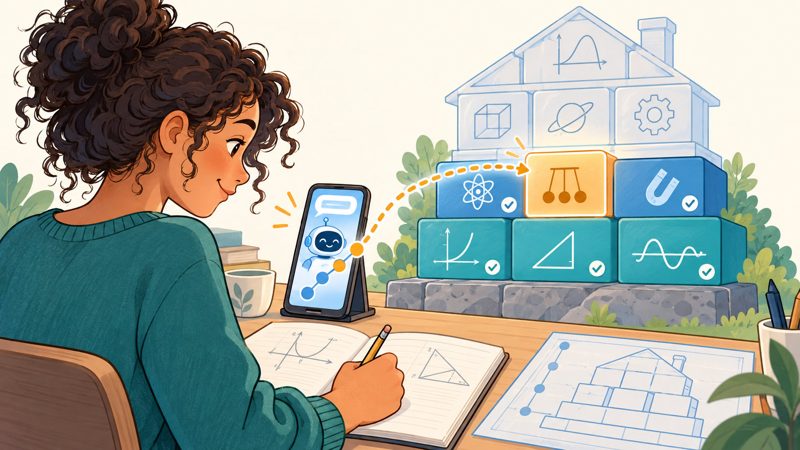
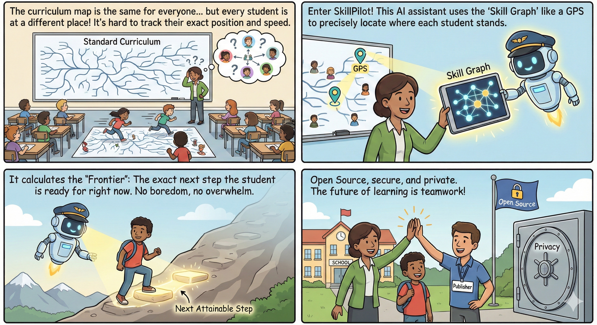
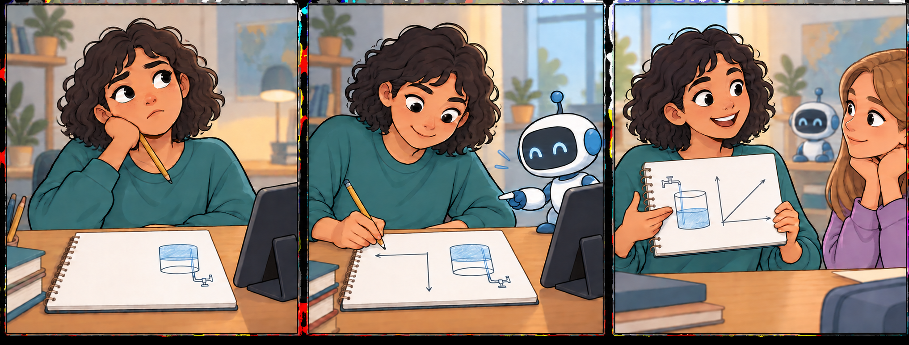
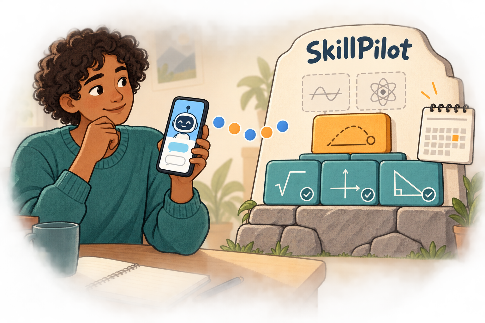
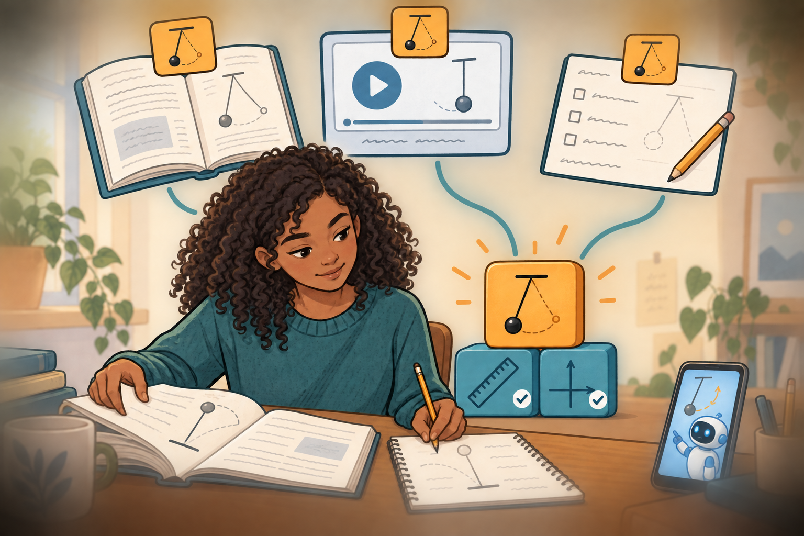
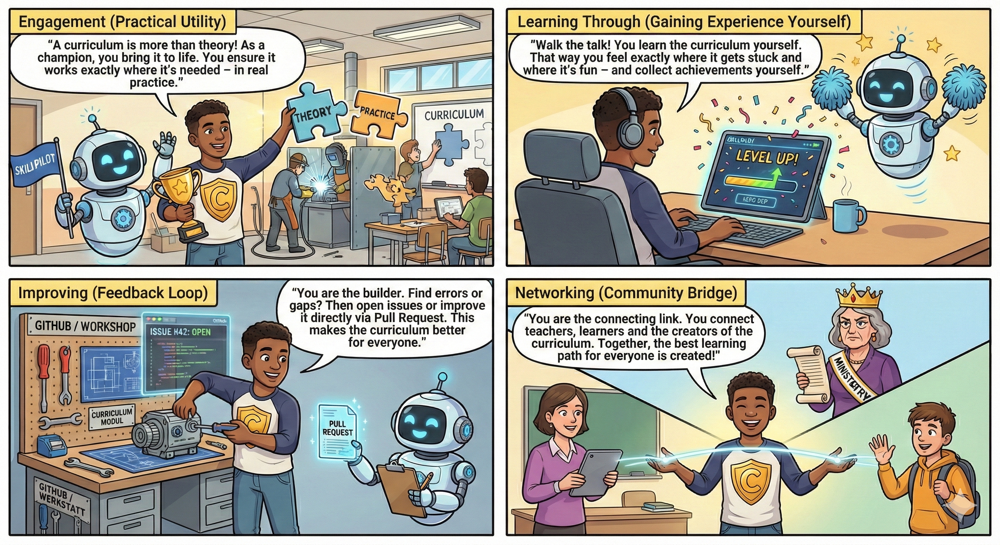

# SkillPilot – the story in pictures

**Version:** 1.0.24 · **Project:** SkillPilot · *Some illustrations are AI-generated.*

## 1. Knowledge you can build on. One learning goal at a time.

From your selected curriculum to a personal learning path: the Claude-based SkillPilot coach already supports learning in Germany’s Gymnasium — on your phone, too. The [curriculum directory](https://skillpilot.com/curricula) shows the reviewed subjects and stages. You do the learning; each understood building block supports what comes next.

## 2. A shared curriculum. Your own learning path.

**“What do I need to take the next step myself?”** Expectations remain high. SkillPilot considers your recorded progress and the necessary foundations; the coach supports you in moving forward. The map is a learning aid, not an infallible judgment of your abilities.

## 3. Think for yourself. Get support. Explain it yourself.

The moment of understanding is yours. In the Claude chat, you can type, use Voice Mode, or photograph your own work with your phone and discuss it. Ask for an explanation if a concept is new, bring your own questions, and explore the idea with an example. Learning brings explanation, conversation, and practice together. An assessment requires your independent performance; you can challenge the AI’s feedback.

## 4. Your progress stays connected.

The coach handles the conversation; SkillPilot manages curriculum, progress, and planning separately from the chat. Tomorrow, you pick up where you left off. **The plan guides your learning; it does not limit it.** The subject-specific core is separate from the AI provider. Alongside Claude, a ChatGPT Desktop beta route is available; the [Quickstart](https://skillpilot.com/quickstart/en) explains its requirements and tested limits.

## 5. One learning goal. Different ways to understand it.

*Vision · in development*

We are working to connect books, YouTube videos, and exercises to SkillPilot. You or your teacher should be able to choose suitable materials; content providers should be able to connect their resources to learning goals and plans. **We are starting with [Physik Libre](https://physikbuch.schule/).** Your progress stays independent of the material provider.

## 6. Better together. Join in.

Something not right? Report it directly in the Cockpit wherever goal feedback is supported: **Learn → give feedback on the goal → review and revise → improve the learning experience.** You do not have to be a Champion. Subject specialists can also contribute as Curriculum Champions.

**SkillPilot is free. The open beta is available to anyone aged 18 or older with their own, separately paid Claude Pro account.**

**[Try it now: the 5-minute Quickstart](https://skillpilot.com/quickstart/en)**

The [full Whitepaper](https://skillpilot.com/whitepaper/en#whitepaper) explains learning guidance, privacy, quality assurance, and content integration in depth.
