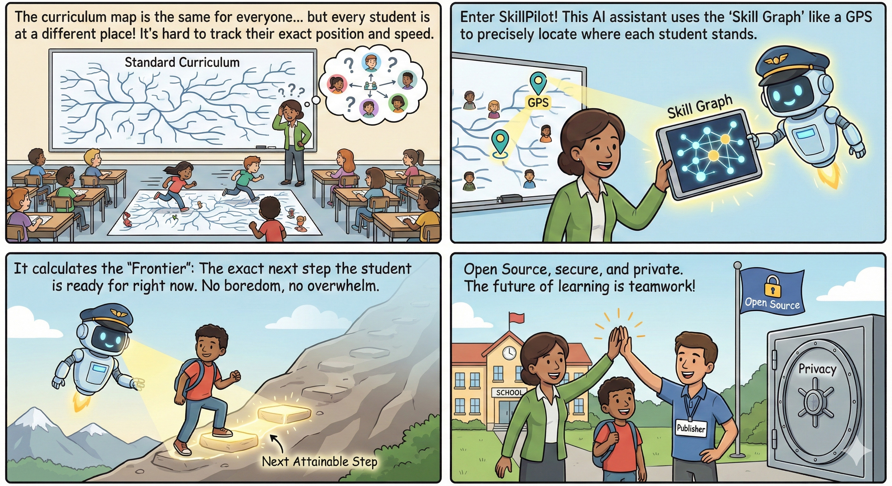
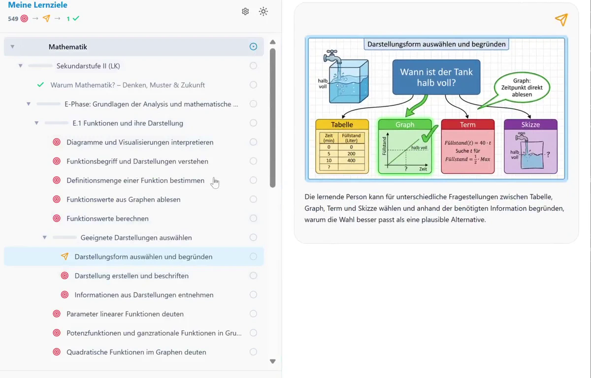
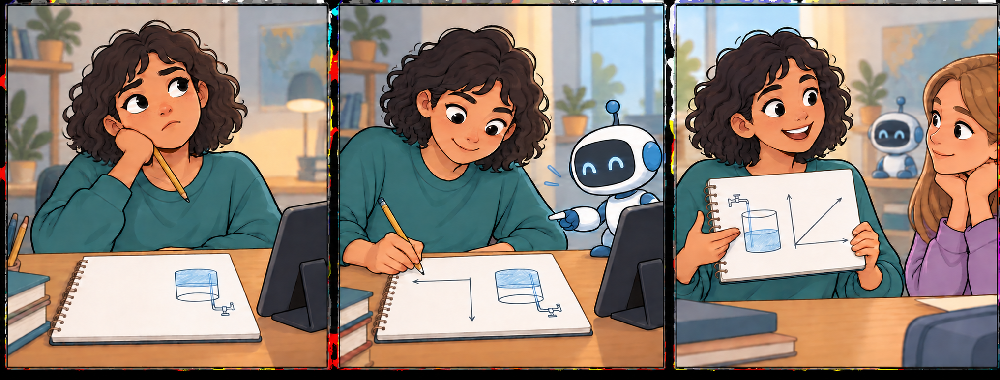
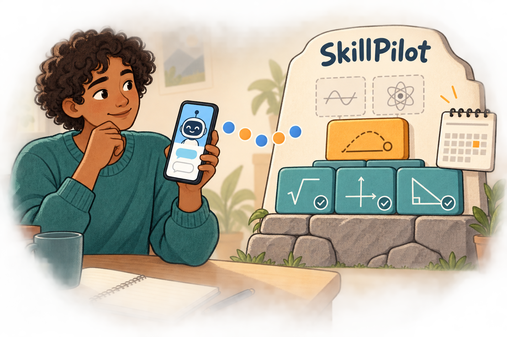
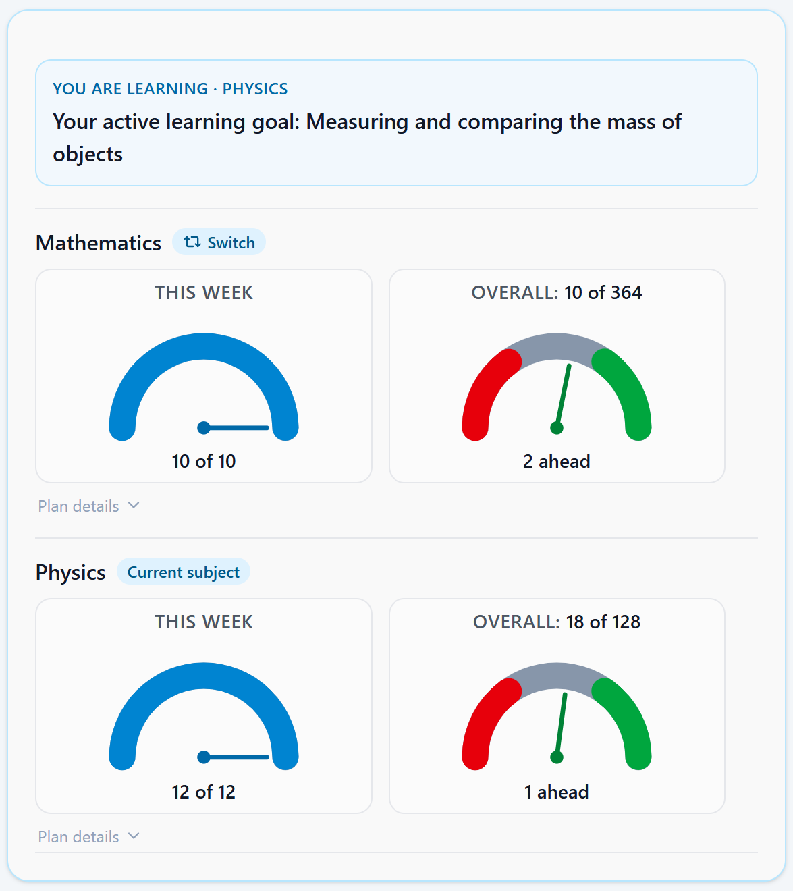
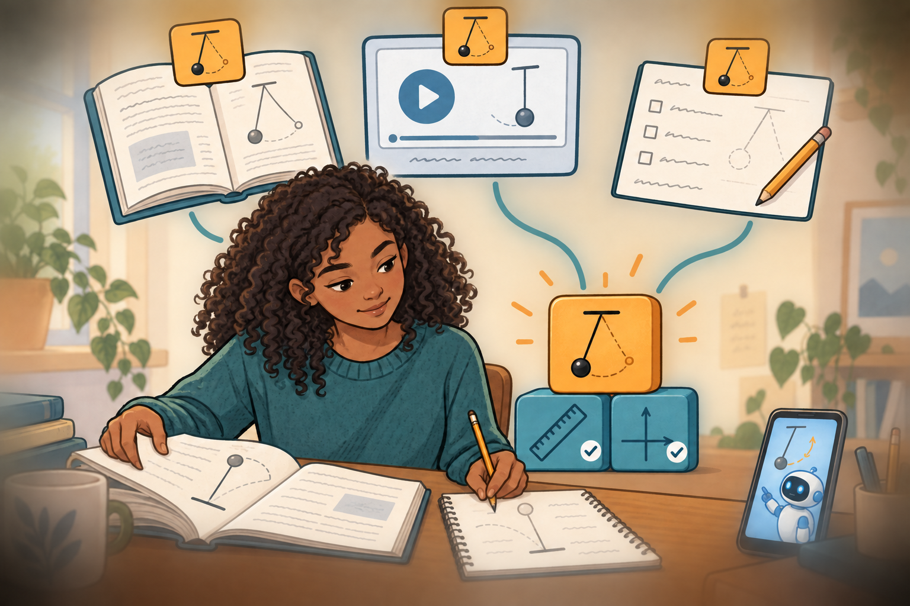
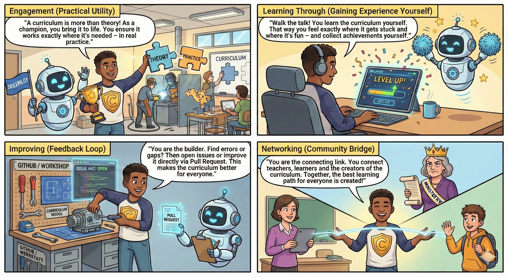
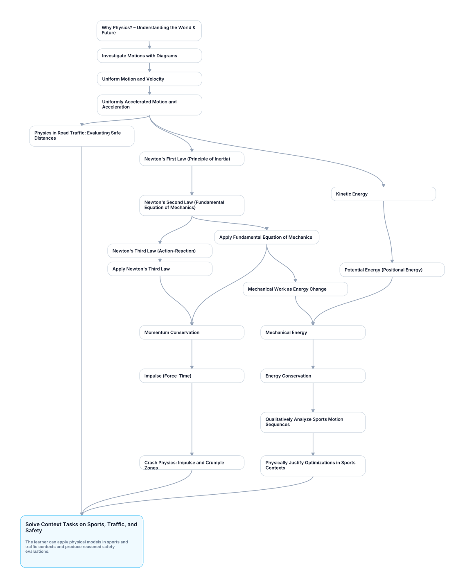

# SkillPilot Whitepaper (EN)

**Version:** 1.0.27 · **Project:** SkillPilot · *Some illustrations are AI-generated.*

---

**Knowledge you can build on. One learning goal at a time.**

Mathematics, Physics, Chemistry, Biology, and Economics in Germany’s Gymnasium – guided learning is already available with the Claude-based SkillPilot coach, including on your phone. After setup, SkillPilot automatically guides you through your Personal Curriculum, based on the selected official curriculum. Each learning goal builds on the foundations it requires.

Like a well-built house, each building block you understand supports what comes next. The coach guides you – the learning achievements are your own.

## Summary

**High educational expectations and individual support belong together.** SkillPilot turns existing curricula into a personal learning map. It connects three questions: What should I learn, which foundations do I need, and which step is within reach now? Expectations remain high; support follows the learner’s recorded progress.

The foundation is the **applicable curricula**, such as state curricula, module handbooks, or language standards. The **skill graph** derived from them connects specific learning goals to their prerequisites. In the web interface, learners select the scope that matches their educational context and subjects. These connections already cross subject boundaries: Physics goals build on the mathematical foundations they need (section 3.1).

**The coach supports work on the next goal; SkillPilot records progress.** The AI explains, offers hints, and discusses learners’ own attempts at a solution. SkillPilot manages learning state and determines which goals are reachable next. A **learning plan** adds a daily or weekly workload. It shows backlog or work ahead separately for each subject, turning the curriculum into manageable everyday learning (sections 3.2–3.4).

**Mathematics, Physics, Chemistry, Biology, and Economics have reached M7 for their currently reviewed Gymnasium curricula**, meaning fully completed machine quality assurance. Human trials by Curriculum Champions are reported separately; M7 does not certify human approval or classroom effectiveness (section 5.1).

The next area of development is to connect **suitable learning materials**, such as books, videos, and exercises, to these goals and learning plans. Teachers and learners should be able to choose suitable resources themselves. We are starting with Physik Libre (section 5.2).

The [5-minute Quickstart](https://skillpilot.com/quickstart/en) explains how to try SkillPilot. Section 6 describes the available beta routes through Claude and ChatGPT Desktop and their requirements.

---

## 1. The Challenge: From a Shared Curriculum to an Individual Learning Path

Education follows curricula defined by the state or through **accreditation**. In practice, however, there is a gap between the curriculum and learners’ actual starting points:

- Learners **do not start at the same point** (prior knowledge, pace, gaps).
- Teachers still have to guide **many people in parallel**, often in large cohorts.
- Learning goals usually exist **as text**, but not as a **navigable structure** with dependencies and sensible next steps.

This leaves some learners overwhelmed and others bored, while making it laborious to track learning progress and next steps accurately.

**A shared curriculum. Your own learning path.**

The goals remain ambitious; the support adapts to each learner’s starting point.

**When learners struggle, the guiding principle is to improve support rather than lower expectations prematurely.** SkillPilot connects the shared curriculum to individual learning progress: instead of “Calculus is still difficult,” it becomes clear which specific abilities are documented, which foundations are missing, and which step is available next. Teachers retain responsibility for teaching and assessment.

---

## 2. The Division of Responsibilities: AI Explains, SkillPilot Manages Learning State

**The AI learning coach supports the dialogue; SkillPilot manages the learning path.** They have different responsibilities and work with the same learning goals.

Language-based AI can explain concepts, formulate tasks, discuss solutions, and respond to questions in natural language. In a learning dialogue, it offers different approaches to a topic and adapts explanations to the learner’s responses.

Reliable learning guidance also needs an authoritative foundation: which goals belong to the curriculum, which prerequisites are met, and which progress has been recorded? SkillPilot manages these facts and rules in the backend.

The learning coach accesses these **authoritative backend rules** through defined tools. SkillPilot calculates reachable learning goals and plan status, checks permitted state changes, and stores confirmed progress. Subject-specific assessment in the dialogue remains an AI judgment and can contain errors; technical validation of a state change is not independent proof that a solution is correct.

**Shared preparation, individual learning support:** The skill landscape is built before use, reviewed under defined quality procedures, and maintained continuously (section 5.1). Particularly capable AI systems can help with the demanding work of interpreting curricula. This reusable work benefits all learners. The AI used for the subsequent learning dialogue need not be the same; it must meet the subject-matter, pedagogical, and technical requirements for learning guidance.

The **plugin and adapter architecture decouples the subject-matter core from any particular AI provider**. Provider adapters expose tools through the **Model Context Protocol (MCP)**. A new AI integration must, among other things, load coach instructions, call tools reliably, handle authentication and learning sessions securely, and display the required images and learning cards. MCP standardizes tool access but does not guarantee these capabilities. Authoritative decisions about learning state, permissions, and navigation remain in the shared SkillPilot core; each specific integration is tested separately.

**The goal is freedom to choose among suitable AI environments.** In the future, this could include AI running locally on a learner’s own device, provided it has the required capabilities and a validated integration. Today’s Claude access is a concrete starting point, not a permanent architectural commitment to that provider. This does not imply that a local learning-coach integration is already available.

---

## 3. The Product: How SkillPilot Works

Everyday learning brings four steps together: **choose a reachable goal, work on it, record progress, and plan further learning.** The following sections trace this path from the Personal Curriculum to the daily or weekly workload.

### 3.1 From Curriculum to the Next Learning Goal

The official curriculum sets the requirements. SkillPilot translates them into specific learning goals and prerequisites. This learning map, the selected personal scope, and recorded progress determine which goals are reachable next.

*From the application: the Cockpit shows the learning map alongside the current goal. A large task becomes a concrete next step. German curriculum shown.*

#### From Curriculum to Learning Map

Curricula, module handbooks, and standards provide the authoritative requirements. The learning goals derived from them remain linked to their sources, sections, and versions. The **skill graph** makes these requirements actionable:

- **Learning goals and topics:** Individual, assessable abilities form atomic goals. Clusters group them into broader topics or modules.
- **Prerequisites (`requires`):** A goal refers to the foundations it needs.
- **Composition (`contains`):** A topic refers to the learning goals it includes.

This creates several possible learning paths rather than one fixed sequence. Formal checks safeguard the structure, for example against cycles. Content quality assurance also checks whether goals are correct in their subject and their prerequisites make educational sense (section 5.1). The [graph definition](https://enpasos.github.io/skillpilot/concept/skill-graph/graph-definition/) explains the formal model; changes are versioned and reviewed (section 6).

#### Cross-Subject Prerequisites: Mathematics and Physics

**The learning map already connects Mathematics and Physics through specific `requires` links.** For example, “Describe motions using distance-time diagrams” requires “Read axes, scales and units,” among other foundations. The more advanced Physics goal “Investigate Motions with Diagrams” builds on “Calculate and interpret average rate of change,” among other goals.

The mathematical foundations retain their own learning-goal IDs and previously recorded progress. SkillPilot can therefore take that progress into account when learning Physics too. Which goals belong to the personal selection and which serve only as prerequisites is explicitly defined.

#### Four Levels of Personalization

The shared learning map becomes a personal learning path. SkillPilot distinguishes the lasting scope, the current step, and progress already achieved:

1. **Base Curriculum (Level 1):** The selected base curriculum, such as “Gymnasium (DE),” provides the available learning goals.
2. **Personal Curriculum (Level 2):** Federal state, school stage, subjects, and, where applicable, duration and course model determine the personal learning scope. This selection is made in the SkillPilot web app, not in the coach chat.
3. **Learning Focus and Active Goal (Level 3):** A temporarily selected subset and exactly one current learning goal guide the ongoing work. The coach uses the options offered by the backend. Widening the focus requires consent; within confirmed plan-guided or autopilot learning, the next permitted goal can be selected automatically.
4. **Learning Progress / Mastery (Level 4):** Progress is stored against stable learning-goal IDs and is retained when the view or focus changes.

A subject-specific **composition view** arranges the shared goals for the selected educational context. It distinguishes **goals to be learned (`target`)** from **prerequisites only (`prerequisiteOnly`)**. Only target goals count toward the visible learning tree, goal selection, progress, and completion of this scope. Prerequisite-only goals retain their recorded progress for prerequisite checks.

Lower-secondary foundations can therefore be taken into account in an upper-secondary view, or mathematical foundations when learning Physics, where that role is explicitly modeled. Including them as learning goals in their own right requires an appropriately selected personal scope. Neither moving to a new school stage nor a cross-subject link certifies their mastery.

#### Frontier: Which Goals Are Reachable Now

The backend calculates the **frontier** from the learning scope and recorded progress: goals not yet mastered whose effective prerequisites are met. The checks also include foundations explicitly modeled as `prerequisiteOnly` outside the visible learning scope. Optional **Strict Mode** additionally checks prerequisites globally.

This selection sets the boundaries for the coach’s next learning step. It reflects the recorded state and is not a psychological assessment of an individual’s learning potential.

### 3.2 Learning Through Dialogue and Recording Progress

**Think for yourself. Get support. Explain it yourself.**

The moment of understanding belongs to the learner.

The **SkillPilot Learning Coach** turns the selected goal into a concrete learning task. It explains, offers hints, asks follow-up questions, and discusses solution methods. It receives the current learning scope, frontier, and permitted transitions from the backend. **Learners still do their own thinking**: for example, solving a task with paper and pencil, photographing their solution, and then discussing the feedback. AI should support the necessary effort effectively, not replace it.

#### Making Understanding Visible

For subject-specific understanding goals, the coach asks for reasoning and explanations in the learner’s own words rather than only correct final answers. Drawing on Socratic dialogue and the **Feynman technique**, this approach aims to reveal gaps in understanding and support targeted further practice. It is a teaching approach, not evidence of the effectiveness of the overall system. This knowledge assessment explicitly does not apply to orientation nodes.

#### Mastery: Recording Achieved Progress

Work on a task provides evidence of whether a learning goal has been understood. For ordinary learning goals, the coach makes a completion decision under the applicable evidence rules; SkillPilot checks and stores the permitted state change. The Cockpit shows the recorded progress, which is taken into account when selecting further learning goals.

This learning state is called **mastery**. Each learning goal has one outcome: achieved or not yet achieved. Assessment goals follow the same rule; a passed goal needs no additional qualification. Percentages for broader topics are weighted aggregates of achieved goals, not partial grades for individual goals. Orientation and memorization have their own completion rules (section 3.3).

The stored learning state remains separate from complete dialogues and additional artifacts. Institutions may require evidence outside this learning-goal state; this does not create a second outcome per goal in SkillPilot.

#### A Short Path from Feedback to Improvement

Does an explanation miss the point, is an exercise unclear, or does the coach behave differently than expected? **For supported subject-matter learning goals, you can give feedback directly in the Cockpit; the current goal is already linked to the feedback.** The feedback is critically reviewed during the next revision and considered for appropriate corrections. Learning experiences reach the place where the content and coaching can be improved. You do not need to be a Curriculum Champion to contribute. Please describe the specific problem without including private details or the full learning chat.

#### Learning Velocity

Learning Velocity shows how many **atomic goals** are newly recorded as mastered per week. It is an indicator of progress over time, not a measure of intelligence or a fixed trait of a child; learning goals can also require different amounts of effort. When new abilities become apparent after a longer initial learning phase, further steps can become available. **Recorded learning progress determines the next step — it is not a judgment of a child’s potential.** An earlier pace does not limit subsequent learning.

### 3.3 Understanding, Memorizing, and Applying Independently

The path to a learning goal depends on what needs to be learned. SkillPilot combines different forms of learning:

- **Understanding:** The coach explains concepts, supports learners’ own attempts at a solution, and asks for reasoning.
- **Memorization:** Vocabulary, notation, or selected formulas are reviewed as needed.
- **Independent application:** Practice and assessment tasks require independent work, for example on paper followed by a photo upload. The coach discusses and assesses solutions according to the requirements of each task.

Within a context such as “Mathematics, Year 7” or “Advanced Physics Course, Hesse, Abitur Preparation,” **modeled learning routes** connect these forms of learning. One possible route leads from orientation through guided understanding to independent application. Necessary memorization can run in parallel. Prerequisites and the current learning state determine the next permitted step; there is no rigid four-step sequence. The appendix provides a schematic example.

**Orientation** helps learners experience the purpose of a topic and the concrete possibilities it offers. It invites personal engagement and does not test subject knowledge. Merely selecting a suggested interest first starts the corresponding follow-up. For this goal type, the existing mastery state means completed orientation, not subject mastery; no additional completion marker is stored.

For content that needs to be memorized, **spaced repetition** complements work with explanations and tasks: the flashcard system (SRS) schedules when cards are reviewed, while the skill graph determines the next learning goals. Ordinary flashcard practice changes only the review schedule. Mastery of a memorization goal is derived from server-side card state and the separate **Verified Recall**, an unaided recall check. This distinction also remains visible in the Cockpit.

**Practice and assessment nodes** lead to independent application. In lower-secondary mathematics, year-level exams are organized under “Exams for Year …”; upper-secondary education adds appropriate course and Abitur exam tasks. Their review status is part of the respective curriculum’s quality assurance. Further task formats, for example for programming, writing, or speaking, can be added.

### 3.4 From Curriculum to Everyday Learning: Learning Plans and Coach Guidance

**Your progress stays connected.**

The coach explains through conversation; SkillPilot keeps the curriculum, confirmed learning progress, and planning connected. It stores learning state, not the conversation.

A navigable curriculum does not yet answer the everyday question: **“What do I need to learn today or this week, and how far have I got?”** A learning plan connects progress already made, goals still open, and time remaining. It makes deviations from the planned pace visible and provides a basis for agreeing on more learning time, additional support, or a different rhythm. Individual learning therefore does not mean learning without commitments to a time frame. **The plan guides learning, but must not prevent it.**

#### The Teacher Plans the Framework

The **Personal Curriculum** defines which competencies belong to the selected educational context. The **learning plan** specifies which topics or groups of learning goals should be addressed within which periods. It complements the skill graph without replacing its goals or prerequisites. To work through an entire curriculum, the plan must cover its intended scope; completing a partial plan does not automatically mean completing the curriculum.

Under **“Course planning”**, teachers prepare learning sections, date ranges, buffer time, and milestones. Subject plans, for example for mathematics and physics, apply **together** but are evaluated **per subject**: each subject has its own daily or weekly target, and work ahead in one subject does not offset backlog in another. Switching the current subject does not deactivate another subject plan or impose an order such as “finish all of mathematics before physics.” Several plans of the same subject are merged; overlapping sections do not count the same goal twice. The learner chooses the time resolution in the Personal Curriculum learning configuration in the Cockpit.

The **learner preview** shows each subject’s daily or weekly target and an outlook over the next seven calendar days before changes are applied; in weekly mode, entries are grouped by calendar week. It uses the same calculation as the Cockpit and chat. Dates are scheduled on weekdays from Monday to Friday. Goal counts describe the workload, not learning minutes. The teacher reviews scope and workload and adjusts the plan when necessary.

Drafts initially remain on the planning device. Only explicit joint confirmation makes them effective for the learner; later draft edits do not silently alter ongoing learning. **Teaching coverage is not learner mastery:** recording “covered in class” does not establish individual competence.

#### Daily and Weekly Resolution

Learners choose between **1 day** and **1 week**. This setting applies consistently to the Cockpit, chat, learner-specific planning, and selection of the next planned goal:

- **Daily resolution:** The workload covers the current calendar day.
- **Weekly resolution:** The workload covers the current calendar week from Monday to Sunday. Learners can complete it at the start of the week, over the weekend, or spread it out. Earlier days within the same week do not create additional backlog.

The choice is saved for the SkillPilot ID; weekly resolution is the default. Switching changes the time frame of the evaluation while preserving plan dates and achieved learning progress.

#### Plan Status in the Cockpit: Workload, Overall Progress, and Plan Balance

In plan mode, the Cockpit displays **two gauges with needles** for each subject. They bring together three different measures: the current workload, overall progress, and work ahead or backlog against the plan.

*Weekly Cockpit view with example data: both weekly workloads are complete. The numbers above the right gauges show overall progress; the needles and short labels below them show work ahead. Physics is the current subject.*

- **Current workload — “Today” or “This week”:** The left gauge shows the completed share as “x of y.” Work already done ahead of schedule counts toward it, so the display does not count only goals newly completed during this period.
- **Overall progress — “Overall: x of y”:** The number above the right gauge counts all achieved atomic goals in the subject’s current Personal Curriculum, including goals completed before the learning plan began. Each goal counts once.
- **Plan balance — behind, on track, or ahead:** The right needle and the text below show progress against the subject plan. Work ahead is taken into account within the same subject.

**A completed daily or weekly workload can coexist with older backlog.** Conversely, a currently unfinished workload alone does not create additional backlog. Subject balances remain separate. The active goal, offered subject switches, and expandable **“Plan details”** complete the overview. The Cockpit and coach use the same values calculated by SkillPilot.

#### The Learner Works in Chat

With plan mode enabled and a valid learning session, SkillPilot handles the organization in the background:

1. **Orient:** The coach quotes the plan status formulated by SkillPilot verbatim: for each subject, the daily or weekly target and any backlog or work ahead. The Cockpit shows a short form of the plan balance beside the gauge; the coach does no arithmetic of its own. It announces the active learning goal separately, once, when the learning task begins.
2. **Resume automatically:** A valid ongoing goal is continued; otherwise, while the daily or weekly workload remains open, a due goal whose prerequisites permit learning is selected, if one is available. Joint activation can already select this first goal. No extra “Continue learning” click or manual goal search is needed.
3. **Learn and check progress:** The coach explains, sets tasks, and supports the work. Only progress recorded under the applicable evidence rules changes the learning state and thus the plan status. The plan-guided flow then leads to the next permitted step.
4. **Switch subjects or finish:** A request such as “Physics now” switches within the available subject options; other requirements remain in place. Once the period targets are reached, the coach acknowledges this and does not start another goal on its own. Reaching a daily or weekly target does not mean there is no backlog; in that case, the coach invites the learner to catch up without pressure. Further learning remains available on request, and future goals do not automatically become extra duties for the current period. The plan status explicitly identifies plans that cannot be evaluated instead of presenting them as complete.

A status-only question does not start a new task; a requested pause remains a pause. If prerequisites or invalid planning block open goals, the coach reports the blockage instead of inventing a completed daily or weekly workload or a replacement duty. Plan corrections remain on the planning side. An expired learning session still requires a fresh start through SkillPilot; chat guidance does not extend the session.

#### Example: Mathematics and Physics on the Same Day

An **illustrative daily example**, not live data: in mathematics, 13 plan goals are scheduled through today and 9 progress-effective plan goals have been achieved; in physics, 10 are scheduled and 11 have been achieved. The **plan balance** also counts plan goals scheduled for later, but excludes goals already mastered when the plan was created. By contrast, “Overall: x of y” in the Cockpit covers all current atomic goals in the Personal Curriculum, including earlier achievements.

| Subject | Daily workload | Additional plan status |
|---|---|---|
| Mathematics | 1 of 3 | 2 learning goals behind |
| Physics | 2 of 2 | 1 learning goal ahead |

The two mathematics goals still open today and the additional backlog are shown separately. Work ahead in physics does **not** offset the mathematics backlog. “Ahead” describes the amount of progress, not mastery of every item scheduled earlier; earlier open goals remain available for goal selection.

On a weekly basis, the same rule applies to the amount due by the end of the current week, the weekly workload, and completions during that week, so the figures may differ. The coach names the active goal separately from plan status: **“Your active learning goal: …”**. Completing a daily or weekly workload does not prevent further learning.

This turns the curriculum into a guided learning path: **The teacher is responsible for scope and timing, SkillPilot calculates the next permitted steps, the coach leads the dialogue, and the learner concentrates on learning.**

---

## 4. Trust: Protecting Learning Data and Understanding Evidence

Anyone who entrusts their learning journey to a digital system should know which data goes where — and what the recorded evidence actually shows.

### 4.1 Which Data Goes Where

The data used in the learning process serve different purposes and require different protections. SkillPilot separates **permanent pseudonymous identity**, the **short-lived learning session**, **authorization of the AI integration**, and **authoritative learning state**. The chat service receives the learning context it needs, not the permanent SkillPilot ID.

#### Pseudonym Instead of Identity

Learning progress is managed under a permanent **pseudonymous SkillPilot ID**. This does not require registering a name or email address with SkillPilot. The ID also serves as a secret access key to the learning profile: it should be backed up as a protected ID file and must not be shared in chats or public feedback. The coach integration does not send it to the AI provider. The chat service requires its own account, and its access conditions also apply.

#### A Separate Session for the Learning Chat

Starting the **SkillPilot Learning Coach** from the SkillPilot web app creates a new random `learningSessionId` with an absolute lifetime of 24 hours. It connects the prepared chat to the confirmed learning context without exposing the permanent SkillPilot ID. The learner does not need to copy or manage any technical value. Its lifetime is extended neither by use nor by an OAuth refresh. The session uses the German or English communication language set in the confirmed context. OAuth authorizes the integration; the learning session determines the learning context.

Learner-specific access **through the coach integration** requires both an admitted, authenticated integration and a valid learning session. App authorization alone does not grant access to learning progress; a learning session alone does not authorize the app to access it. The SkillPilot web app has separate access paths for configuration, navigation, and data management.

#### Dialogue Content Is Decoupled

The learning-coach dialogue stays with the respective AI provider. Answers, solution steps, and free-text assessment explanations are not sent to the SkillPilot backend through the coach tools. To track learning progress, SkillPilot processes structured completion decisions and, where applicable, authorized numerical exam scores.

Conversely, the provider receives the learning context it needs, such as the current goal, relevant progress, and tool results. **Separating the ID does not mean that no learning data reaches the AI provider.** Its terms govern chat and context processing. Explicitly submitted learning-goal feedback is a separate process, not an automatic import of chat content.

**Recommendation for educational institutions:**
Set clear guidelines on which data should not be shared in learning-coach chats (sensitive personal information) and how to support learners safely.

#### Mapping Inside the Institution (Local)

The mapping “who is which pseudonym?” stays with the institution or teacher and is stored **locally**, for example in protected storage — not centrally.

#### Separate Access for Each AI Provider

Claude and ChatGPT have separate adapters with their own authentication and session boundaries. Each provider is responsible for operating the chat and processing the dialogue. The shared SkillPilot core remains responsible for the curriculum, learning state, and learning rules.

A technical integration alone does not establish suitability in terms of data protection or institutional requirements. Each integration is tested separately against the requirements for tool access, privacy, session separation, and reliable learning guidance.

### 4.2 Backing Up Learning Progress: Integrity and Provenance Information

Learners can export their profile, including learning progress and learning plans. The server protects the export against modification using **HMAC-SHA256** and verifies this protection on import. This is server-verifiable integrity protection, not a signature that can be independently verified using a public key.

On import, existing source profiles and import timestamps can be retained as **provenance information**. This is not a complete history of every assessment or state change, and it does not include the underlying learning dialogues.

**An unchanged export does not prove that every recorded assessment is correct in its subject.** It supports backup, transfer, and traceability; institutional recognition requires its own rules and, where appropriate, additional evidence.

---

## 5. The Foundation: Reviewed Learning Goals and Suitable Materials

Protected data and traceable progress are one side of trust. Equally important is the quality of the goals on which the learning path is built. This section describes the review status achieved, the role of human trials, and the planned addition of further materials.

### 5.1 Current Focus: Gymnasium in Germany

SkillPilot’s current development and content focus is **Gymnasium, Germany’s academic secondary school track, across all 16 federal states**. The shared “Gymnasium (DE)” entry provides access to subject-level skill graphs through state-specific mappings and views. Shared competencies are grouped by subject, while differences between state curricula, school stages, and course profiles remain represented. Shared learning goals are therefore maintained once rather than separately for every federal state; subject-specific improvements can benefit all state views built on those goals.

**Mathematics, Physics, Chemistry, Biology, and Economics have reached M7**, the highest machine-assessed maturity level. Machine quality assurance is complete for each subject’s current set of content goals. All five are maintained as shared subject curricula with state-specific mappings. Other Gymnasium subjects are at varying stages of development and are being expanded gradually.

Coverage and quality are reported by subject, year group, and federal state. The current subject coverage and quality evidence for the specific area selected are reported in the [Curriculum Directory](https://skillpilot.com/curricula) and the generated quality status.

The machine-readable maturity levels **M0 to M7** assess, among other things, graph integrity, federal-state coverage, route coverage, assessment-ready tasks, and memory-card traceability. A maturity level always applies only to the precisely named scope and content version. Equal maturity levels can therefore coexist with different breadths of subject development.

**M7 means fully completed machine quality assurance, not human approval.** In addition to continuing to meet M6, every current individual content goal (`curricularAtomic`) must satisfy all five gates:

- **D — Descriptions:** Two independent reviews with resolved decisions.
- **P — Understanding profiles:** Reviewed requirements for what demonstrates understanding of a goal. This is curriculum QA, not a retrospective review of individual chat answers.
- **A — Atomicity:** A subject-specific justification for treating the competence as a single learning goal.
- **M — Memory:** A justified decision on whether any content needs to be memorized and, if so, which content.
- **V — Visualizations:** A subject-specific AI image review of the current image with valid content bindings, or an explicitly permitted subject-specific exception.

What counts is the **intersection of all five gates across the current goal set**, together with passed final validation checks and no open M7 blockers. Evidence is bound to the reviewed content and context; changes may require targeted re-review. The M7 status of the five subjects remains verifiable in the [quality report](https://enpasos.github.io/skillpilot/qa-ci/status/curriculum-quality-status/).

100% means complete coverage by this QA process, not guaranteed freedom from errors or demonstrated classroom effectiveness. The [quality and human-trial concept](https://enpasos.github.io/skillpilot/concept/curriculum-quality-and-human-trial/) explains the binding rules.

**How the reviewed goals work in actual learning is tested separately.** **Curriculum Champions** contribute their subject expertise to this process:

- Champions take responsibility for a curriculum or a **clearly scoped topic area**.
- They **work through learning goals themselves** and report errors or unclear content directly on the relevant goal wherever a feedback entry is available.
- Larger, cross-cutting or technical topics, and feedback on other curricula, are collected on GitHub.
- The Champion role is voluntary. Public goal feedback does not require Champion registration or a GitHub account.
- Champion profiles show learning progress and available quality status, not rankings by feedback volume or Issues/PRs.

**Human trials are a separate attribute, not M8.** They can start at the core QA level M5 and do not have to wait for M7. Existing learning progress by an active Champion in the assigned scope, or an explicitly confirmed start, counts as “Human QA in progress,” provided the trial is not paused; the registration date is irrelevant. “Human-tested,” by contrast, requires evidence of a complete run-through, no open blocking findings, and explicit confirmation of completion. M7 alone does not meet these conditions.

The QA process covers more than curricula: the SkillPilot AI learning coach is continuously evaluated and improved in ongoing use to keep learning reliable and educationally meaningful across real curricula.

> A clearer learning route can begin with your feedback. Choose a manageable topic area, work through the goals yourself, and report where questions remain. **[Become a Curriculum Champion](https://skillpilot.com/curricula)** and contribute your subject expertise to our shared development work.

### 5.2 One Goal, Different Approaches: Finding Suitable Materials

A clearly described learning goal leaves room for the explanation or exercise that helps each person most. This is where the planned integration of additional materials comes in.

**One learning goal. Different ways to understand.**

*Vision · in development*

**External learning materials are connected to the curriculum, not built into it.** A separate mapping layer connects explanations, tasks, books, videos, and interactive resources to suitable learning goals and, through them, to learning plans. Materials can remain where they are already published. The shared competence structure remains independent of individual providers and resources.

**Teachers and learners should be able to select, combine, and switch suitable materials.** Teachers can contribute their subject expertise and pedagogical experience by selecting resources that fit their lessons and the needs of their learning group. At the same time, learners retain room for their own approaches and material choices. Teachers’ pedagogical design and learners’ independence complement each other.

Selecting materials or switching providers changes neither curricular learning goals nor progress already recorded. The integration is optional; opening a resource is not evidence of competence. Free and paid resources use the same architectural framework. Selecting a resource grants neither additional usage rights nor automatic access to its contents by the AI.

**SkillPilot aims to support the purposeful use of existing educational resources, not take them over.** OER initiatives, publishers, educational portals, and other contributors with relevant expertise should be able to map their materials to suitable learning goals without providing a complete progress-management system themselves. Making open educational resources accessible and helping people actually build skills belong together.

The architectural framework is defined. The details of mappings and exchange formats are being explored with real resources and are intended to be developed together with the people who create and use those materials. We are starting with [**Physik Libre**](https://physikbuch.schule/). This starting point requires neither complete resource coverage nor an agreed partnership with the provider.

*Further reading: [Content integration architecture](https://github.com/enpasos/skillpilot/blob/main/docs/concept/skill-graph/content-integration.md).*

### 5.3 Outlook: Applying the Approach to Higher Education

The repository also contains content for other school types, higher education, and CEFR-based language learning. These illustrate how the approach transfers to other settings, but they are not the current development focus.

Bologna/EHEA sets the framework for **outcomes, transparency, recognition, and quality** in higher education. SkillPilot can support these goals, but it does not replace institutional decisions.

- **Learning outcomes / competencies:** Contribution: Make outcomes navigable as a skill graph and progress visible. Limits/prerequisites: Sound modeling, source references, and versioning.
- **Credits/workload (ECTS logic):** Contribution: Support paths, prerequisites, and workload transparency. Limits/prerequisites: **No credit awarding**; rules remain institutional.
- **Recognition/mobility:** Integrity-protected exports support the transfer of documented learning progress. They are not publicly verifiable achievement certificates; recognition remains an institutional process with its own evidence requirements (section 4.2).
- **Quality assurance:** Contribution: Signals about obstacles and paths to inform teaching development. Limits/prerequisites: QA processes and transparent AI rules are required.

## 6. Developing and Testing Together

**Better together. Join in.**

Try it yourself, find the stumbling blocks, improve it together: feedback in the Cockpit is linked to the learning goal and reviewed during the next revision. Learners and Curriculum Champions bring the learning map into practice.

**An idea rooted in the open education movement.** SkillPilot’s original idea was presented and discussed at the OER conference in Berlin in 2013 under the theme “Education in a Landscape of Skills” (German: “Bildung in einer Landschaft aus Fähigkeiten”). Individual goals, existing knowledge, and skills that build on one another were already central to that approach. Today’s project revisits the idea using modern AI: connecting a shared knowledge foundation with individual learning support. The [2013 presentation](https://de.slideshare.net/slideshow/oer-2013-skillpilot/26948355) documents the original approach.

Openness extends beyond software: it and the technical infrastructure are available under **[Apache 2.0](https://github.com/enpasos/skillpilot/blob/main/LICENSE)**. We release our own skill landscapes, tasks, learning cards, curated link descriptions, educational media, and this whitepaper under **[CC BY 4.0](https://github.com/enpasos/skillpilot/blob/main/LICENSES/CC-BY-4.0.txt)**, to the extent the relevant rights exist and we can grant them. Third-party content and private user data are not covered by these grants; the [licensing scope](https://github.com/enpasos/skillpilot/blob/main/LICENSING.md) explains the boundaries. The aim is an openly inspectable educational infrastructure that can be developed collaboratively and that schools, specialists, and public institutions can build on.

- Institutions retain **sovereignty** over curricula and content.
- Reviewed visualizations, tasks, and memory decks can already be linked directly to learning goals; further content formats can be added.
- Open interfaces enable contributions and integration.

Changes to curricula and software are versioned and reviewed through **GitHub and pull requests**. The quality evidence and practical feedback described in section 5.1 provide the basis; additional institutional subject reviews can build on them.

Good individual learning support should not depend on how much help parents can provide themselves or afford privately.

**The long-term goal is age-appropriate learning support that is free for school students, including the AI it requires.** This needs suitable access arrangements and sustainable funding that does not depend on payments from families. The current trial access does not yet achieve that goal. Paid supplementary resources can remain an optional choice but must not become a prerequisite for a learning path that can be used free of charge.

**The next step is practical exploration together with learners, teachers, and educational partners.** It can begin with interested adults using the current access and develop through collaboration with OER initiatives, out-of-school education providers, and learning mentors. Research partners can support the study of educational effectiveness; companies and foundations can contribute as development or funding partners. These possibilities do not imply any partnerships have already been agreed.

School-led use remains an important application and requires suitable access, including age-appropriate arrangements. Across the different learning settings, evaluation must establish whether SkillPilot improves understanding, independent problem solving, and lasting learning, and whether it effectively supports learners whose potential has previously been underestimated. Technical functionality, initial user experiences, and completed curriculum QA do not establish that evidence in advance.

### Join the Beta: Claude or ChatGPT Desktop

**SkillPilot itself is free. The Claude learning coach requires your own Claude Pro account; this beta route is open to anyone interested aged 18 or over.** That subscription is purchased separately from Anthropic. The age limit comes from the [requirements for personal Claude accounts](https://support.claude.com/en/articles/8114491-get-started-with-claude).

**Learning in Claude chat already works on your phone — including Voice Mode.** After working independently with pen and paper, you can photograph your solution with your phone, share it with the SkillPilot coach in chat, and discuss it. Typing, speaking, and showing your own work complement each other.

Claude access is through the SkillPilot marketplace; the [5-minute Quickstart](https://skillpilot.com/quickstart/en) explains the setup. In SkillPilot’s responsive web interface, you select your Personal Curriculum, view your progress, and start the learning session. **[Try it now](https://skillpilot.com/quickstart/en)** and help shape the beta.

**SkillPilot is not tied to one particular AI.** Plugins and dedicated provider adapters connect the independent subject-matter core to each AI chat. Alongside the Claude beta, **ChatGPT Desktop (Beta)** is available through the [SkillPilot Git marketplace](https://github.com/enpasos/skillpilot-chatgpt-marketplace). Installation and learning start have been confirmed on Windows. Choose **ChatGPT Desktop** in SkillPilot, prepare its start message and send it in a new desktop chat. The [plugin guide](https://skillpilot.com/plugins#chatgpt-desktop) explains setup and updates. Browser and mobile ChatGPT access have not been confirmed for this route. Further integrations depend on suitable interfaces and reliably supported capabilities at the provider.

**Initiator:**
The organization behind SkillPilot is **enpasos GmbH**. We invite partners to develop SkillPilot further together — in subject content, teaching, and technology.

**More transparency:**
[GitHub](https://github.com/enpasos/skillpilot)
[Documentation](https://enpasos.github.io/skillpilot/)
[Graph definition](https://enpasos.github.io/skillpilot/concept/skill-graph/graph-definition/)

---

## Appendix: A Modeled Learning Route

*A schematic detail for section 3.3: orientation, understanding, and independent application are connected by prerequisites; necessary memorization runs in parallel. The graph and current learning state determine the next permitted step, not a rigid sequence.*
