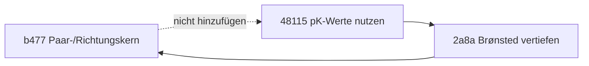

# Tatsächlicher Pfad und verworfene Kante

`A → B` bedeutet: **A verlangt B**.

Die zwei durchgezogenen Kanten stehen in den ganzen aktuellen Zielkörpern. Die gestrichelte Kante wäre neu und würde den Dreierzyklus schließen. Sie wird nicht geschrieben. Die Prüfung ist ein endlicher eigener Edge-Beleg und keine fachliche Freigabe des gesamten bestehenden Voraussetzungspfades.
