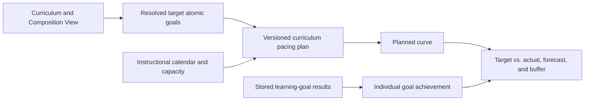

# Curriculum Time Axis, Buffer Planning, and Target-vs-Actual Learning Pace

**Status:** Target concept; local, purely browser-based planning pilot
implemented. The backend-authoritative target architecture is still open.

**Binding correction of 21 September 2026:** Stored learning-goal results are
the sole source of goal achievement in the Cockpit, learning-goal tree, and
teacher planning. The former manual instructional progress state
(`CoverageEvent`, `CoverageLedgerAttestation`, instructional actuals together
with their associated curve, forecast, and confirmation workflow) is
**superseded**, including as a future target architecture. The corresponding
technical design details in Sections 4–18 and in the historical staged rollout
plan remain preserved to contextualize existing datasets; they are not active
implementation or acceptance requirements. Legacy data is neither deleted nor
reinterpreted as mastery. The current pilot contract is defined in Section 19.1;
personal target-vs-actual status is governed by the
[Unified Learning-Plan Status Concept](unified-learning-plan-status.md).

**Outcome boundary of 29 October 2026:** Mastery is the sole stored outcome
state per learning goal: achieved or still open. This also applies to exam
goals. Planning reads this state and may evaluate event timestamps for
trajectory metrics; it introduces no separate pass projection, no qualifying
secondary proof, and no stored failed attempts. The former requirement for
`AssessmentResultEvent` is withdrawn. Missing timestamp or reporting data limits
the evaluable history, not the recognition of existing mastery. Percentage
values aggregate across multiple goals.

**Scope:** First-party SkillPilot WebGUI and backend; no implicit modification
of published provider contracts or historical artifacts.

## 1. Objective

SkillPilot should answer not only **what** is to be learned and **what** is
already mastered, but also:

- when a subject section is scheduled to start and end,
- how much real instructional capacity is available during that period,
- how much buffer remains deliberately protected,
- what progress is expected by a given date,
- which concrete learning or exam goals should be completed by a milestone date,
- how quickly new learning goals have actually been achieved since the
  individual learning start,
- whether the stored individual learning progress matches the plan,
- how a teacher can present both the plan and the current plan posture
  transparently on a single page to department heads or school leadership,
- and what transparent plan adjustment would make sense when deviations occur.

The primary school scenario is a subject course planned by a teacher. The same
model must also work for a personal learning plan without a class. The school
leadership view is an access-controlled projection of the very same course plan,
aggregated by default, rather than a separate reporting system with diverging
numbers.

## 2. Core Decision

From a user perspective, a cluster such as "Linear Functions" sits on the time
axis as a bar with a concrete start-to-end date range. Technically, however, the
canonical cluster receives **no date fields**.

The time axis is a dedicated, versioned planning layer:

- Goals and clusters define **what** is learned.
- `programUnits` and `goalPlacements` define **where** a goal resides within a
  program.
- The Composition View defines **which unambiguous tree** a resolved scope sees.
- A curriculum pacing plan defines **when and with what capacity** a class or
  individual works through this material.
- Mastery defines **what an individual has mastered based on available
  evidence**.

Absolute dates belong neither on canonical clusters nor on `programUnits`,
`goalPlacements`, or Composition Views. The same cluster can fall into different
time windows across different classes, school years, federal states, and
individual plans.

The pacing plan is therefore an execution schedule orthogonal to the four
personalization levels. It is neither a new learning goal nor a replacement for
Personal Curriculum, focus, frontier, or mastery.



## 3. Single Outcome State, Explicitly Named Planning Scope

Teachers and learners see the same stored results per learner:

1. **Planned target:** What should have been achieved by today according to the
   pacing plan?
2. **Goal achievement:** Which goals have been achieved according to the stored
   learning state?

A plan determines dates and scope, not learning outcomes. There is no additional
manual instructional confirmation that reveals or hides a stored completion. A
completed orientation goal likewise counts within its goal scope without thereby
proving subject-matter mastery.

The full personal goal scope may be larger than the plan set **G** recorded at
the start of the plan—for example due to previously achieved goals or a narrower
planning scope. Wherever scopes match, the exact same counting rules apply
everywhere; differing scopes are named explicitly. An unchanged planning
baseline is not a current learning state. Querying progress rewrites neither the
plan nor stored results.

Missing or stale results remain recognizable as unavailable rather than
producing an apparently reliable zero balance. Former coverage documentation is
not used as a fallback source.

## 4. Functional Domain Model

### 4.1 `InstructionalCalendar` — Instructional Calendar

The calendar describes the time available specifically for a given course or
personal plan:

- school year and IANA time zone, for example `Europe/Berlin`,
- recurring subject lessons with their duration in minutes,
- school holidays, public holidays, and weeks without subject instruction,
- cancellations, class trips, project days, and other exclusions,
- additional or rescheduled lessons.

Internally, minutes should serve as the shared capacity unit. The UI can render
them as lesson periods, double periods, or clock hours. This keeps 45-, 60-, and
90-minute lesson models comparable.

Calendar data is plan-local or reusable at the institutional level. It does not
belong inside a curriculum package because holidays and timetables depend on the
school year, location, school, class, and subject.

The calendar provides only available subject capacity. How that capacity is
allocated to initial instruction, review, assessment, remediation, buffer, or
still-unallocated time belongs exclusively in the pacing plan. This ensures the
same minute is never deducted in the calendar and then booked a second time in
the plan.

### 4.2 `PacingPlan` — Curriculum Pacing Plan

A pacing plan is a stably identified plan for a class or an individual learner.
It contains at least:

- owner type `class` or `learner`,
- title, subject, and school year,
- the complete Level 2 fingerprint as its validity context,
- an explicit `planningScope`, for example subject plus grade level, program
  unit, or Composition subtree,
- references to Curriculum, Composition View, and Instructional Calendar,
- `scheduleStartDate` and the final plan end date of the shared time grid,
- a versioned interpretation of the existing mastery state;
  `mastery-threshold-0.9-v1` denotes solely the legacy numeric compatibility
  evaluation, not a graded subject-matter mastery scale,
- status `draft`, `published`, or `retired`,
- a sequence of immutable revisions.

A class plan represents the shared target schedule. A `PlanAssignment` binds a
learner to the plan through time-bounded revision bindings and records that
learner's learning start and baseline. A personal plan can exist without a class
plan.

### 4.3 `PlanRevision` — Immutable Published Revision

Drafts may be edited. A published revision is never overwritten. It stores:

- revision number and `effectiveFrom`,
- predecessor revision and reason for change,
- scope and projection digests,
- immutable calendar revision and calendar digest,
- materialized daily or weekly capacity including all exclusions and overrides,
- the goal set resolved at that time,
- positive reference capacity `referenceWeekMinutes` and start-of-week day,
- timeline blocks, milestones, pins, and buffers,
- a versioned calculation and display policy for measurement windows, minimum
  observation thresholds, and speedometer scaling,
- creator and creation timestamp,
- a version number for optimistic locking.

When replanning, the past portion of the effective schedule is preserved. Only
the future portion is replaced by a new revision. Historical target-vs-actual
reports therefore cannot be retroactively "planned into the green." Every
revision has a half-open validity interval. Plan-local units of already bound
goals remain constant across successor revisions; the new planned curve starts
with the unchanged continuity offset of the previous curve. Without a new
mastery or coverage event, switching revisions must not create a jump in target,
actual, or variance values.

### 4.4 `TimelineBlock` — Timeline Block

A timeline block is the visible bar on the time axis. It contains:

- a stable block ID and a human-readable label,
- an explicit reference to a canonical cluster or a stable Composition View
  node,
- `startDate` and `endDateInclusive` as local calendar dates,
- a role,
- `scheduledGoalIds` as the materialized set of all goals worked on in this
  block,
- `countedTargetGoalIds` as the unambiguous subset that counts toward planned
  progress for the first time in this block,
- separate digests for both goal sets,
- explicitly allocated minutes or lesson slots and their distribution within the
  date range,
- when bound to milestones, stable capacity slices with ID, source slot, minute
  share, and exactly one `workItemGoalId` prepared by that slice,
- plan-local planning units and optional goal overrides,
- optional pins on start dates, end dates, or milestones,
- the forecast horizon `d_b` materialized at publication time, derived from the
  earliest binding pin of this block or its own end date.

Recommended roles for the initial contract:

- `primary`: initial scheduled instruction; counts toward planned progress,
- `revisit`: review; consumes capacity, does not count goals a second time,
- `assessment`: exam or diagnostic check; consumes capacity, provides an
  assessment slot, and can be linked to a milestone, but is itself neither a
  milestone nor silent proof of mastery,
- `remediation`: explicit catch-up work on prerequisites or gaps,
- `buffer`: protected reserve without learning-goal points.

A block may reference a structural node, but its scheduled goal set is
deterministically compiled upon publication. Historical evaluations do not
re-expand the reference against a subsequently modified live tree.

A date range alone does not yet reserve capacity. For every block, it must
therefore be specified which minutes or concrete subject slots it occupies. A
simple initial variant distributes `allocatedMinutes` proportionally across the
slots available within the block's date range; explicit slot assignments
override this distribution. Only this makes both the planned curve and
overbooking checks deterministic. A capacity slice remains owned by exactly one
block; milestones merely reference it and do not create a second time booking.
If an instructional phase combines multiple goals, planning splits its minutes
conservatively across multiple slices. That is a planning approximation, not a
claim about second-by-second classroom impact.

The sum of work slices must not exceed the content minutes of the block. Block
minutes not broken down further remain visible for coarse block planning, but
must not inflate the denominator of a milestone speedometer.

Accordingly, a buffer block materializes `BufferCapacitySlice` entries with ID,
source slot, and minute share, but without a learning goal. Referencing a buffer
in a forecast does not release that buffer yet; only a new effective revision
may turn it into content capacity.

Within a revision, each buffer slice carries at most one
`forecastReservationKey`. This reserves it exclusively for exactly one still-open
forecast commitment—either a block or a milestone. Multiple displays may
reference the same reservation only if they describe the exact same functional
workload according to goal-set and occurrence digests; even then, the capacity
is counted only once across the course. A functionally different block,
milestone, or second forecast must not claim the same buffer slice again as
reserve.

In the first version, `programUnits` may group rows or headings on the time
axis, but they are not a valid block target: a program unit does not possess an
unambiguous atomic goal set of its own. A later extension would require a
dedicated, scope-bound expansion rule via `goalPlacements`.

### 4.5 `PlanMilestone` — Concrete Goals by a Target Date

In addition to longer cluster blocks, a plan can contain a due-date-sorted list
of concrete milestones, for example:

> Abitur Mathematics problems by 15 March 2027

A milestone contains:

- stable ID, clear title, and `dueDate`,
- functional kind `kind: learning | assessment | exam`,
- deadline bindingness `deadlinePolicy: target | hard`,
- `workloadGoalIds`: the concrete learning goals that may be scheduled as the
  functionally admissible preparation workload for this milestone,
- when referencing a cluster, the materialized goal set including its digest,
- exactly one typed fulfillment rule:
  `allCurrentlyMastered(goalIds)`,
  `atLeastNCurrentlyMastered(goalIds, n)`;
  for exam milestones, these rules reference the exam learning goals,
- the functional references of the fulfillment rule kept separate from the
  preparation workload,
- concrete `capacityAllocationIds` pointing to capacity slices with exactly one
  goal ID and a minute share,
- optional `releasableBufferAllocationIds` that fall no later than the local due
  date and are designated as releasable buffer specifically for this forecast,
- as well as the designated assessment slot where applicable.

This separation is essential: in the example "Abitur Mathematics problems by
15 March 2027", the preparatory learning goals can govern gradual progress and
required pace, whereas mastery of the concrete exam learning goals governs
completion of the milestone.

The initial contract deliberately restricts admissible combinations:

- `kind: learning` uses a mastery-based rule; in the initial contract, its set
  of admissible goal IDs is identical to `workloadGoalIds`.
- `kind: assessment | exam` uses `allCurrentlyMastered` across the exam learning
  goals. Their IDs are functionally linked to the preparation workload via a
  published `assessmentGoalMapping`. The preparation workload may be empty, in
  which case no pace speedometer exists.

For the first pacing-plan version, `assessmentId` is the stable canonical ID of
the exam/assessment goal. A content digest of its approved `examData`, including
the grading rubric, describes the scheduled task and its authoring revision. It
is not an additional individual success condition: existing mastery of this
stable goal ID counts immediately. A functionally different learning goal
requires an appropriately reviewed goal model, not a hidden second pass status
attached to the existing goal ID.

For `atLeastNCurrentlyMastered`, each `PlanAssignment` additionally materializes
`activeWorkloadGoalIds` before rendering a speedometer. First, **all**
alternatives currently mastered with rule effect are taken into account—both
baseline goals and goals achieved after learning start, even if they were not
previously selected. If their count is already at least `n`, the rule is
fulfilled and there is no remaining open speedometer workload. Otherwise, the
assignment adds exactly `n - q` concrete still-open alternatives, where `q` is
the number of these currently rule-effective completions.

A relevant mastery event therefore triggers a deterministic, logged
rematerialization: existing still-open selections are retained in stable
selection order, with only surplus trailing entries dropped or missing slots
explicitly filled. Thus, newly mastering a previously unselected alternative
goal immediately reduces the open workload accurately. As long as the required
open selection has not been determined, the UI displays the alternatives group
rather than a single pseudo-precise pointer. Changing the selection freely is an
audited assignment adjustment; the broader set of functionally admissible
alternatives remains unchanged and visible.

`target` denotes an adjustable target date. `hard` denotes an external or
deliberately fixed date that neither tolerance bands nor automatic replanning
may shift. Modifying it requires a new revision, the appropriate capability, and
both actor and rationale; for a class plan, this is normally the authorized
teacher, and for a personal plan, its owner. Externally mandated exam dates may
only be superseded by an equally authorized replacement date.

Milestones can originate from the published class plan or be added personally. A
personal entry modifies neither the class plan nor other learners' milestones
and must remain resolvable within the learner's own Personal Curriculum.

The milestone itself consumes no minutes and generates no mastery. The
associated `primary`, `revisit`, `assessment`, or `remediation` blocks carry the
capacity. A fixed milestone can pin those blocks' end dates and forms a boundary
for forecasting and replanning.

For pace calculations, only the content capacity explicitly allocated to this
preparation workload up to the end of the local `dueDate` counts. An underlying
slot allocation may serve multiple milestones as the same work if it prepares
the exact same `workItemGoalId` there via the same capacity slice; this avoids
double-booking any minute in the overall plan. By contrast, two functionally
disjoint milestone workloads must not each claim the same capacity share for
themselves. Where workloads overlap only partially, solely the slices belonging
to the genuinely shared goal IDs may be referenced multiple times. Required
prerequisites and assessment slots must likewise fall no later than the due
date. For buffer slices, the shared revision-wide exclusivity rule from
Section 4.4 applies. Once buffer is actually released, the new revision
regenerates subsequent forecasts from the remaining reserve.

All fulfillment rules read the current mastery state. If mastery is legitimately
revoked or corrected on subject-matter grounds, a previously fulfilled milestone
can become open again. A later ordinary failed attempt on an exam does not
revoke existing mastery. No pass projection exists independently of mastery.

Fulfillment status is evaluated per `PlanAssignment`. A class milestone is
therefore not summarily "done for the class" merely because a single learner has
fulfilled it; course coverage remains a separate track.

For each fulfillment rule, the projection materializes its chronologically
ordered validity episodes—that is, every transition into and out of "rule
currently fulfilled." Before the due date, it distinguishes `openBeforeDue` and
`currentlyFulfilledBeforeDue`; after the due date, `completedOnTime`,
`completedLate`, `overdueOpen`, and `currentlyReopened`. Decisive are the end of
the local due date in the plan revision's time zone and calendar, the truth
value of the rule at that exact boundary, and the current episode:

- If the rule is fulfilled today and was fulfilled at the end of the due date,
  the status is `completedOnTime`.
- If it is fulfilled today, but was open at the end of the due date, the status
  is `completedLate`; the UI shows the start of the current re-fulfillment
  episode, not some earlier historical completion.
- If it is open today and there has never been a valid fulfillment episode, the
  status is `overdueOpen`.
- If it is open today and there was at least one prior valid fulfillment
  episode, the status is `currentlyReopened`; the metadata fields
  `fulfilledAtDue` and `reopenedAt` additionally preserve whether the rule held
  at the end of the due date and when the most recent episode reopened.

An initial completion before the due date therefore does not retroactively make
a later re-fulfillment on time if the rule was open on the due date itself.
Conversely, losing mastery only after the due date does not erase the
historically accurate statement that the milestone was fulfilled on the due
date. Append-only correction chains can transparently re-evaluate the episode
projection for a new snapshot; the old snapshot remains stable via its
watermark.

From the plan revision and milestones, the runtime first compiles sorted
`DatedGoalOccurrenceTemplate` entries for the concrete goal list. Each entry has
a stable occurrence key, a functional goal or assessment ID, a role, a date,
exactly one date source, and an explicit `dateSemantics`:

- `deadline` applies only to a published milestone, an explicitly ordered or
  dated goal occurrence, or a concrete `assessment` slot;
- `contextEnd` is purely a display fallback to the end of its own `primary`,
  `revisit`, or `remediation` block.

A `contextEnd` merely states "this goal lies within this time segment." It is
not an independent target deadline and must never trigger `overdue`,
`completedLate`, or an atomic target quota. The user interface labels the date
semantics explicitly rather than making both kinds of dates look identical. As a
result, the same goal may carry multiple visible dates—such as "learn,"
"review," and "assess"—while still counting only once toward primary planning
units. A minimum-count requirement is rendered as an "at least n of m" group
with genuine alternatives rather than decomposed into m seemingly mandatory
individual goals.

Per assignment, `DatedGoalOccurrenceStatus` projects orthogonal fields rather
than overlapping single status values:

- `completionState: open | done`,
- `scheduleState: noDeadline | notDue | overdue | completedOnTime |
  completedLate`,
- `readinessState: ready | blocked` including `blockedReasons`,
- data quality of the information available for the report.

For a compact primary badge, precedence is deterministically `done` before
`overdue` before `blocked` before `open`; the remaining fields stay visible
alongside it. A goal that is both open past a genuine deadline and functionally
blocked is therefore labeled primarily "overdue" while additionally explaining
its blockers. A currently mastered goal remains "done" even if a prerequisite
gap is surfaced separately. `contextEnd` always enforces
`scheduleState: noDeadline`.

For primary learning goals, completion and readiness follow from current mastery
and effective prerequisites. For review or remediation, a dedicated
`PlanActivityEvent` is required; existing mastery and mere course coverage do
not prove this personal activity. For assessments, the learning-goal outcome
likewise follows exclusively from mastery. Initial exam dates and retake dates
remain scheduling dates, not separate outcome states. From mastery alone,
neither the attended exam sitting nor any failed attempt can be reconstructed;
any corresponding historical statement remains unknown without reliable process
data.

Free-form checklist items without a stable functional reference are possible as
organizational notes, but count neither toward the planned curve nor as achieved
learning goals. "Task opened" or "covered in class" does not automatically
fulfill a functional milestone; its published fulfillment rule remains decisive.

### 4.6 `PlanAssignment` — Assignment and Learning Start

The assignment linking a plan lineage and a learner maintains a sequence of
effective `AssignmentRevisionBinding` entries and additionally records:

- `assignedAt` and the functional `learningStartedAt`,
- the goal IDs already mastered at start as the baseline,
- the baseline digest and baseline planning units,
- the comparison mode `classSchedule` or `rebaseAtStart`,
- assignment-specific active goal selections for alternative milestones,
- optional authorized individual calendar adjustments,
- assignment status and end timestamp.

Learning start is not automatically account creation, first login, or first
mastery update. When a learner joins a class late, personal velocity measurement
begins at actual entry.

`classSchedule` continues to compare a late entrant against the published class
schedule. `rebaseAtStart`, by contrast, distributes only the personal goal
workload remaining after the baseline starting from the individual learning
start. The mode is chosen explicitly rather than inferred from data.

In `classSchedule` mode, individual absences alter personal remaining capacity
and forecasts, not retroactively the shared class planned curve. If the personal
planned curve is also meant to diverge, the assignment requires `rebaseAtStart`
or an explicitly published individual plan revision. Accommodations and
disadvantage compensation thus become visible as authorized planning rather than
being treated as a silent arithmetic trick.

### 4.7 `MasteryEvent` and Achievement Projections

For learning velocity, the current mastery record alone is insufficient. An
append-only `MasteryEvent` records at least:

- learner ID and stable goal ID,
- prior and new binary mastery state,
- event type, idempotency key, and predecessor event where applicable,
- `occurredAt` kept separate from `recordedAt`,
- source, for example first-party WebGUI, import, Verified Recall, or an
  explicitly versioned provider integration,
- import and trust classification,
- optionally the state version that caused the change.

These events log transitions of the existing goal outcome and do not create a
second success state. Legacy numeric events are retained as compatibility data.
Where reliable history exists, two distinct timestamps can be derived from them:

- `firstEverAchievedAt`: first valid transition to mastery across the entire
  history;
- `firstAchievedAtForAssignment`: first valid transition to mastery after
  `learningStartedAt` for a goal that did not belong to the baseline.

If a goal was previously achieved once, had become open again by plan start, and
is completed again later, that subsequent completion is classified as
`recovered` rather than `new`. It may count once toward achieved plan scope for
this assignment, but is broken out separately in the UI. A further downgrade
followed by another completion does not count a second time. Current mastery
state remains separately visible alongside it.

The legacy numeric interpretation `mastery-threshold-0.9-v1` remains traceable
for already bound legacy data. It is not an additional pass requirement imposed
by a plan. The functional goal model knows only mastery or non-mastery;
timestamps and `new`/`recovered` classify trajectory history, not the validity
of current achievement. Historical values are never rewritten, and no new
timestamp is fabricated when history is missing.

A subject-matter downgrade following new evidence (`LOSS_REASSESSMENT`) leaves
the earlier achievement intact as a historical fact. A data correction
(`DATA_CORRECTION_VOID`), by contrast, declares an erroneous prior entry invalid
in append-only fashion and removes it from derived achievement curves. Every
writer admitted for planning metrics in the future must use the same central,
transactional mutation/event path with normalized source and idempotency **once
that respective writer is explicitly approved for this new planning feature**. A
source value `coach` is provenance only, not implementation approval. Existing
writes are not retroactively reinterpreted as temporally precise events. As long
as a write path supplies no reliable trajectory data, its existing mastery
outcomes remain valid; only the velocity display is restricted for that share of
the data. Provider contracts and historical published artifacts retain their own
modification and acceptance boundaries.

Imported prior knowledge without a reliable original timestamp is treated as
baseline and produces no artificial velocity spike on the import date. If the
import occurs after learning start, the original baseline remains unchanged; an
audited `BaselineAdjustment` increases the current actual state and reduces
remaining work without retroactively inflating velocity since learning start.

### 4.8 `CoverageEvent` — Superseded Draft for Instructional Coverage

This section documents the former model, not the current progress contract. The
binding correction at the top of this document and Section 3 are authoritative;
existing records remain preserved unchanged.

The teacher confirms separately when a block or concrete goals were actually
covered in the course. The event mandatorily references the plan revision,
`timelineBlockId`, and the stable occurrence key. The role is inherited from
this bound block occurrence and verified server-side against the revision rather
than trusted as free-form client input. Within this occurrence, the event
references either:

- explicit goal IDs,
- or the complete, already compiled goal scope of a block.

It contains at least event ID, idempotency key, `coveredAt`, the separate
`recordedAt`, source, and `supersedes` in case of a correction. A goal-oriented
projection counts each primary goal from a `primary` occurrence at most once as
currently covered. Coverage for `revisit`, `remediation`, or `assessment`
documents the execution of that specific course activity, but never increments
the primary `D(t)` curve. Conversely, an earlier `primary` confirmation does not
satisfy a later revisit occurrence. Retries, block confirmation plus individual
confirmation, or subsequent corrections therefore do not produce duplicate
instructional coverage. This information represents course coverage, not mastery
evidence for individual learners.

A missing `CoverageEvent` does not by itself prove that a goal was not taught.
For forecasts, there is therefore an additional append-only
`CoverageLedgerAttestation`: course, plan revision, `completeThroughSlotId`,
`attestedAt`, `recordedAt`, authorized teacher, idempotency key, and
`supersedes` where applicable. It attests solely that all coverage entries known
up to that completely elapsed slot have been recorded or explicitly corrected.
Without an attestation matching the snapshot, `D_b` is merely a confirmed lower
bound; any coverage forecast or traffic-light color remains `unavailable`.

The writer accepts no freely asserted future boundary: the referenced slot must
belong to the bound plan and calendar revision, and its local end must already
lie in the past at the server-confirmed `attestedAt`. The server adopts the
coverage-stream watermark from an actually existing stream position visible to
the writer at that moment; a client can neither fabricate it nor place it in the
future. These checks are hard write invariants, not mere UI hints.

"Matching the snapshot" means: the attestation covers at least the last relevant
subject slot completely elapsed by the report cutoff and binds the
coverage-stream watermark up to which confirmed and corrected events were
verified. New coverage events or corrections after this watermark require a new
attestation before a complete forecast becomes available again; older snapshots
remain unchanged.

### 4.9 Exam Completion from Existing Mastery

The earlier design featuring a separate `AssessmentResultEvent` and an
independent passed projection is superseded. Exam goals use the exact same
outcome state as other learning goals. A successful exam flow writes mastery; a
failed attempt leaves mastery unchanged and stores neither the failed attempt
nor its score.

An exam milestone rule reads the mastery of the referenced exam goals directly.
It demands no form, version, sitting, or artifact recognition alongside that
outcome. Assessment versions describe authored content and plan revisions, not
individual outcome variants.

Scheduling multiple dates for the same learning goal does not alter its
functional identity. Existing mastery fulfills the goal commitment even on a
retake date; neither actual attendance nor any historical statement about an
earlier attempt follows from this. Temporal plan metrics may use existing,
reliable mastery event timestamps. Missing timestamp data limits those metrics
and creates no additional open exam status.

### 4.10 `PlanActivityEvent` — Confirmed Revisit or Remediation

Scheduled review or catch-up remediation cannot be derived either from existing
mastery or from a class `CoverageEvent`. A personal append-only
`PlanActivityEvent` therefore records at least:

- learner, assignment, and occurrence keys,
- activity kind `revisit` or `remediation`,
- `occurredAt`, `recordedAt`, source, and idempotency key,
- in case of a correction, the superseded event and a rationale.

This event confirms solely the respective plan activity. It modifies no mastery
and does not count primary planning units a second time.

## 5. Resolving Clusters into Schedulable Work

### 5.1 Binding to the Resolved Scope

A plan is not created against the unfiltered skill landscape, but against a
fully resolved scope comprising:

- Root Curriculum,
- jurisdiction or canonical view,
- school form, stage, and G8/G9 duration model,
- subject and course profile,
- Composition View,
- curriculum release or projection digest.

This complete Level 2 scope forms the validity context. Within it,
`planningScope` narrows down the concrete planning horizon—for instance to
Mathematics in Grade 8. Other subjects, grade levels, or stages of the Personal
Curriculum are not removed as a result; they lie explicitly outside this plan.

For `primary` blocks, only visible `target` atomic goals from a referenced
cluster or structural node are adopted as `countedTargetGoalIds`. Alongside
these, a `remediation` block may schedule explicit `prerequisiteOnly` goals in
`scheduledGoalIds`. Those consume capacity and can continue to block the
frontier, but do not count as additional target goal scope of the plan.

Each revision also declares its `planTargetGoalIds`: the portion of the Level 2
goal space for which the concrete planning horizon accounts. For every visible
Level 2 goal, it is recorded explicitly whether the goal lies within this
horizon or outside it together with rationale and follow-up planning. A missing
entry is not a valid "later" status.

### 5.2 Unambiguous Primary Assignment

Because canonical goals in a polyhierarchy can sit underneath multiple clusters,
each published plan revision enforces:

- every `planTargetGoalId` within the horizon has exactly one `primary` block;
- overlapping block references are detected at compile time;
- `revisit`, `assessment`, and `remediation` may reference goals again, but
  generate no additional progress points;
- every goal outside the planning horizon receives an explicit disposition such
  as `deferred` with a follow-up plan or `outsideHorizon` with a subject-matter
  rationale.

### 5.3 Prerequisite Edges Remain Authoritative

The pacing plan prioritizes within functionally valid options. It must never:

- promote a dated yet locked goal into the frontier,
- bypass or rewrite `requires`,
- infer mastery from reaching a calendar date,
- alter the Level 3 focus or the active goal outside the rules governing them.

Class-wide plan validation statically checks whether each prerequisite and its
dependent goal are arranged in a chronologically plausible order. It has no
knowledge of individual mastery and therefore never claims that a prerequisite
is already mastered. Overlapping timeline blocks can be permissible following an
explicit check if their internal sequence covers the prerequisite in time.

Only the `PlanAssignment` compares this sequence against current individual
mastery. Open prerequisites are surfaced there as personal blockers or potential
`remediation`; they do not retroactively invalidate the published class
revision.

## 6. Planning Units Instead of Repurposing `weight`

Existing goal weights express a share of progress and subsequent grading. They
are neither time estimates nor effort estimates and must not be reinterpreted as
such.

For the first version, the following transparent rules apply:

- every eligible `target` atomic goal receives one plan-local planning unit;
- clusters never count directly, only via their unambiguous atomic goals;
- a teacher can assign custom plan-local units to noticeably smaller or larger
  goals;
- later calibration must not alter historical plan revisions.

By default, regular subject-matter atomic goals count. Orientation nodes do not
count as subject-matter mastery. Memorization, practice, and exam nodes are
included only via an explicit plan role so that their specialized completion
semantics do not produce artificial spikes in learning progress.

Under the one-point approximation, the UI must state clearly that "goals per
week" is a coarse metric that depends on goal granularity.

In the local direct-ID pilot, the planning space is constructed against an
immutable snapshot of all projected `target` atomic goals of the complete
personalized subject scope (Level 2); clusters never count. The mutable Cockpit
focus (Level 3) does not restrict this selection space. For a concrete learning
section, however, only the atomic goals underneath the actually selected goal or
cluster count. Its course-plan to-do set consists exclusively of the subset
still open at the snapshot with mastery below `0.9`. A selected lower-secondary
(Sek I) section with 259 atomic goals and 206 mastered goals therefore comprises
53 schedulable goals—even if the personalized subject scope additionally
contains upper-secondary (Sek II) goals. Only a dedicated upper-secondary
section brings those goals into the concrete plan. Subsequent learning progress
does not retroactively alter this planning basis. Rendered target goal counts
are rounded to whole goals; rates such as the weekly quota are displayed with at
most one decimal place.

### 6.1 Comparable Effort for Learning Units and Plan Sections

[Learning units](../skill-graph/learning-units.md) bundle learning goals and
subunits into a functionally coherent whole with derived completion. A calendar
year or semester can schedule multiple such units; a time period and a
functional unit are not automatically identical. The budget conditions below
define an additional planning profile. They neither claim an implemented
cross-subject budget check or automatic approval nor define the concept or
functional completion of a learning unit via available time.

Without shared calibration, plan-local units from different subject courses are
neither directly comparable nor additive into a cross-subject workload. Checking
such a budget requires a shared unit of effort—preferably minutes—and a
traceable estimate:

- reference learner profile and assumed entry level,
- unambiguous goal scope and included learning activities,
- estimation method, version, and evidence status,
- expected effort or range together with an evaluation rule.

Initial acquisition of a canonical goal counts once along the learning path,
even when multiple subjects or placements reference it. Review, exams, and
additional preparation can consume further time without generating new goal
achievement. The one-point approximation from Section 6 remains a progress
metric and does not by itself prove manageability. Nor does a cross-subject
budget check introduce a cross-subject learning-pace speedometer or offset
backlogs across subjects; existing subject-specific status rules remain
authoritative.

## 7. Capacity, Instructional Weeks, and Buffer

### 7.1 No Raw Calendar-Week Arithmetic

A holiday week has zero capacity for a subject. A week with a canceled double
period has less capacity than a regular week. Therefore, the planned curve is
based on available subject capacity rather than on the number of elapsed Monday
weeks.

For week `w`:

```text
GrossCapacity(w)
  = regular and additional subject minutes

AvailableCapacity(w)
  = GrossCapacity(w)
  - Exclusions(w)

AvailableCapacity(w)
  = primary(w)
  + revisit(w)
  + assessment(w)
  + remediation(w)
  + buffer(w)
  + unallocated(w)
```

This equation is a plan invariant: calendar exclusions are deducted exactly
once, after which every remaining minute is assigned to at most one plan role.
`buffer` is protected reserve; `unallocated` is time not yet scheduled, yet not
promised as buffer either.

The UI displays two distinct weekly quotas:

- **Capacity quota:** subject periods or minutes in this week,
- **Planned progress:** scheduled atomic goals or planning units in this
  effective instructional week.

An effective instructional week can be normalized as a capacity fraction.
Because `referenceWeekMinutes` may change across revisions, the normative
interval function is piecewise by revision. For the half-open effective revision
intervals `I_k`, the metric-specific formula is:

```text
W_X(a, b)
  = sum over all k:
      measurableMinutes_X((a, b) intersected with I_k)
      / referenceWeekMinutes_k
```

Half an instructional week thus counts as `0.5`; a week without subject lessons
counts as `0` and does not depress reported learning velocity.

`referenceWeekMinutes` is positive and immutable per plan revision. This keeps
the display reproducible across timetable or semester changes. Internally,
SkillPilot computes entirely in minutes; "effective weeks" is purely a
human-friendly presentation unit. Time zone and start-of-week day come from the
plan revision, never from the incidental browser locale.

`X` denotes the functional denominator of the respective metric, for example all
primary content, a milestone workload, or a block. Only when the entire capacity
under consideration falls within a single revision may the simplified division
by its single `referenceWeekMinutes` be used. Historical and sliding windows
spanning revision boundaries always use `W_X`; a change in reference capacity
alone must never cause a rate jump.

"Measurable" in each case means the capacity during which plan progress is
expected for the metric under consideration. Still-protected buffer, exam time,
and organizational time do not belong in the velocity denominator. Once buffer
is explicitly released for content, that capacity counts starting from the
effective plan revision.

### 7.2 Visible Buffer

Buffer is reserved capacity, not invisible stretching of topic blocks. Sensible
combinations include:

- distributed micro-buffer for cancellations and deeper exploration,
- end-of-term buffer ahead of exams, report cards, or the end of the school
  year,
- dedicated reserve for diagnostics and review.

The plan breaks down:

- total available subject capacity,
- capacity committed to content,
- protected reserve,
- buffer already explicitly consumed,
- remaining buffer in minutes and effective weeks.

A UI may suggest an initial default, but must not hardcode a buffer percentage
as a universally valid pedagogical norm. Zero buffer is permissible, but must be
clearly visible as a deliberate, fragile schedule.

### 7.3 Total and Subject Budgets of a Plan Section

The reference workload of learning units scheduled within a cross-subject
section is checked against both the overall budget and the binding subject
budgets. An adequate overall total does not automatically compensate for an
overbooked subject budget. Out-of-class study time counts only if it is
explicitly scheduled and declared in the reference profile. Every such budget
must satisfy:

```text
planned learning workload + protected reserve <= available capacity
```

Learning workload comprises declared initial instruction, review, exams, and
preparation. The same minute must neither be credited in full to multiple
subjects nor booked simultaneously as content and reserve. Interdisciplinary
activities receive traceable time shares; they double neither the goal scope nor
available capacity. A shared reserve replaces a subject buffer only where
reallocation is genuinely feasible in practice.

The budget result and the reliability of its underlying basis are reported
separately. Missing effort data yields "not yet evaluable." The estimation basis
may, for instance, be provisionally estimated, subject-expert reviewed, or
calibrated against matching learner data; each statement remains bound to its
reference profile, method, and version. Even an arithmetically fitting reference
workload is no guarantee for every individual person. Reserve and deliberately
chosen zero reserve remain visible in accordance with Section 7.2.

Assigning goals to learning units does not replace a concrete chronological
schedule: prerequisites within the same unit must be scheduled prior to their
use. Detailed temporal validation follows Section 5.3.

### 7.4 Reference Workload, Personal Entry Gaps, and Completion

The reference workload applies under the published entry profile. Personal
planning, by contrast, accounts for the stored learning state: already achieved
goals reduce open work; missing entry prerequisites surface as additional
preparation or potential `remediation`. Such gaps may exceed the personal budget
without retroactively invalidating the reference assignment. Scheduling them
follows existing selection rules and expands neither the Personal Curriculum nor
the focus automatically. Without scheduled catch-up work, the additional need
remains explicitly reported; it must not be treated as already mastered or
covered in time.

A unit's own scope and its explicit completion rule must be distinguished from
the complete `target` set of the Personal Curriculum. Elective rules apply
solely to the declared unit scope. An official optional classification removes
no goals from the currently binding Personal Curriculum; existing interim
selection rules and its progress and completion scope remain intact.

Completion of a learning unit follows its published goal-type-appropriate rule:
mandatory subunits and its own goal obligations are fulfilled. Effective
competency encompasses direct results and valid implicit recognition. Dates,
instructional duration, and consumed planning units never generate completion.
Missing outcome data remains non-evaluable. A completed part stays completed
even while a higher-level exam is still open. Mere time scheduling activates no
technical access lock. Whether explicit dependencies between whole units—
including direct exam attempts—are binding is documented as a separate,
still-open product decision in the
[progression concept](../skill-graph/learning-unit-progression.md).

## 8. Planned Curve and Weekly Quota

For a primary block `b`, let:

- `P_b` be the sum of its planning units,
- `C_b(t)` be the usable content capacity of the block up to time `t`,
- `C_b` be the total usable content capacity of the block.

Then the expected cumulative block progress is:

```text
S_b(t) = P_b * clamp(C_b(t) / C_b, 0, 1)
```

The overall planned curve is the sum across all effective primary blocks. The
weekly quota is the difference of the planned curve between the start and end of
the week. School holidays, cancellations, and explicit buffer blocks reduce it
automatically.

Linear distribution within a block is initially a planning approximation. Later,
teachers can specify explicit intermediate milestones or an internal ordering for
goal groups. Without such data, the runtime must not invent a hidden sequence.

A block with a positive goal set and zero content capacity is invalid. Parallel
blocks are permissible only if their combined capacity allocation is not
overbooked.

## 9. Individual Actual Curve and Learning Velocity

### 9.1 Baseline and Newly Achieved Goals

Let:

- `G` be the unambiguous counted atomic goals of the plan,
- `G_0` be the goals already mastered at the personal learning start,
- `p_g` be the plan-local units of a goal,
- `a_g` be the timestamp of its first completion after learning start for a goal
  outside the baseline, classified as `new` or `recovered`.

Then:

```text
B = sum of p_g for g in G_0

A_seit_start(t)
  = sum of p_g for g in (G without G_0) with a_g <= t

A(t)
  = B + A_seit_start(t)

Q(t)
  = sum of p_g for g in G currently still mastered
```

The baseline reduces remaining work, but does not inflate the velocity reported
since learning start.

For comparison, an assignment-specific planned curve `S_zuordnung(t)` is also
defined:

- under `classSchedule`, it is the unchanged published class curve;
- under `rebaseAtStart`, it starts at `B` and distributes only the remaining
  units starting from `learningStartedAt` across personal remaining capacity.

Thus, a late entry is measured deliberately either against ongoing class
progress or against a freshly rebased personal plan.

In addition, the current mastery balance is computed. If a previously achieved
goal later reverts to open, the historical achievement is preserved while the
current gap becomes visible. Historical throughput and current readiness are two
distinct statements.

Remaining open work for forecasting is therefore `P_gesamt - Q(t)`, not
`P_gesamt - A(t)`. A subsequent downgrade creates no second "newly achieved"
goal, yet surfaces the plan workload that is open again today.

### 9.2 Since-Start and Recent Velocity

The user requirement "since learning start" is fulfilled as a stable headline
metric:

```text
v_ist_seit_start
  = A_seit_start(today)
    / W_zuordnung(learningStartedAt, today)
```

Forecasting additionally requires a smoothed recent window:

```text
v_ist_juengst
  = completion units achieved since learning start within window
    / W_zuordnung(windowStart, windowEnd)
```

The UI breaks this down separately into `new` and `recovered`. Both reduce open
plan workload; only `new` denotes a goal achieved for the very first time in
known history.

The window is defined in completed effective instructional weeks rather than as
a rigid number of calendar days. When history is too short, the UI displays "no
reliable forecast yet" instead of an unstable traffic-light judgment.

### 9.3 Target-vs-Actual Variance and Required Velocity

```text
CurrentPlanVariance(t) = Q(t) - S_zuordnung(t)

v_soll_bisher
  = (S_zuordnung(t) - S_zuordnung(learningStartedAt))
    / W_zuordnung(learningStartedAt, t)

v_erforderlich_ohne_puffer
  = (P_gesamt - Q(t))
    / W_zuordnung_reg(t, planEnd)

v_erforderlich_mit_puffer
  = (P_gesamt - Q(t))
    / W_zuordnung_mit_puffer(t, planEnd)
```

A ratio alone is hard to interpret. As its primary signal, SkillPilot should
therefore present projected completion relative to the content end date and the
final plan end date:

- **on track:** forecast ahead of content end date; buffer remains protected,
- **buffer needed:** goal achievable, but only by drawing on reserved capacity,
- **deadline at risk:** forecast falls past the final plan end date,
- **not yet evaluable:** history or future capacity is insufficient.

By default, neutral tolerance should correspond roughly to one regular subject
instructional week and be configurable in the plan. Exact variance in units and
effective weeks always remains visible.

`A(t)` and its breakdown into `new` and `recovered` serve exclusively for
historical throughput and velocity analysis. Current plan status, open work, and
completion forecasts rely on `Q(t)`. Consequently, a goal that reopens later
does not remain falsely "green" permanently.

### 9.4 Cockpit Speedometer

A compact velocity gauge makes sense as a Cockpit quick view provided it does
not conflate pace with deadline risk. It always belongs to an explicitly named
plan or milestone scope; a cross-subject "overall speedometer" would not be
meaningfully interpretable.

The next binding milestone is determined deterministically:

1. first, open milestones that are already overdue, sorted by due date;
2. otherwise, the earliest open future milestone;
3. ties on due date break by `hard` before `target`, then by stable milestone
   ID.

Fulfilled milestones are skipped. If no open milestone exists, the next open
primary block completion serves as an explicitly labeled fallback: earliest
`endDateInclusive`, breaking ties by stable block ID. If none exists either, the
final plan end date follows. For this purpose, the runtime constructs a
synthetic `PacingTarget` sharing the exact same calculation interface: for the
block fallback, `activeWorkloadGoalIds` is populated from its
`countedTargetGoalIds`, `dueDate` from `endDateInclusive`, and
`capacityAllocationIds` from its matching work slices, while
`releasableBufferAllocationIds` remains empty absent an explicit block binding.
For the final plan fallback, these are the still-open plan goal IDs, the final
plan end date, their remaining work slices, and any reserve still unbound up to
that point. The exact same formulas as for a milestone then apply. Upon late
entry into a class, an overdue class milestone remains visible in
`classSchedule` mode and is treated as a catch-up situation. `rebaseAtStart` or
a personal plan may replace it only via a newly published, traceable assignment.

For the selected milestone `m`, let:

- `G_m` be its `activeWorkloadGoalIds` materialized for this assignment; without
  an alternatives rule, this matches the bound preparation workload,
- `G_m_open(t)` be the subset thereof still open according to the current
  mastery state,
- `P_m` be the sum of plan-local units in `G_m`,
- `Q_m(t)` be the units of goals in `G_m` currently fulfilled via mastery,
- `C_m_rest(t, dueDate)` be exclusively the upcoming content capacity of linked
  capacity slices whose `workItemGoalId` lies in `G_m_open(t)` and that are
  available up to the due date,
- `C_m_buffer_rest(t, dueDate)` be exclusively the buffer slices falling no
  later than the end of the local due date and explicitly designated as
  releasable for `m`.

Then:

```text
R_m(t) = P_m - Q_m(t)

W_m_rest(t)
  = sum over k:
      C_m_rest(t, dueDate, intersected with I_k)
      / referenceWeekMinutes_k

W_m_mit_puffer(t)
  = sum over k:
      (C_m_rest(t, dueDate, intersected with I_k)
       + C_m_buffer_rest(t, dueDate, intersected with I_k))
      / referenceWeekMinutes_k

v_soll_m_ohne_puffer(t)
  = R_m(t) / W_m_rest(t)

v_soll_m_mit_puffer(t)
  = R_m(t) / W_m_mit_puffer(t)

v_ist_m
  = completion units from G_m achieved since learning start within observation window
    / W_G_m(windowStart, windowEnd)
```

Minutes belonging to parallel subjects, later blocks, or other milestone
workloads do not enter `W_m_rest`. An identical goal prepared jointly may
reference the same real slot allocation across both milestone forecasts; it is
nevertheless booked only once in the underlying schedule. An assessment or exam
milestone without a positive `workloadGoalIds` scope has a due-date and
fulfillment status, but no fabricated pace pointer.

Recommended visual layout:

- main pointer: smoothed milestone-specific actual velocity `v_ist_m`;
- small dot or thin secondary pointer: value of the most recently completed
  local week carrying positive `G_m` capacity;
- clear target tick: `v_soll_m_ohne_puffer`, i.e., the pace currently required
  through the due date without drawing on protected buffer;
- numeric readout: actual, target, and unit, for example
  "2.1 / 2.5 goal equivalents per effective week";
- text status stating forecast date and remaining buffer.

The last-week figure is computed strictly from the most recently completed local
week with positive content capacity allocated to `G_m`. An ongoing partial week,
holiday week, or pure exam/buffer week generates no apparent slump in pace. For
the main pointer, the window walks backward across completed local weeks until—
by default—four effective week equivalents drawn exclusively from `G_m` capacity
are accumulated. Window length is part of the versioned display policy. The
recommended initial policy simultaneously requires those four equivalents as the
minimum observation threshold for a colored velocity judgment. Prior to that,
instantaneous values and raw figures may be shown, while the speedometer stays
gray and explicitly labeled "provisional." This preserves the quick feedback
desired from the latest week without turning a single slow week into a red
verdict.

For a subject-independent, intuitive scale, the speedometer can normalize to:

```text
Tempoindex_m = 100 * v_ist_m / v_soll_m_ohne_puffer
```

The target tick then sits at `100`, with raw values remaining visible alongside
it. If no regular remaining capacity exists, yet releasable buffer remains, this
standard index is not computed; instead, the UI displays the explicitly labeled
absolute target rate `v_soll_m_mit_puffer`. The versioned display policy sets a
positive lower bound for a renderable target rate and an upper bound for the
scale, initially recommended as `maxTempoIndex = 200`. Values above that render
as `> 200`, while the clamped-free raw value is preserved for diagnostics and
tests. If a positive target rate falls below the configured lower bound, the UI
shows the absolute rates and "target near zero" rather than an unstable ratio.

Distinct states govern zero-denominator and boundary cases:

- `R_m = 0`: preparation workload achieved; whether the milestone itself is
  fulfilled continues to be decided exclusively by its separate fulfillment
  rule;
- `R_m > 0`, `W_m_rest = 0`, and `W_m_mit_puffer > 0`: achievable only by
  releasing buffer; the target value is then explicitly labeled
  `v_soll_m_mit_puffer`;
- `R_m > 0` and `W_m_mit_puffer = 0`: no longer achievable under the published
  plan—not "no planned progress right now";
- no allocated content capacity in the observation window: no reliable actual
  velocity;
- no usable history: raw status and due date remain visible, without a
  pseudo-precise pointer.

Actual and target rates thus always operate over the exact same goal set `G_m`.
Completions in other subjects or later blocks remain visible in their respective
views, but must not artificially accelerate this speedometer.

Color zones are computed from due-date and buffer forecasts rather than
arbitrary percentage thresholds:

| Zone | Meaning |
| --- | --- |
| Green | with reliable data, `v_ist_m >= v_soll_m_ohne_puffer`; due date achievable and buffer remains protected |
| Yellow | with reliable data, `v_soll_m_mit_puffer <= v_ist_m < v_soll_m_ohne_puffer`; due date achievable only with buffer |
| Red | due date already missed while open, structurally unreachable even with buffer, or with reliable data `v_ist_m < v_soll_m_mit_puffer` |
| Gray | no positive pace target, goal already achieved, or insufficient reliable velocity data so far |

State precedence is unambiguous: `overdueOpen` or a post-due `currentlyReopened`
is always Red; structural unreachability despite buffer follows next. Only for a
still-future, structurally reachable due date do data maturity and actual pace
decide between Gray, Green, and Yellow. A fully prepared assessment milestone
that has not yet been passed past its due date therefore displays Red with the
label "Preparation complete – proof overdue," even though the pace pointer
itself rests because `R_m = 0`.

Red must therefore never arise solely from one weak week. When the pointer sits
well above target, the neutral wording is "ahead of plan"; the speedometer
should not imply that faster is always better. There is no red high-speed zone
like on an automobile tachometer.

The forecast uses `Q_m(t)`, the strictly milestone-bound future capacity
including the strictly assigned releasable buffer, and `v_ist_m`. Given
sufficient observation duration and `v_ist_m = 0`, an open remaining workload is
projected as unreachable. Given zero future capacity, this holds regardless of
observation duration. A tolerance band may smooth the green–yellow boundary, but
must never mask a deadline with `deadlinePolicy: hard` or the final plan end
date.

Color is never the sole signal: zone, actual/target figures, forecast, and
rationale are exposed as visible text as well as in accessible names and
descriptions.

## 10. Instructional Actual Curve and Class Plan Posture

### 10.1 Instructional Coverage

Instructional coverage uses the same plan-local units, but relies exclusively on
explicit `CoverageEvent` records:

```text
D(t)
  = sum of primary planning units explicitly confirmed
    as covered up to t
```

From this follow an instructional variance `D(t) - S(t)` and a dedicated
coverage velocity. For class views, individual mastery values are shown
alongside this as a distribution rather than folded into `D(t)`. Where coverage
confirmation is absent, the statement reads "unconfirmed," not necessarily "not
taught"; data completeness and the timestamp of the last entry remain visible.

For school leadership's legitimate question "How well are you on schedule?",
this instructional coverage is the primary operational actuals track: it
describes which scheduled goals were actually covered in the course. The
learning state of the class is a second statement—pedagogically just as
important, yet not interchangeable with instructional coverage.

### 10.2 One Target-vs-Actual Row per Plan Section

For each primary timeline block `b`, let:

- `G_b` be its unambiguous `countedTargetGoalIds`,
- `P_b` be the sum of their plan-local units,
- `S_b(t)` be the block progress expected up to the reporting cutoff according
  to Section 8,
- `D_b(t)` be the units from `G_b` confirmed as covered up to that point via
  valid `CoverageEvent` records,
- `Q_i,b(t)`, given complete evidence, be the units from `G_b` that learner `i`
  currently masters at that point according to existing mastery state; given
  incomplete evidence, the interval from Section 10.3 applies instead,
- `S_i,b(t)` be the assignment-specific target value of that same goal set for
  that person.

Then:

```text
Unterrichtsabweichung_b(t) = D_b(t) - S_b(t)

Lernstandsabweichung_i,b(t) = Q_i,b(t) - S_i,b(t)
```

Point-valued learning-state variance is permissible only under complete
evidence; otherwise, the report displays lower and upper variance bounds.

Without a matching `CoverageLedgerAttestation`, `Unterrichtsabweichung_b` is
likewise not a complete point value, but merely the confirmed lower bound of
actual variance. The page then labels it, for instance, "at least 7 of 12
confirmed" and must not treat `P_b - D_b` as reliably remaining instructional
work.

Only when a matching attestation is present are goals not yet confirmed as
covered and their future capacity used for an instructional forecast:

Here `d_b` is the published forecast horizon of the block occurrence: the
earliest binding milestone due date pinning this block, or otherwise the end of
the local `endDateInclusive`. Capacity after `d_b` must not improve the block
forecast.

```text
R_U_b(t) = P_b - D_b(t)

W_U_reg_b(t)
  = sum over k:
      C_U_b_rest(t, up to d_b, intersected with I_k)
      / referenceWeekMinutes_k

W_U_mit_puffer_b(t)
  = sum over k:
      (C_U_b_rest(t, up to d_b, intersected with I_k)
       + C_U_buffer_b_rest(t, up to d_b, intersected with I_k))
      / referenceWeekMinutes_k

v_U_soll_ohne_puffer_b(t)
  = R_U_b(t) / W_U_reg_b(t)

v_U_soll_mit_puffer_b(t)
  = R_U_b(t) / W_U_mit_puffer_b(t)

v_U_ist_b
  = newly confirmed unique coverage units from G_b within measurement window
    / W_b(windowStart, windowEnd)
```

Ratios are formed strictly when the denominator is positive. The exact same
explicit zero-denominator cases apply as for the personal speedometer:

- `R_U_b = 0`: primary instructional coverage of the block is complete; no
  required rate;
- when `coverageForecastQuality = exact`, `R_U_b > 0`, `W_U_reg_b = 0`, and
  `W_U_mit_puffer_b > 0`: structurally, only buffer capacity remains; the
  buffer-free rate stays undefined;
- when `coverageForecastQuality = exact`, `R_U_b > 0`, and
  `W_U_mit_puffer_b = 0`: structurally at risk;
- no positive observation capacity: `v_U_ist_b` is unknown.

Given `coverageForecastQuality = exact`, sufficient minimum observation, and
`W_U_reg_b > 0`, the zone is derived deterministically:

- `v_U_ist_b >= v_U_soll_ohne_puffer_b`: **on track**;
- `v_U_soll_mit_puffer_b <= v_U_ist_b < v_U_soll_ohne_puffer_b`:
  **buffer needed**;
- `v_U_ist_b < v_U_soll_mit_puffer_b`: **deadline at risk**.

In the buffer-only case `W_U_reg_b = 0 < W_U_mit_puffer_b`, given a reliable
`v_U_ist_b`, achieving at least the defined rate `v_U_soll_mit_puffer_b` means
**buffer needed**, whereas a lower rate means **deadline at risk**. Absent a
reliable actual rate, the UI states factually "buffer capacity only" without a
forecast color.

`C_U_b_rest` contains exclusively upcoming work slices of not-yet-confirmed
goals up to and including `d_b`; `C_U_buffer_b_rest` contains exclusively buffer
slices falling up to that point whose `forecastReservationKey` belongs to this
block occurrence or to the exact same functional forecast scope. As with
learning velocity, both the measurement window and its minimum observation
threshold are versioned. Without sufficient observation, the page displays only
planned target and confirmed actuals (or their attested variance), without an
apparently reliable deadline/buffer forecast. Only with a matching attestation
is `R_U_b > 0` under zero future capacity including buffer structurally at risk
irrespective of the measurement window.

A simple valid block may initially specify only `allocatedMinutes` without
breaking them down exhaustively into `workItemGoalId` slices. That does not
imply `C_U_b_rest = 0`. With a matching attestation but incomplete goal binding,
`coverageForecastQuality` is `coarse`; the snapshot shows planned target and
confirmed actuals, but neither an exact goal-adjusted rate nor a color zone.
Without a matching attestation, it is `unavailable` regardless of capacity
modeling. `exact` is permissible only once both coverage up to the cutoff is
attested and all content minutes used for the forecast are unambiguously bound
to goals. Buffer slices, by contrast, deliberately carry no learning goal; for
`exact`, they must be assigned exclusively and unambiguously to this block or
forecast. Only physically absent future subject capacity paired with attested
open work justifies the structurally at-risk zero-denominator state.

For a linear block with a matching attestation, variance can additionally be
converted into intuitive effective weeks:

```text
W_b_gesamt
  = W_b(blockStart, d_b)

planRate_b
  = P_b / W_b_gesamt

UnterrichtsabweichungWochen_b(t)
  = (D_b(t) - S_b(t)) / planRate_b
```

The denominator is guaranteed positive by the required positive block capacity
and composed piecewise across revision boundaries according to Section 7.1;
negative values indicate a backlog. Without a matching attestation, the
arithmetic figure represents only a lower bound derived from confirmed coverage;
consequently, the plan posture omits any point-precise statement "x weeks ahead
of / behind plan."

The overall header does not sum such block weeks. Instead, it inverts the
monotonic overall planned curve continuously composed across revisions. The
effective content-week axis used for this is defined piecewise by revision:

```text
E(t)
  = sum over all revision intervals k effective up to t:
      primaryContentMinutes_k(up to t) / referenceWeekMinutes_k

e_equivalent
  = inverse(S_gesamt_auf_E)(clamp(D(t), 0, P_gesamt))

UnterrichtsabweichungWochenGesamt(t)
  = e_equivalent - E(t)
```

`S_gesamt_auf_E` is the continuous, piecewise linear interpolation across all
materialized cumulative `(E, S)` anchors at completely elapsed primary slot ends
and revision boundaries. Anchors sharing an identical `E` collapse into a single
point; for every segment with `Delta E > 0`, publication requires `Delta S > 0`.
This makes the curve strictly increasing along its content axis and its clamped
inverse unambiguous. A reporting timestamp continues to use solely its latest
completely elapsed slot anchor. School holidays, buffers, and other intervals
without subject instruction do not advance `E` and therefore create no
artificial plateau. Specifically, when `D(t) = S(t)`, `e_equivalent = E(t)`
holds exactly; a backlog `D(t) < S(t)` can never produce a positive week
variance. Thus, even across changing `referenceWeekMinutes`, parallel blocks,
and revision boundaries, exactly one reproducible course-wide statement "x
effective subject weeks ahead of or behind plan" is preserved. This point
statement is permissible only when a coverage attestation matching the overall
course cutoff is present; otherwise, it stays `unavailable` while the confirmed
minimum bound remains visible.

All figures in a row share the exact same materialized goal set, plan-local
units, and projection digest. A whole-cluster target must never be compared
against the actuals of a silently narrowed subset. Each row belongs to a primary
**plan occurrence**, not merely to a cluster ID: if the same cluster is
scheduled across two blocks, two distinctly labeled rows appear. Multiply
referenced goals count solely via the `countedTargetGoalIds` of their primary
block; child percentages are never summed.

Block status—"on track," "buffer needed," or "deadline at risk"—is forecast from
instructional actuals, remaining block capacity, fixed dates, and the buffer
assigned to this block. It is not a judgment on the teacher and is never derived
from the class mean mastery.

A linear block target reliably answers how many units of the cluster are
scheduled up to today. Without additional authoring metadata, it does not
specify **which** individual atomic goals ought to be due already. If the page
is to report that at the individual goal level, the goal requires a published
`DatedGoalOccurrenceTemplate` with `dateSemantics: deadline`, an explicit
sequence, or an intermediate milestone. A `dateSemantics: contextEnd` derived
solely from the block end date is insufficient. In that case, the drilldown
accurately states "within this block, no individual target due date" rather than
fabricating an atomic sequence. It may still indicate binarily whether such a
goal has been confirmed as covered via coverage. Goal-level class learning state
uses its own missingness contract: `n_goal_mastered / n_goal_evaluable`, paired
with `n_goal_evaluable / n_goal_in_scope / n_roster` as well as
`n_goal_unknown = n_goal_in_scope - n_goal_evaluable` and
`n_goal_excluded = n_roster - n_goal_in_scope`. Computing a share against the
entire roster that makes unknown or excluded cases look "not mastered" is
impermissible. Any atomic target count or overdue traffic light is likewise
omitted absent `deadline` semantics.

The progress formulas above govern `primary` rows. Other roles are never
artificially converted into primary learning-goal points:

- `revisit` and `remediation` show course-side execution via the referenced
  block/coverage event and personal participation via `PlanActivityEvent`
  records;
- `assessment` shows the scheduled slot and existing mastery of the exam
  learning goals; sitting or attendance history is never fabricated from this;
- `buffer` shows reserved, released, and remaining capacity, but neither
  coverage points nor mastery.

### 10.3 Statistical Learning-State Actuals of the Class

The statistical class row is built from the authorized `PlanAssignment` records
active at the reporting cutoff. Its counter contract is:

- `n_roster`: all active members of the bound roster version as of the cutoff;
- `n_in_scope`: among those, assignments compatible with this exact plan row
  under the inclusion policy and digests;
- `n_excluded = n_roster - n_in_scope`: transparently excluded cases, for
  instance due to a not-yet-reconciled revision;
- `n_complete`: cases in `n_in_scope` carrying complete usable evidence;
- `n_classified`: cases whose point value or entire evidence interval falls
  unambiguously `behind`, `within target corridor`, or `ahead`;
- `n_indeterminate = n_in_scope - n_classified`: functionally ambiguous cases
  that cannot be classified uniquely;
- `n_unplannable`: subset of `n_indeterminate` for which no valid personal
  planned curve exists, such as remaining work with zero personal capacity under
  `rebaseAtStart`.

`n_complete` and `n_classified` are distinct subsets of `n_in_scope`; neither is
required to contain the other. Thus, a learner can have complete mastery
evidence for class statistics while still not being schedule-classifiable due to
a missing personal planned curve. Median and percentiles exclusively use
`n_complete`. The three status shares use `n_classified` as their denominator
and remain undefined when `n_classified = 0`. `n_indeterminate / n_in_scope`
(including `n_unplannable`) and `n_excluded / n_roster` are reported separately.
Every rendering states at least `n_classified / n_in_scope / n_roster` so that
an apparently clean distribution never hides its data gaps. Each row displays at
least:

- median and 25th–75th percentile of the mastered share across learners with
  complete usable evidence,
- breakdown `behind plan / within target corridor / ahead of plan /
  indeterminate` under a versioned tolerance and evidence policy,
- the aforementioned counters alongside their fixed denominators,
- count of learners completely blocked on subject-matter grounds, without
  turning this into a ranking.

Target tolerance is defined not as a hidden point margin, but as a positive,
versioned width `h` along the subject-capacity axis effective for the
assignment. Under `classSchedule`, the shared class axis is used:

```text
lower_i,b(t) = S_b_auf_E_klasse(E_klasse(t) - h)
upper_i,b(t) = S_b_auf_E_klasse(E_klasse(t) + h)
```

Personal absences shift neither target nor tolerance corridor in this mode.
Under `rebaseAtStart` or a published individual plan revision, by contrast, the
corresponding personal planned curve and its personal subject-capacity axis are
used:

```text
lower_i,b(t) = S_i,b_auf_E_i(E_i(t) - h)
upper_i,b(t) = S_i,b_auf_E_i(E_i(t) + h)
```

All axis arguments are clamped to the block's start and end. Under complete
evidence:

```text
behind plan            iff Q_i,b(t) < lower_i,b(t)
within target corridor iff lower_i,b(t) <= Q_i,b(t) <= upper_i,b(t)
ahead of plan          iff Q_i,b(t) > upper_i,b(t)
```

The three classes are mutually disjoint; `indeterminate` remains a separate
data-quality state. Every class reports both its numerator and denominator.

In `classSchedule` mode, `S_i,b(t) = S_b(t)` holds: baseline and already
mastered goals appear in `Q_i,b(t)`, whereas individual absences modify only
remaining capacity and forecasts. Under `rebaseAtStart`, with block baseline
`B_i,b` and personal content capacity `C_i,b`:

```text
S_i,b(t)
  = B_i,b
    + (P_b - B_i,b) * clamp(C_i,b(t) / C_i,b, 0, 1)
```

When `B_i,b = P_b`, `S_i,b(t) = P_b` holds directly without computing a ratio.
Conversely, when `B_i,b < P_b` and `C_i,b = 0`, the assignment is `unplannable`
for this block absent additional capacity and receives no fabricated planned
curve.

An explicitly published individual plan revision may establish a further
diverging personal planned curve, for instance for authorized disadvantage
compensation. Doing so does not retroactively alter the class plan. The report
surfaces case counts per assignment mode alongside the roster and evidence
policies.

Missing or stale data in a report is `unknown`, not automatically mastery `0`.
This is a report availability attribute, neither a third learning-goal state nor
an additional recognition decision. Per learner and block, a versioned data
freshness policy defines the set `K_i,b(t)` of goals with a reliably read
current mastery state based on fetch timestamp, access authorization, and state
version. Existing mastery never expires due to a report's maximum age threshold.
Honest bounds follow directly:

```text
Q_minus_i,b(t)
  = sum of p_g for known, currently mastered g

Q_plus_i,b(t)
  = Q_minus_i,b(t) + sum of p_g for unknown g
```

Only when `K_i,b = G_b` does the point value enter the median and percentiles.
Under partial evidence, a target corridor class is assigned strictly if the
entire interval falls unambiguously inside it: `Q_plus < lower` means "behind,"
`Q_minus > upper` means "ahead," and `lower <= Q_minus <= Q_plus <= upper` means
"within corridor." Every other case remains `indeterminate`. Unknown learning
state is thus never imputed as `0`.

`fullyBlocked_i,b` holds strictly given sufficient evidence, open block
workload, and zero currently open goals in `G_b` eligible for the frontier under
effective prerequisites. Individual blockers are explained separately rather
than equated with complete blockage. Alongside the robust distribution,
authorized users retain access to an individual drilldown showing personal
target, actuals interval, assignment mode, forecast, blockers, and data quality.

### 10.4 `CoursePlanStatusSnapshot` — Reproducible Read Model

The single-page view is a derived read model rather than a new source of truth
for plans, coverage, or mastery. A reproducible snapshot binds:

- course and subject, plan revision, and originating plan lineage,
- `asOfInstant`, local report time, time zone, and the cutoff rule ("strictly
  completely elapsed subject slots" or explicitly "end-of-day projection"),
- curriculum, projection, calendar, and goal-set digests,
- roster version plus digests of the inclusion, evidence, tolerance, and
  quantile policies,
- the `AssignmentRevisionBinding` entries effective at the cutoff and an
  assignment-state watermark; for each included assignment, at least baseline
  digest, comparison mode, active alternative selection, plus digests of any
  personal calendar adjustment and individual plan revision,
- ID, digest, `completeThroughSlotId`, and coverage-stream watermark of the
  `CoverageLedgerAttestation` used—or explicitly its absence,
- processed event-store watermarks for mastery, coverage, coverage attestations,
  assessments, and plan activities,
- full scope disposition plus current block and milestone rows,
- remaining buffer and unchanged revision history,
- generator, generation timestamp, report contract, and visibility profile.

By default, the interactive view uses "as of now" and does not yet count a
lesson scheduled later on the same day toward the target. An end-of-day
projection must carry a visibly distinct label. Saved or exported reports stay
bound to their snapshot digest so that subsequent replanning never rewrites an
earlier reported plan posture. Watermarks additionally record which events
recorded up to that point were known to the snapshot. A backfill recorded later
with an older `occurredAt` therefore never mutates a saved report retroactively;
instead, it appears in a new snapshot with a visible data correction notice. Any
later change to roster, baseline, assignment mode, calendar, or policy likewise
produces a new snapshot; a leadership aggregate binds the digests used for it
without thereby exposing personally identifiable input records.

## 11. Worked Calculation Example

A personal plan in `rebaseAtStart` mode contains twelve unambiguous atomic
goals carrying one planning unit each. Together they form the
`activeWorkloadGoalIds` of a learning milestone "Complete scheduled material"
using `allCurrentlyMastered`, due on the final plan end date. Two goals are
already mastered at entry.

- available time: five regular subject weeks,
- comprising one week of protected end-of-term buffer and four content weeks,
- remaining work: ten units,
- regular content time: four weeks,
- target velocity without buffer: `10 / 4 = 2.5` units per week.

After two content weeks, four new units have been achieved:

- planned target so far: five,
- actuals: four,
- variance: minus one unit,
- required across the remaining two content weeks: `6 / 2 = 3` units per week,
- required when drawing on the buffer week: `6 / 3 = 2` units per week.

The reliable current statement first reads **"one unit behind target."**
Arithmetically, the milestone-specific raw pace is `2`, while the pace needed to
preserve the buffer is `3`. Were the raw pace observed so far to continue, the
plan end date would be reachable only by drawing on the buffer; that is
explicitly a scenario calculation, not yet a yellow forecast zone.

After just two weeks, the speedometer still sits below the recommended minimum
observation threshold of four effective weeks: it displays both raw figures, yet
remains gray as a velocity verdict and reads "no reliable forecast yet." Red
would likewise be impermissible here. Only once sufficient observation has
accumulated may that exact same numeric contract deterministically emit a green,
yellow, or red zone. A separate thin marker may additionally indicate the value
from the most recently completed week.

## 12. Interaction with Personal Curriculum, Focus, and Frontier

### Level 2 — Personal Curriculum

The published plan binds to a resolved Level 2 scope. Modifying Level 2 marks
the plan binding as requiring review. Goal IDs that remain valid are preserved;
added, removed, or differently projected goals surface in an explicit
reconciliation step.

The declared `planningScope` is a visible subset of the Personal Curriculum. A
pacing plan must silently shrink neither this planning scope nor the Personal
Curriculum; goals outside the concrete plan explicitly remain part of other
planning horizons.

### Level 3a — Focus

An active timeline block can prioritize matching focus options or highlight them
along the time axis. Confirming the first-party action **Activate plan**
atomically activates the jointly selected personal subject plans, switches on
**Learn by plan**, and immediately adopts the first due, frontier-eligible goal.
When the Cockpit is opened later, an explicit idempotent reconcile request
performs the exact same step whenever the mode is active without a selected
goal. There is no separate manual initial start step.

An ongoing active goal is never preempted during normal learning flow. However,
the learner may deliberately switch to another subject. That explicit foreground
write parks the prior goal without modifying mastery, re-evaluates the chosen
subject plan, and sets its next due frontier goal together with focus and
subject route. Following a confirmed completion, eligible goals from a valid
plan carrying a completion anchor take precedence; otherwise, eligible subject
plans are ordered deterministically by due date and stable subject identity.
Mere passage of a date, a forecast, or a local teacher plan edit triggers no
background write.

Plan mode alters neither Level 2 nor mastery nor `requires`. Stale or invalid
plan bindings are skipped. Whenever no valid stored plan or due
frontier-eligible atomic goal exists, no substitute goal is fabricated. While
plan mode remains switched on, general autopilot stays suppressed in those cases
as well, and blockers are surfaced visibly. The learner can pause plan mode at
any time.

Today's backend `planned_goal` model remains Level 3 focus. It is neither
extended with date fields nor repurposed as a curriculum pacing plan.

### Level 3b — Active Goal and Frontier

Within the current plan block, strictly genuinely open frontier goals are
prioritized. A future date never unlocks a goal. If a scheduled block is
unreachable due to open prerequisites, the system displays the blockers and
proposes a validated remediation or replanning step.

### Level 4 — Mastery

Mastery remains global on stable goal IDs. Plan progress is derived from mastery
and the bound plan scope; the plan maintains no second copy of mastery.

## 13. Replanning

Replanning first generates a proposal and, once confirmed, creates a new plan
revision. Recommended precedence order:

1. utilize still-unallocated regular capacity,
2. draw on buffer according to the approved rule,
3. shift future blocks without violating fixed dates or DAG dependencies,
4. add extra subject capacity strictly via explicit entry,
5. adjust functional goal scope strictly through an explicitly authorized change
   to the Personal Curriculum.

Never performed automatically:

- removing mandatory goals or other `target` goals,
- bypassing `requires`,
- modifying Personal Curriculum or mastery,
- altering focus or active goal via replanning, forecasting, calendar edits, or
  an externally owned class plan; the revocable learner-side plan-mode
  authorization described in Section 12 remains the sole narrowly bounded
  exception,
- overwriting the historical planned schedule,
- shifting binding milestones without an explicit new decision,
- inferring ability or grading performance from pace.

The preview presents before/after comparisons, shifted blocks, buffer
consumption, and the newly required velocity.

## 14. Curriculum and Projection Changes

Every published plan revision is bound to curriculum and projection digests.
When the curriculum changes, the historical plan is never live-expanded anew.

Instead:

- unchanged stable goal IDs can be carried forward,
- added and removed goal IDs are listed explicitly,
- splits and merges require an explicit mapping decision,
- affected blocks are marked `needsReconciliation`,
- historical planned and actual curves remain reproducible against the prior
  revision.

## 15. User Interfaces

### 15.1 Teacher: Plan and Plan Posture on a Single Page

On a single page, the teacher should be able to answer two questions:

1. **What does the plan look like?**
2. **How well is the course currently tracking against the plan?**

The top header states course, subject, course profile, school year, plan
revision, reporting cutoff, next binding deadline, and available buffer. It also
displays the resolved `planningScope` with its digest and full disposition, for
example "42/42 applicable LK goals scheduled; 0 authorized outside horizon;
0 unresolved." A scope containing unresolved or `needsReconciliation` goals can
never receive a green overall status. Directly underneath sits the schedule as a
deliberately clean text list generated from that exact same revision, for
example:

```text
18.08.–12.09.  Cluster XYZ                  12 planning units
15.09.–10.10.  Cluster ABC                   9 planning units
13.10.–17.10.  Review and diagnostics        4 subject periods
20.10.         Exam 1                        hard deadline
21.10.–31.10.  Protected buffer              6 subject periods
```

This list is not a second manually maintained schedule. It is rendered directly
from the `TimelineBlock` entries, milestones, and buffers of the bound plan
revision and can be expanded down to the functional goal IDs.

Below it, that exact same schedule appears row by row as the plan posture. A
purely illustrative row looks like this:

| Date range | Section | Planned teaching today | Confirmed teaching actuals | Class learning-state posture | Teaching variance and forecast | Data status |
| --- | --- | ---: | ---: | --- | --- | --- |
| 18.08.–12.09. | Cluster XYZ | 8 / 12 | 7 / 12 | 4 behind; 8 within corridor; 3 ahead; 1 indeterminate. Median 6.5; P25–P75: 5–8; complete 14, classified 15 / in scope 16 / roster 16 | −1 unit; buffer needed, deadline reachable | Coverage attested through 10.09.; `exact`; minimum window met |

Numbers are interactive:

- **Planned teaching today** explains the subject slots elapsed up to the
  reporting cutoff and the resulting shared target quota.
- **Confirmed teaching actuals** opens the confirmed and still-open goals along
  with their associated `CoverageEvent` records.
- **Class learning-state posture** displays the robust distribution computed
  against each learner's effective personal planned curve, evidence coverage,
  and subject-matter blockers. Its median is not directly netted against the
  adjacent shared teaching target.
- The authorized **individual drilldown** shows per-learner personal target,
  current actuals, variance, data quality, and open prerequisites.

The individual drilldown stays as a detail drawer on the same teacher page and
can list all authorized course members in roster order for the selected plan
section, for example:

| Learner | Plan mode | Target today | Actuals | Variance | Classification and evidence |
| --- | --- | ---: | ---: | --- | --- |
| Person A | Class schedule | 8 / 12 | 7 / 12 | −1 | within corridor; 12/12 goals currently evidenced |
| Person B | Individually revised | 6 / 12 | 4–7 / 12 | −2 to +1 | indeterminate; 3 goals lacking current evidence |

Under `classSchedule`, the shared target is shown; under `rebaseAtStart` or an
individual revision, the bound personal target is shown. The table supports
functional filtering, but cannot be sorted as a performance or velocity
leaderboard. By default, the school leadership view omits this personally
identifiable table.

The compact header answers "on schedule?" with instructional variance in
planning units and effective weeks, the forecast for the next fixed date, and
remaining buffer. Class learning states sit deliberately alongside this rather
than being blended into a single traffic light.

Every plan row states its data status. Only when the attestation, capacity, and
measurement-window contracts are satisfied may it read "on track," "buffer
needed," or "deadline at risk"; otherwise, the forecast explicitly reads "no
reliable forecast" together with the missing precondition.

The separate planning editor displays:

- a horizontal school-year axis showing holidays and subject capacity,
- draggable/adjustable cluster blocks and clearly distinguishable buffer blocks,
- an editable list of concrete milestones such as "Abitur Mathematics problems
  by 15 March" carrying functional references, fulfillment rule, and designation
  as an adjustable target date or hard fixed deadline,
- goal scope, planning units, and prerequisites per block,
- fixed dates for exams or other milestones,
- warnings on overbooking, gaps, double-counting, and conflicts with `requires`,
- planned curve, actual instructional coverage, and the authorized distribution
  of individual mastery,
- a replanning preview detailing buffer consumption.

"On a single page" refers to the versioned report contract
`course-plan-overview-v1`: a single route featuring a fixed header, the complete
text schedule, and the complete plan-posture table; long full-year schedules may
scroll vertically, but are never silently truncated. Editor, replanning, and
individual drilldowns are collapsed by default there and do not belong to the
compact leadership projection. A print export starts with a fixed summary cover
page stating scope, completeness, overall status, current or overdue section,
and next section. Whenever the complete schedule table does not fit onto page
one, it follows deterministically as a labeled appendix, with total page and row
counts printed on page one. "Single-page" must never be achieved by dropping
unfavorable plan rows.

Class metrics are rendered as median, robust interquartile range, and the three
mutually disjoint shares `behind / within target corridor / ahead of plan` using
`n_classified` as the denominator. Alongside them always appear `n_complete`,
`n_indeterminate` (with its subset `n_unplannable`), `n_excluded`, and the chain
`n_classified / n_in_scope / n_roster`. Ranking learners by learning velocity is
excluded. Future sections read "not yet due" rather than misleadingly "green";
missing evidence surfaces as a data gap rather than as a subject-matter failure.

A visible revision banner states when and why the schedule changed, which future
scope was affected, and how much buffer was consumed. Past target values stay
unchanged so that a realistic updated schedule never looks like retroactive
window-dressing.

For discussions with department heads or school leadership, the teacher can view
or export a digest-bound `leadership-summary-v1` snapshot of that exact same
page. By default, it includes the schedule, instructional actuals, and strictly
aggregated learning-state metrics. Operational teacher mode retains the
individual drilldown. Both share the exact same metric contract while using
separate server-side response and capability profiles; personally identifiable
fields are never merely hidden client-side in the browser from a fully loaded
course payload.

### 15.2 Learner

The personal view concisely presents:

- current topic block and next milestone,
- realistic weekly quota,
- personal actual vs. planned progress,
- recent and since-start learning progress rates,
- the accessible actual/target speedometer from Section 9.4,
- a date-sorted list of upcoming concrete goals with status and due date,
  explicitly labeling derived block end dates and genuine alternative groups,
- remaining buffer and forecast,
- a plain-language rationale, for example:
  "One planning unit behind target; reserved buffer is sufficient under the
  current forecast."

The presentation is designed to provide orientation rather than pressure. Pace
is neither a grade nor a fixed personal trait.

## 16. Privacy, Fairness, and Interpretive Boundaries

- Each learner is compared against their own authorized plan, never against
  other learners.
- Individual absences and disadvantage accommodations can be accounted for via
  private plan or calendar adjustments.
- Real names and learner IDs stay separated. Today's trainer frontend stores
  real names strictly locally; introducing server-side class planning must not
  incidentally erode that boundary.
- Holding a "school leadership" role does not automatically grant access to
  named individual records. By default, `leadership-summary-v1` is aggregated
  and contains neither names nor individual absence, accommodation, or blocker
  reasons. Accessing a named individual drilldown requires a dedicated,
  purpose-bound capability and is audited.
- In small courses, aggregation does not guarantee anonymization. Even the
  aggregated leadership view stays access-controlled and enforces an
  institutionally configured suppression and release policy. If a valid policy
  is absent or its minimum cell size is not met, rendering and export fail
  closed. The default leadership payload omits both assignment modes and
  `n_unplannable`; sensitive sub-counters are at most rolled up into
  `n_indeterminate` in compliance with policy. Differencing-prone filters across
  time, goals, or subgroups cannot be freely combined there and are restricted
  to pre-approved plan rows.
- A learner's own assignment, achievement, assessment, and plan-activity history
  along with individual adjustments must be covered by versioned learner data
  export, re-import, retention, and deletion workflows. A learner export
  includes neither an externally owned class plan nor course coverage nor other
  learners' figures; it references the approved revision strictly by ID and
  digest or via an explicitly portable, non-personal snapshot.
- Data quality stays visible: imported timestamps, missing history, and overly
  short measurement windows must never masquerade as precise measurements.
- The system speaks of learning progress rate or plan variance, never of talent,
  diligence, or grade predictions.

## 17. Validation Rules

A published plan revision is valid strictly when:

1. Level 2 context, `planningScope`, Curriculum, and Composition View are
   complete and digest-bound;
2. calendar revision, materialized capacity, time zone, start-of-week day, and
   positive `referenceWeekMinutes` are bound;
3. all block and milestone references resolve in the bound release;
4. every `planTargetGoalId` within the horizon is assigned to exactly one
   `primary` block and every other scope goal to an explicit disposition;
5. `prerequisiteOnly` counts solely as a scheduled support goal, never as
   additional target goal scope;
6. block dates are valid, start date does not fall after end date, and every
   block carries a deterministic minute/slot allocation;
7. per slot, the sum of `primary`, `revisit`, `assessment`, `remediation`,
   `buffer`, and `unallocated` partitions available capacity exactly;
8. every primary block carrying positive goal scope possesses positive content
   capacity;
9. school holidays, exclusions, and buffers are never deducted twice;
10. every milestone separates kind from deadline bindingness, carries a
    fulfillment rule admissible for that kind, binds assessments together with
    version and functional mapping, and never masks `deadlinePolicy: hard`
    behind tolerance bands;
11. milestone workload, linked capacity slices, prerequisites, and assessment
    slots fit together no later than `dueDate`, and disjoint workloads never
    double-claim capacity; each work slice belongs to exactly one
    `workItemGoalId`, their sum never exceeds the block, and each buffer slice
    carries at most one revision-wide exclusive `forecastReservationKey`;
    co-references are permissible strictly for the exact same functional
    forecast scope and count the reserve only once;
12. every entry in the concrete goal list carries a stable occurrence key plus
    `dateSemantics: deadline | contextEnd` and a role-appropriate date source, a
    `contextEnd` never triggers overdue status, minimum-count groups stay intact
    as alternatives, and prior to rendering any single speedometer all currently
    rule-effective completions plus a concrete assignment-specific selection of
    remaining alternatives are materialized; completion, schedule, readiness,
    and attempt remain orthogonal status fields with deterministic primary-badge
    precedence;
13. static schedule ordering respects `requires` while individual mastery
    blockers are checked separately at the assignment level;
14. fixed dates and confirmed past coverage are never shifted silently;
15. selecting the next binding milestone is deterministic even in the presence
    of overdue and identically dated entries;
16. division by zero, near-zero target rate, zero remaining capacity, `v = 0`,
    speedometer overflow, expired plans, and missing measurement data each yield
    a well-defined state;
17. on-time, late, overdue, and subsequently reopened milestone states follow
    unambiguously from disjoint fulfillment episodes, the truth value at the end
    of the due date, and the current state in the bound plan time zone;
18. mastery, assessment, plan-activity, coverage, and coverage-attestation
    events are idempotent and corrections supersede their predecessors in
    append-only fashion; every coverage event binds a valid block occurrence of
    its revision along with its server-derived role; every scheduled assessment
    attempt binds assignment, occurrence, and slot matching assessment ID and
    version; every attestation references a slot of its bound plan/calendar
    revision whose end has already elapsed at the server-confirmed `attestedAt`,
    plus a server-existing coverage watermark observable at that moment;
19. a new revision references the prior one unchanged and continues its curves
    at the effective date without an artificial jump;
20. every plan-posture row derives target, coverage, and learning state from the
    exact same materialized goal set and digest;
21. `asOfInstant`, time zone, slot cutoff, event-store and assignment-state
    watermarks, plus the coverage attestation used unambiguously specify whether
    "as of now" or an end-of-day projection is meant and which backfills and
    assignment states were already known;
22. roster, inclusion, quantile, and evidence policies preserve missing data as
    an `unknown` interval, compute point statistics strictly under complete
    evidence, and uphold the contract for `n_roster`, `n_in_scope`,
    `n_excluded`, `n_complete`, `n_classified`, `n_indeterminate`, and
    `n_unplannable` together with their denominators; analogously, a goal-level
    drilldown breaks out `n_goal_mastered`, `n_goal_evaluable`,
    `n_goal_unknown`, and `n_goal_excluded` separately;
23. an atomic goal lacking a `deadline` occurrence, explicit sequence, or
    intermediate milestone is never labeled individually overdue, and a derived
    `contextEnd` provides orientation only;
24. non-primary rows exclusively apply their role-appropriate event or capacity
    semantics, and their coverage neither increments the primary `D(t)` curve
    nor inherits from an earlier primary occurrence;
25. instructional schedule status and statistical class learning-state actuals
    stay separately computed and labeled, and forecasts honor minimum
    observation thresholds;
26. an exact coverage forecast requires both a `CoverageLedgerAttestation`
    matching the cutoff and coverage watermark and exhaustive goal-bound work
    slices plus exclusively block-/forecast-bound buffer slices strictly up to
    the published forecast horizon `d_b`, whereas missing attestations and
    coarse block minutes never masquerade either as zero coverage/capacity or as
    a pseudo-precise forecast;
27. `rebaseAtStart` handles complete-baseline cases and positive remaining work
    with zero personal capacity without dividing by zero;
28. every velocity and capacity denominator spanning revision boundaries uses
    the piecewise revision function `W_X`, and overall week variance is never
    summed across block figures, but computed via the identically composed
    content-week axis and its defined strictly increasing piecewise linear
    planned curve and unambiguous inverse;
29. snapshots and individual drilldowns enforce their visibility profile and
    required capabilities fail-closed;
30. a snapshot binds every effective assignment revision alongside baseline,
    mode, calendar, and policy digests from which its personal and aggregated
    metrics were produced;
31. the report discloses the full disposition of the bound `planningScope` and
    never emits a green overall status when unresolved or
    reconciliation-pending goals exist;
32. `course-plan-overview-v1` never silently truncates plan rows, and a print
    export discloses every appendix with row and page counts on page one;
33. lacking a valid release/suppression policy or falling below minimum cell
    size causes a leadership projection to fail closed and withholds assignment
    modes, sensitive sub-counters, and freely combinable differencing filters.

## 18. Testable Acceptance Criteria

- Two courses schedule the exact same canonical cluster on different dates
  without mutating curriculum data for one another.
- School holidays and cancellations accurately reduce weekly capacity and target
  quotas.
- Parallel blocks receive strictly their explicitly assigned slots and cannot
  double-spend available subject capacity.
- Prior knowledge counts toward the baseline, never toward since-start velocity.
- Late entry yields the two explicitly distinct planned curves under
  `classSchedule` and `rebaseAtStart`.
- In `classSchedule` mode, an individual absence alters the forecast while
  leaving both the class target value and its tolerance corridor unchanged.
- A subsequent mastery update does not shift `firstEverAchievedAt`; a
  `DATA_CORRECTION_VOID` transparently adjusts the projection.
- An import lacking a reliable original timestamp produces no velocity spike;
  after learning start, it surfaces as a `BaselineAdjustment`.
- Instructional coverage and individual mastery produce distinct metrics.
- Within a snapshot, the text schedule list and the plan-posture table originate
  from the exact same revision and contain identical blocks, dates, and goal
  sets.
- The header accounts for the entire bound scope as scheduled, authorized
  outside the horizon, or unresolved; even a single unresolved goal blocks a
  green overall status.
- A subject lesson scheduled later today does not yet increment "as of now";
  that same capacity appears solely in the explicitly labeled end-of-day
  projection.
- A block's instructional status never changes merely because the class's
  statistical mastery distribution shifts.
- Missing learning-state evidence renders as `[Q_minus, Q_plus]` and is imputed
  neither as mastery `0` nor as passed competency; median and percentiles use
  strictly `n_complete`, status shares use `n_classified`, and the UI reports
  `n_classified / n_in_scope / n_roster` alongside `n_indeterminate` and
  `n_excluded`.
- A goal-level class share uses `n_goal_mastered / n_goal_evaluable` and visibly
  reports `n_goal_unknown` plus `n_goal_excluded`; it never divides blindly by
  the full roster.
- A future block reads "not yet due," and an atomic goal lacking its own target
  due date is never flagged overdue despite a linear cluster target; its derived
  block end date carries `dateSemantics: contextEnd` rather than `deadline`.
- Two learners in the same course can have differing personal target values
  solely via `rebaseAtStart` or an authorized individual revision; a baseline
  alone never rewrites the target value in `classSchedule` mode.
- The report breaks down case counts per assignment mode; `fullyBlocked` is
  reported strictly when open workload exists and not a single goal is
  frontier-eligible.
- With attested coverage yet an insufficient measurement window, a block shows
  solely target, confirmed actuals, and required rates without a buffer
  forecast; attested open work paired with zero future capacity remains
  immediately structurally at risk.
- Without a `CoverageLedgerAttestation` matching up to the reporting cutoff, a
  block displays `D_b` strictly as a confirmed lower bound without claiming
  certain remaining work, rate, buffer traffic light, or deadline forecast. A
  subsequent attestation produces a new snapshot without mutating the prior one.
- An attestation pointing to an unrelated or not-yet-elapsed slot—or to a
  fabricated or then-unobservable coverage watermark—is rejected server-side and
  cannot subsequently unlock an exact traffic light.
- A block carrying coarse `allocatedMinutes` without complete goal work slices
  renders `coverageForecastQuality: coarse` with a matching attestation and
  `unavailable` otherwise, rather than falsely claiming zero remaining capacity
  or an exact color zone.
- Under `rebaseAtStart`, a complete baseline stays complete even with zero
  further capacity; positive remaining work with zero personal capacity is
  reported as `unplannable` and `n_indeterminate` rather than classified against
  the schedule, while complete mastery evidence may still enter the separate
  learning-state statistics.
- When regular remaining capacity is zero while exclusively reserved buffer
  exists, capacity status reads "buffer only." Paired with a reliable actual
  rate, this deterministically yields `buffer needed` or `deadline at risk`;
  absent an actual rate, no forecast color appears.
- Course-wide variance in effective weeks comes from inverting the overall
  planned curve rather than summing parallel block variances; switching
  revision-bound reference weeks stays reproducible.
- Along the overall axis, `D(t) = S(t)` always yields strictly zero week
  variance, and `D(t) < S(t)` never turns positive. Fixtures covering the first
  slot, subject-free plateaus, and revision boundaries satisfy that exact same
  invariant.
- Given identical event and capacity traces, changing `referenceWeekMinutes`
  alters strictly the capacity fraction belonging to its new revision;
  since-start, window, milestone, and coverage rates across the revision
  boundary never jump retroactively.
- Revisit, remediation, assessment, and buffer rows each display their own
  respective events or capacity and generate zero extra primary progress points.
- A coverage event for a `revisit` occurrence of the same goal does not
  increment the primary instructional actual curve; conversely, the earlier
  `primary` confirmation does not mark the subsequent review as completed.
- An older `CoursePlanStatusSnapshot` remains reproducible after replanning,
  while the current report visibly displays the revision and rationale for
  change. Because of its event watermarks, a backfill ingested later with an
  older functional timestamp does not alter the historical snapshot.
- Subsequent changes to baseline, assignment mode, individual calendar, roster,
  or tolerance policy leave a stored snapshot untouched; a new snapshot visibly
  binds the new assignment revision and its digests.
- By default, `leadership-summary-v1` contains strictly aggregated
  learning-state metrics; named individual drilldowns fail closed absent a
  purpose-bound capability, and small or differencing-vulnerable groups are
  protected under the release policy.
- Absent that release policy, the aggregate itself fails closed; assignment
  modes and `n_unplannable` are withheld by default, and impermissible filter
  combinations cannot reconstruct small cells.
- Digitally, the single-page view presents all plan rows without requiring page
  navigation. A multi-page print export discloses scope and labeled appendix on
  page one rather than silently dropping rows.
- API retries, block confirmation plus individual confirmation, and coverage
  corrections never double-count a covered goal.
- Multiply referenced goals count as primary strictly once; `prerequisiteOnly`
  may appear in remediation, never in the target goal counter.
- Every goal in `planningScope` carries either a primary or an explicitly
  outside-horizon disposition.
- A dated yet functionally locked goal stays outside the frontier.
- "Abitur Mathematics problems by date" references concrete approved goals or
  assessments and completes strictly according to its fulfillment rule.
- If a goal loses its current mastery, a mastery-based milestone reopens without
  erasing historical throughput.
- A passed exam learning goal holds mastery. A subsequent failed attempt leaves
  it unchanged; a functionally legitimate mastery correction triggers
  re-evaluation of that exact same milestone rule.
- When initial and retake exam sittings share the same assessment ID, the same
  mastery state applies. Existing mastery satisfies the functional goal
  commitment without proving which sitting was attended. Failed attempts and
  sitting-specific pass states are not stored additionally.
- The same goal may carry multiple dated occurrences across distinct roles while
  counting strictly once as primary; "at least n of m" stays rendered as an
  alternatives group.
- Under "at least 3 of 10," an individual speedometer computes strictly after a
  concrete active selection of three goals is materialized; two matching
  baseline goals plus one open selected goal yield exactly one open unit, not
  eight.
- If A, B, and C are initially selected and the previously unselected
  alternative D is mastered after learning start, the projection rematerializes
  D plus two open selections, and the speedometer displays two open units
  instead of three.
- A capacity slice may support two milestones strictly via the exact same
  jointly prepared goal work; disjoint workloads fail publication.
- Across partially overlapping workloads, strictly the slice of the shared goal
  ID is shared while remaining minutes stay assigned to their respective goals.
- A single buffer slice cannot improve two functionally distinct block or
  milestone forecasts; permissible co-references share the exact same
  `forecastReservationKey` and increment course-wide reserve only once.
- Regular or reserved buffer capacity falling after the pinned fixed date or
  block horizon `d_b` never improves the corresponding block forecast.
- Open work lacking allocated capacity ahead of the due date renders as
  "unreachable"; parallel yet unlinked subject capacity never lowers the target
  rate.
- A goal fulfilled strictly after the end of its local due date renders as
  `completedLate`, and a subsequent loss of mastery renders as
  `currentlyReopened`.
- A goal open past a genuine deadline while simultaneously missing a
  prerequisite carries primary badge `overdue` alongside
  `readinessState: blocked`; a mastered goal whose prerequisite is lost later
  remains primarily `done` while surfacing the blocker separately. A
  `contextEnd` never becomes `overdue` under any circumstance.
- Completion ahead of due date, loss prior to due date, and remaining open
  status yield `currentlyReopened` with `fulfilledAtDue: false`; re-fulfillment
  after the due date yields `completedLate`. When loss occurs only after a
  fulfilled due date, `currentlyReopened` preserves `fulfilledAtDue: true`.
- Reviews can be confirmed as personal activity via `PlanActivityEvent` without
  constituting an additional learning-goal achievement. Exam goals exclusively
  use mastery. Course coverage never substitutes for a goal outcome.
- An open overdue milestone remains the binding reference ahead of any later due
  date, with ties resolved reproducibly.
- Buffer is visible across scheduled, consumed, and remaining capacity.
- Replanning honors `requires`, fixed dates, milestones, plan end date, and the
  prior revision. Absent an event, target, actuals, and variance never jump upon
  switching revisions.
- Changing a curriculum digest triggers a visible migration requirement rather
  than silently mutating the plan.
- A holiday week or ongoing partial week never shifts the weekly pointer
  artificially.
- Insufficient history **by itself** produces "no reliable forecast yet" in both
  personal and course speedometers without emitting any pace-based green,
  yellow, or red zone. However, an already overdue deadline as well as positive
  remaining work under zero future capacity including buffer take precedence and
  remain immediately visible (for course statements, that remaining work must be
  attested). No tolerance band ever renders a deadline carrying
  `deadlinePolicy: hard` green.
- Green, Yellow, and Red rely exclusively on milestone-bound content or buffer
  assigned ahead of the due date; unlinked buffer never improves the zone.
- A near-zero target rate never causes a pointer spike; values exceeding the
  display scale receive an overflow label while preserving raw figures
  unchanged.
- An unrelated teacher can neither read nor modify plans or coverage; learners
  never see classmates' figures, and revoking a role terminates access.
- Starting already in Stage 1, anonymous as well as cross-user learner, history,
  assessment, import, and export requests fail closed despite today's general
  `permitAll` fallback rule; positive tests alone are insufficient.
- Stale revision writes fail, event retries stay idempotent, and both export and
  deletion respect the ownership boundaries separating learner plans from class
  plans.

## 19. Current State and Technical Gaps

The existing [Learning Velocity Concept](learning-velocity.md) and today's user
interface provide a sensible stepping stone, yet do not constitute reliable
pacing schedules:

- `ProgressPopover.tsx` buckets entries returned by the history route into eight
  local Monday-starting week buckets for a bar chart alongside five most
  recently dated entries;
- `LearnerService.getHistory()` reads strictly current mastery rows at or above
  `0.9`;
- `Mastery.updatedAt` is overwritten both upon creation and on every subsequent
  entity update, making it unsuitable as an immutable timestamp of first
  threshold crossing;
- the history route does not verify by itself whether a historical entry is a
  schedulable atomic goal;
- `planned_goal` stores Level 3 focus rather than a calendar schedule;
- there is not yet a persistent `CoverageEvent`, shared class plan revision, or
  consequently a reproducible `CoursePlanStatusSnapshot`;
- today's `__ALL__` view inside `TrainerView` computes an arithmetic mean of
  mastery while treating missing goal values as `0`. It supplies neither a
  robust distribution nor an evidence coverage rate, assignment-specific target,
  or leadership-grade data-quality statement; moreover, its mastery cache
  indexed solely by goal ID is not a reproducible course snapshot model;
- no persistent assessment-attempt and outcome ledger currently exists: neither
  failed exam attempts nor attempt ID, raw score, or assessment version are
  stored durably; passing an exam workflow persists mastery. That mastery also
  fulfills exam milestones; no separate pass or proof infrastructure is planned,
  and historical attempt logs cannot be reconstructed from it;
- trainer class definitions—including real names and student rosters—currently
  reside strictly in browser storage, whereas mastery and Level 3 focus of
  linked learners reside server-side per person. No backend ownership and
  authorization model for shared class plans exists yet;
- the general first-party `SecurityConfig` currently protects only selected
  routes explicitly while falling back to `anyRequest().permitAll()`. New
  personally identifiable event, history, plan, or reporting routes must not
  inherit that fallback rule and require their own fail-closed ownership and
  capability checks prior to activation.

Consequently, the production plan-posture page must not fetch arbitrary learner
IDs individually from the browser and aggregate them client-side the way today's
trainer view does. Course membership, visibility profile, and metric projections
are authorized server-side on every request, returning strictly the aggregates
or individual records approved for that concrete capability.

Before going live across devices, a durable class plan therefore requires
genuine teacher/class ownership and authorization. A bounded pilot can rely on a
browser-local, exportable schedule template free of student rosters and real
names while explicitly assigning versioned copies to individual learners. The
existing full class export is unsuitable for that purpose; the pilot requires a
dedicated, schema-validated format. Even that remains an interim step rather
than the target architecture.

### 19.1 Local Teacher Pilot

Since 31 August 2026, the first-party trainer view includes the dedicated
workspace `?view=plan` as a deliberately bounded Stage 0 pilot:

- Course organization itself carries no upstream global curriculum. Root
  Curriculum, subject, and subject-specific filters are chosen when creating
  each respective course and held exclusively inside its `ClassSession`. The
  quality filter serves solely to locate a curriculum and is not persisted as a
  course attribute. Opening a course loads strictly its own context, keeping
  multiple courses with distinct curriculum roots independent. Likewise, the
  browser-local plan storage key binds to class, root, subject, and effective
  Level 2 configuration: switching subject, stage, course profile, or duration
  model never silently opens the schedule of another course context. Confirming
  deletion of a class removes all of its context-bound and legacy local plan
  variants.
- The teacher creates learning sections, protected buffers, and dated entries
  directly; a dated entry may optionally reference a concrete curriculum goal or
  cluster.
- Clusters resolve against the visible Composition projection into unambiguous
  atomic goals. Overlaps count toward the planned target strictly inside the
  chronologically first learning section.
- Locally, the planned target initially distributes those goals evenly across
  weekdays Monday through Friday. School holidays, public holidays,
  cancellations, and real lesson capacity are explicitly flagged as planning
  foundations not yet modeled.
- Per learner and subject, learning progress is read from the current
  backend-owned goal scope and stored results. Neither the fixed planning basis
  nor legacy coverage entries substitute for this state. Manual instructional
  documentation, retroactive entries, and completeness attestations are no
  longer an active progress workflow.
- Every plan edit creates a new revision. Undo hides nothing, writing a new undo
  revision instead. Even the plan title is adopted strictly via an explicit Save
  step. The UI distinguishes saved state from unsaved draft edits explicitly;
  while a draft remains open, no older publication confirmation can be reused.
- Neither a seven-day speedometer nor a corresponding traffic light derived from
  manual instructional coverage is rendered as learning progress anymore.
- Whenever a learning-goal reference can no longer be resolved, the UI renders
  "not computable" fail-closed rather than plausible zeros.
- Its dedicated JSON export contains the schedule and any preserved legacy
  documentation, without class IDs, real names, learner IDs, or mastery values.
- A personal progress panel reads current outcomes within the explicitly
  selected learner and subject context via existing learner routes. Switching
  contexts must never display another learner's or stale results. Class labels
  and local memberships are never transmitted during fetches, nor does fetching
  establish any new class or teacher privilege. The ID-possession boundary
  remains that of the
  [existing learner workflow](../runtime-workflows/existing-learner-teacher-view.md).
- Both planned target and handoff share the exact same calendar day in
  `Europe/Berlin`. A tab left open refreshes that day across the Berlin midnight
  boundary and upon regaining visibility.

Under `skillpilot_teacher_course_plans_v1`, the pilot persists data exclusively
inside the respective browser. It is explicitly not a cross-device,
audit-proof leadership record. New institutional class statistics and leadership
views remain gated behind server-side course assignment, purpose binding, and
capability enforcement. The existing read-only personal view accessed via a
known SkillPilot ID claims no such institutional authority.

### 19.2 Personal Learning-Plan Cockpit Pilot

The counterpart to local teacher planning is an explicitly personal pacing plan
bound to the SkillPilot ID. Existing ID-possession boundaries govern it without
introducing an additional role or invitation model:

- Per personalized subject skill landscape, exactly one personal plan carrying
  its own revision can be stored. It forms part of the learner record and is
  handled just like the rest of the learning state across export, re-import,
  retention, and deletion.
- The teacher's local course plan stays an independent browser working copy.
  Only the deliberate action **Provision in Cockpit** writes a standalone copy
  of its subject schedule to the known SkillPilot ID. Doing so creates no
  teacher, class, or membership relationship on the server and transmits neither
  class ID, real names, coverage, attestations, mastery values, nor the
  learner-specific planning baseline snapshot.
- The teacher UI resolves learning blocks from the complete schedulable Level 2
  subject scope into canonical atomic goal IDs. The server revalidates those IDs
  against the current personal subject scope. Newly added goal IDs are adopted
  strictly while still open; goal IDs already present in the personal subject
  schedule may be retained during a confirmed replacement to preserve plan
  continuity. Overlaps are deduplicated chronologically. Stale or out-of-subject
  goal IDs are never silently reinterpreted into a plausible-looking plan.
- `expectedRevision` prevents an older local copy from silently overwriting a
  personal revision modified in the meantime. A Personal Curriculum digest binds
  the plan to the scope for which it was recorded; following a relevant
  personalization change, the plan surfaces as stale and leaves focus untouched.
- Absent an effective schedule, **Learn by plan** defaults to off and can be
  paused by the learner at any time. Confirmed joint activation of multiple
  subject plans executes as an atomic foreground write under the known
  SkillPilot ID: it replaces either all subject copies or none, switches the
  mode on, and immediately adopts the first due, still-open goal eligible for
  the frontier under `requires`. An idempotent reconcile on Cockpit launch
  resolves strictly the state "plan mode on, yet no active goal"; it never
  preempts an ongoing goal and writes nothing when no candidate exists.
- Following a confirmed completion, an eligible candidate from a plan containing
  the completed goal takes precedence. Thereafter, other valid subject plans are
  considered deterministically by action urgency and stable subject identity.
  Exclusively stale or invalid plans, absence of a stored plan, or absence of an
  eligible due goal never fabricates a substitute goal. Even then, general
  autopilot stays suppressed while plan mode is switched on.
- An explicit subject switch may park an incomplete goal without modifying its
  mastery, revalidates the target subject's revision, Personal Curriculum
  fingerprint, and prerequisites, and activates strictly a frontier goal
  genuinely due there.

The Cockpit presents all subjects inside a shared compact **Today** / **This
Week** guide. Plan posture follows the
[Unified Learning-Plan Status Concept](unified-learning-plan-status.md): for
each subject, the backend tallies across all of its valid plans on the chosen
daily or weekly basis and formulates per-subject period and balance statements.
The Cockpit renders those texts verbatim without recalculating them locally.
Subject plans run in parallel: there is neither a rigid sequence "first
Mathematics, then Physics" nor a cross-subject sum. The learner can switch
freely among subjects. Subject rows appear in stable subject order and identify
the active subject, offering a direct continue or switch action whenever the
subject is backed by exactly one valid plan. Plan title, date range, current
section, next goal, milestone, buffer, and plan scope remain accessible inside
expandable subject details—describing the schedule rather than the plan status.
Non-evaluable plans are explicitly flagged as such. During a refresh, prior
figures remain visible for orientation while all plan actions are disabled; if
an error occurs, both the stale-as-of timestamp and the lock state are displayed
explicitly. Subject plans are combined neither into a cross-subject pace pointer
nor into a seemingly comparable overall velocity.

Teacher and learner projections share the exact same cumulative rounding across
chronologically ordered learning blocks. Within each block, atomic goals are
topologically sorted stably according to their effective prerequisites, while
mutually independent goals preserve their editorial order wherever possible.
Prior to publication, all learning blocks of the same subject plan are
additionally validated jointly against their computed due dates. Upon a
cross-block collision, SkillPilot attempts a deterministic repair strictly by
reordering atomic goals inside their already selected blocks, accepting solely a
schedule whose prerequisites hold strictly across every relevant plan date. That
final check applies the exact same cumulative rounding on every relevant weekday
as both the teacher and learner views; its computational budget is bounded and
plans exceeding it fail closed. Goal assignments, block dates, and parallel
subject plans remain untouched. Consequently, both views agree not merely on a
goal count, but on the exact concrete goals due up to the cutoff date. Whenever
no conflict-free ordering exists within those bounds, publication fails closed.

## 20. Staged Implementation

The stages below document the original architectural blueprint. All
coverage/attestation and separate instructional-actuals components within them
are superseded by the decision of 21 September 2026 and must not be treated as
pending implementation work packages. Stored learning-goal results remain the
sole source of goal achievement.

Every runtime stage is preceded by a dedicated impact and freeze review. Even a
single added event in the shared mastery write path can affect error handling,
latency, export, deletion, or state semantics of the frozen OpenAI V1 contract.
Whenever complete V1 neutrality cannot be demonstrated, an explicit Product
Owner exception, unfreeze, or new contract version is required prior to making
changes. None of the stages below lifts a review freeze on its own.

### Stage 0 — Contract and Calculation Model

- define data types, invariants, and JSON examples,
- specify ownership, read/write capabilities, role revocation, and threat model;
  personal plan data must never go live behind unprotected public mutation
  routes,
- build deterministic cluster resolution and overlap detection,
- test calendar, planned-curve, and buffer calculations as pure functions,
- specify milestone, occurrence, selection, and speedometer policies as
  versioned pure functions,
- specify block rows, counter contracts, roster/evidence/tolerance policies,
  coverage attestation, assignment bindings, and `CoursePlanStatusSnapshot` as
  pure read-model projections backed by fixed `asOf` fixtures,
- adopt the worked calculation example from Section 11 as a reference fixture.

### Stage 1 — Reliable Events

- prior to activating any new event, history, import, or export route, enforce
  the ownership, read/write capability, and role-revocation boundary defined in
  Stage 0 technically fail-closed and prove it with negative authorization
  tests; a global `permitAll` fallback rule is impermissible for these
  personally identifiable paths,
- add append-only `MasteryEvent`, a stable global `firstEverAchievedAt`
  projection, and the pure function supporting subsequent assignment-scoped
  achievement projections,
- evaluate exam milestones from existing mastery; add neither a separate
  `AssessmentResult`/passed projection nor stored failed attempts; absent
  reliable timestamp data, display strictly current goal completion,
- log first-party writers and explicitly approved, versioned provider writers
  transactionally and idempotently through a central path while honoring
  existing provider contracts and historical artifacts,
- distinguish import, baseline, and data correction,
- migrate `/history` and `ProgressPopover` from today's snapshot approximation
  to the atomic event projection,
- version the server-side export contract, define re-import and ownership
  boundaries, and extend deletion and retention workflows,
- label existing `updatedAt` timestamps explicitly as uncertain legacy data.

### Stage 2 — Personal Pacing Plan

- introduce calendar, plan, revision, blocks, milestones, assignment, and
  explicit buffer backend-authoritatively,
- materialize `firstAchievedAtForAssignment`, `BaselineAdjustment`, active
  alternative selections, and `PlanActivityEvent` on the now-available
  assignment,
- activate strictly behind the ownership and capability boundary established in
  Stage 0,
- build the first-party plan view featuring a dated goal list compiled from
  `DatedGoalOccurrenceTemplate` and assignment-specific status,
- surface target-vs-actual, data-quality status, milestone-specific speedometer,
  and simple forecast,
- omit automatic replanning.

### Stage 3a — Teacher and Course

- establish teacher/class ownership and authorization,
- add versioned course rosters, shared class plan revisions, and `CoverageEvent`
  records together with an authorized attestation writer and append-only
  correction trail for `CoverageLedgerAttestation`,
- reproducibly bind effective assignment revisions, baseline, mode, and personal
  calendar digests plus their stream watermark alongside coverage and
  attestation watermarks inside the snapshot,
- preserve the browser-local real-name boundary,
- ship the teacher response and view contract `course-plan-overview-v1`
  combining the full text schedule with block-level plan posture and evidence
  quality,
- expose named individual drilldowns strictly gated by capability and audit
  logging.

### Stage 3b — Department and School Leadership View

- establish organization/school scope and purpose-bound leadership capabilities,
- serve `leadership-summary-v1` through a dedicated server-side aggregate
  contract rather than hiding individual records client-side,
- exclude real names, learner IDs, individual trajectories, absences,
  accommodations, and personal blockers,
- protect small cells and differencing-prone filter combinations under an
  institutional release policy, failing closed absent a valid policy,
- suppress sensitive assignment modes and sub-counters by default,
- build `leadership-summary-v1` on top of this together with a labeled
  leadership/print appendix free of silent row truncation,
- audit snapshot generation, viewing, and export.

### Stage 4 — Assisted Replanning

- generate proposals subject to capacity, buffer, fixed-date, and DAG
  constraints,
- provide transparent before/after simulation,
- publish strictly following explicit confirmation,
- keep functional scope changes separately authorized.

### Stage 5 — Optional Coach Integration

Only following a dedicated product and versioning decision may future coach
contracts receive schedule-aware, read-only hints. Today's OpenAI Coach V1—along
with its tools, schemas, session handling, and state semantics—remains
unchanged.

## 21. Deliberate Non-Goals of the First Version

- no automated curriculum pacing generation by AI,
- no automated grading derived from pace or plan variance,
- no cross-class rankings or leaderboards,
- no calendar dates embedded directly inside canonical curriculum files,
- no repurposing of `weight` into study time,
- no automatic trimming of the Personal Curriculum,
- no equating instructional coverage with mastery,
- no forecasting on top of insufficient or questionable history.
