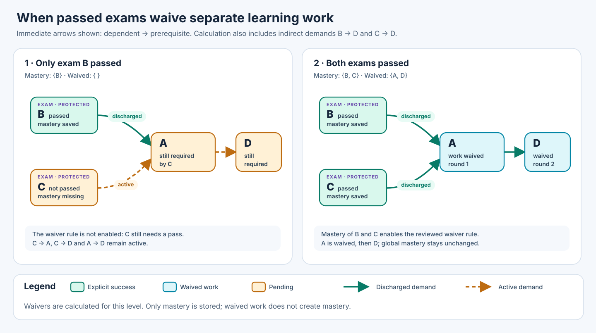

# Assessment-Gated Completion and Prerequisite Discharge

**Binding product decision, 31 October 2026.** SkillPilot derives whether
learning work is still needed from the skill graph and the existing binary
mastery state. The following three rules replace the earlier pilot's manually
reviewed waiver profiles:

1. When **any** goal is mastered, it no longer demands its own `requires`
   prerequisites. The source or age of that valid mastery does not matter.
2. An unmastered goal which no other unfinished goal needs is **implicitly
   completed**, unless it is a final assessment. Its own prerequisite demand
   then also disappears. Repeat until stable.
3. Every final assessment in the applicable learning scope is directly
   addressable. Missing prerequisite mastery does not prevent an intentional
   assessment attempt. Choosing useful assessments from the complete set is a
   discovery and interaction problem, not another eligibility rule.

Mastery remains the **only persisted outcome per atomic goal**:
`mastery ∈ {0,1}`. Implicit completion is calculated, never written as mastery,
never accepted as a second pass, and never stored in an outcome registry.
The [implementation document](../../dev/assessment-gated-completion-pilot.md)
separates local implementation, verification and deployment evidence.

## Generalisation without manual waiver profiles

There is no per-assessment profile, `waivableGoalIds` list, coverage grant,
additional qualifying result or "preparation only" flag in the general
contract. In particular, a passed assessment is **not** needed to enable
implicit completion: mastery of an ordinary goal also ends its preparation
need. Task quality and the ordinary grading contract still determine when
mastery may be saved; they do not introduce a second acceptance test.

The earlier model combined preparation discharge with certification of every
prerequisite competence. That was the conceptual error. Implicit completion
states that separate work is no longer needed in the specified scope; it does
not certify each competence. Historical pilot profiles and their reviews may
remain as immutable evidence, but are not runtime prerequisites for this rule.

## 1. Decisions and learner experience

The Cockpit distinguishes explicit mastery, implicit completion and remaining
work without creating three stored goal results. Its compact tree icon explains
**"Für diesen Abschnitt nicht mehr erforderlich"** in a tooltip. It must not
claim "passed examination" when an ordinary mastered goal ended the need.
Mastery bars and mastered-goal counts retain their existing meaning.

The calculation runs without selecting a special profile or starting a coach
session. The default context is the complete Personal Curriculum. Choosing a
structural section deliberately creates a section-specific view; opening or
collapsing tree nodes does not. Learners may still study implicitly completed
goals voluntarily under their ordinary mastery contract.

Final assessments remain open until mastered, even if they have no consumers.
All other goal types follow rule 2, including orientation and memorisation.
Their **explicit** mastery workflows remain unchanged. A memory goal becoming
unnecessary does not mark its cards recalled; an orientation goal becoming
unnecessary does not fabricate a motivational interaction.

A consequence is intentional: **a finite valid scope with no final assessment
is entirely explicitly or implicitly completed**. An ordinary terminal goal
with no consumer is implicitly completed even at zero mastery. Do not defeat
this rule by silently inventing a protected category or an assessment anchor.
If content is meant to remain a compulsory endpoint, its assessment role must
be authoritatively represented in the graph.

## 2. Resolve the scope and direct requirements

Fix the curriculum generation and committed Personal Curriculum. Let $T$ be
the unique applicable atomic targets of the chosen completion scope. The
scope comes from an authoritative program/composition subtree or the complete
Personal Curriculum. Resolve authored elective choices and projection roles;
neither a display filter nor a temporary Level-3 focus silently changes $T$.

Canonical goal identities remain stable. Expand required clusters into their
atomic obligations and inherit cluster requirements according to the existing
[graph definition](graph-definition.md). Apply the authoritative composition
semantics, including direct atomic goal entries. Include the prerequisite
closure, with hidden and cross-landscape support, without promoting supporting
goals to targets. Write $V_H$ for this complete atomic context.

Let

$$
F_H=\{(u,v)\mid u\text{ directly requires }v
      \text{ after atomic expansion and inheritance}\}.
$$

An arrow points **from consumer to prerequisite**. Reject missing references,
identity conflicts, containment cycles, raw requirement cycles and cycles in
the reachable expanded atomic graph. An invalid calculation is unavailable,
not an empty scope or a completed curriculum.

**Do not replace $F_H$ by its static transitive closure.** In
$C\to B\to A$, mastery of B stops demand at B. The additional authored edge
$C\to A$ would preserve a separate direct demand for A while C is open.
These graphs therefore have different work-discharge semantics. Neither
transitive closure nor transitive reduction is a neutral rewrite here.
Indirect demand exists only along paths through still-needed, unmastered goals.

Let $Q_H\subseteq V_H$ be the authoritative final-assessment goals. The current
runtime uses the existing exam/assessment classification (`exam`, assessment
semantic kinds and compatible `examData` encoding), never title matching or
`coveredGoalIds`. A practice task which is merely an alternative form must not
silently become another required goal. Authoring and scope selection decide
which goal identities participate; runtime does not invent a new selector.
An assessment already included as a supporting prerequisite remains an
assessment obligation; hiding it does not make it implicitly complete.

## 3. Mastery and active demand

Let $M$ be the current mastered atomic goals and $E=M\cap V_H$ their
restriction to the context. This uses the ordinary authoritative goal outcomes,
including the normal verified-recall resolver for card goals. Existing mastery
counts immediately, including mastery obtained before this scope was chosen.

For a tentative set $X$ of explicitly or implicitly completed goals:

$$
Active_H(X)=\{(u,v)\in F_H\mid u\notin X\},
\qquad Consumers_H(v)=\{u\mid(u,v)\in F_H\}.
$$

Completing a goal removes its **outgoing demand**. A mastered B does not forward
an incoming demand from C to B's former preparation A. A separate open consumer
of A still keeps A necessary. No authored graph edge is deleted in storage.

## 4. Derive implicit completion with a least fixed point

$$
\begin{aligned}
X_0&=E,\\
X_{n+1}&=X_n\cup\{v\in V_H\setminus Q_H\mid
                       Consumers_H(v)\subseteq X_n\},\\
X_*&=\bigcup_{n\ge0}X_n,\qquad I_H=X_*\setminus E.
\end{aligned}
$$

The operator is monotone and inflationary on a finite set, so iteration reaches
its least fixed point. Every new implicit completion can remove further demand.
There is no special rule for the empty consumer set: a non-assessment terminal
is correctly implicit. Conversely $I_H\cap Q_H=\varnothing$; no assessment is
implicitly passed. Mastery and $I_H$ are disjoint by definition.

An equivalent linear algorithm starts at all **unmastered assessments** and
visits their direct prerequisites, stopping whenever it reaches a mastered goal:

```text
needed = empty set
pending = all assessment goals without mastery
while pending is not empty:
    goal = pop(pending)
    if goal is mastered or already in needed: continue
    add goal to needed
    push its direct expanded prerequisites
implicit = context goals minus mastered minus needed
```

On a valid DAG this is exactly the fixed point above and costs
$O(|V_H|+|F_H|)$ time and memory. It does not materialise all transitive pairs.
An implementation can retain a deterministic open-assessment witness for each
needed goal. An implicit explanation says that no active preparation demand
remains; it must not fabricate a passed-assessment witness.

## 5. Worked examples and level completion

| Graph and mastery | Result |
| --- | --- |
| Assessment C requires B, B requires A; none mastered | C, B and A remain needed. |
| Same graph, ordinary B mastered | C remains open; A is implicitly complete. |
| Same graph plus direct C → A; B mastered | A remains needed directly by C. |
| Assessments B and C both require A; only B mastered | C still needs A. |
| Same graph, both assessments mastered | A becomes implicit; its unused preparation can follow. |
| Ordinary terminal Z with no consumer and no mastery | Z is implicitly complete. |
| Assessment Q with no consumer and no mastery | Q remains open and can be started directly. |
| Scope contains no assessment | All unmastered goals become implicit, with no mastery writes. |



The completion condition is

$$
Complete(H)\iff T\subseteq X_*\ \land\ Q_H\subseteq E.
$$

For this finite DAG contract, all assessment obligations being mastered is
also sufficient: without open assessment anchors, every remaining
non-assessment goal eventually becomes implicit. The target set still governs
counts: supporting goals do not enter the completion denominator.

A goal can be implicit in a completed Sek-I section yet needed in a broader
Sek-I-plus-Sek-II context. That is not a contradiction or a mastery change.
The UI always names the scope and recomputes when its authoritative inputs
change. A focus change may reorder suggestions, but must not alter the chosen
section's obligations.

## 6. Assessment access, discovery and continuation

Every applicable assessment is directly selectable without prerequisite mastery,
including outside the old pilot. The start is deliberate and retains the
existing authentication, learner revision, session ownership, task availability
and grading checks. A failed attempt writes no negative pass record and does
not remove existing mastery. Detailed AI grading, scores, deductions and
feedback remain part of the conversation under the ordinary exam workflow.

Discovery and starting are separate. Read-only discovery writes no workflow,
focus or mastery. An accepted selection binds the exact assessment to the
current learner and supported coach session. Unsupported providers cannot
borrow that binding. A display limit may bound a page or a coach suggestion
batch, **not permanently remove assessments from the accessible set**.

The Cockpit provides search and paginated rendering over the complete offered
set. Recommendations can prefer the active goal's structural section and the
current focus, while the authoritative calculation stays on the complete
chosen scope. The coach uses backend-published choices; intelligent ranking
and navigation through a large offer can be improved independently of the
three completion rules. A single Skalarprodukt example is no longer a valid
substitute for this general offer.

Normal required-work recommendations omit implicitly completed goals. Raw
prerequisite availability remains separate for deliberate voluntary learning;
a derived status never writes mastery to satisfy an access check. The Cockpit
preference `useAssessmentShortcuts` controls direct assessment offers, not the
truth of implicit completion or already valid plan credit.

## 7. Recalculation and adoption requirements

All consumers use one backend calculation: Cockpit, coach, plan status and
continuation. A request reads consistent mastery and structural inputs.
Recompute after mastery, scope or curriculum changes. Increasing mastery cannot
reopen work for unchanged graph/scope; corrected or removed mastery can.
Never feed yesterday's implicit set back as today's mastery input.

Only immutable structural compilation is cached, bounded by context, node and
edge budgets. Keys include curriculum generation, authoritative projection,
scope targets and semantics revision. No learner-result cache becomes an
additional source of truth. Discovery does not compile every possible section
on each request; selected/default contexts share prepared or bounded cached
normalisation. Configuration and input errors remain visible.

### Plan integration

For fixed, deduplicated plan baseline $G$, default plan IST is

$$
I_{plan}=|G\cap(M\cup I_H)|.
$$

For automatic plan credit, $H$ is the **complete Personal Curriculum**, not
merely G or the current dated plan. A plan is a temporal selection, not a new
completion contract: a preparation-only plan must not become completed while
an assessment elsewhere in the Personal Curriculum still needs it. First
compute $I_H$ over all authoritative Level-2 targets and their requirements,
then intersect with G. Multiple plans still deduplicate each counted goal.
Real cross-subject prerequisite demand is preserved; quotas and balance remain
separate by subject. A deliberately chosen smaller completion section may show
its own implicit set, but does not redefine plan credit. Supporting goals
outside G do not increase IST.

The Cockpit setting **"Nur explizit erreichte Lernziele zählen"** defaults to
off. When selected, IST is $|G\cap M|$. G, scheduled quotas and dates stay fixed;
implicit work does not become compulsory again merely because counting changes.
Actual completion events and the current-period H input still describe only
reliably dated explicit outcomes, never fabricated dates of implicit completion.
See the [shared plan contract](../didactic/unified-learning-plan-status.md#34-implizite-erledigung-und-optionale-explizit-zahlung).

### Acceptance evidence

Tests must cover the mastered-intermediate stop, a separate direct edge,
shared prerequisites, unreferenced ordinary terminals, assessment-only terminals,
empty assessment sets, projection and scope boundaries, revocation and direct
non-pilot exam starts. Verify no writes during discovery/evaluation, no forged
or stale start, preserved session ownership, complete discovery beyond one
page, plan deduplication, opt-out and signed preference export/import.
Machine tests establish these contracts; they do not establish assessment
quality, human usability or learning effectiveness. Deployment and real-coach
acceptance remain separate from local test results.
