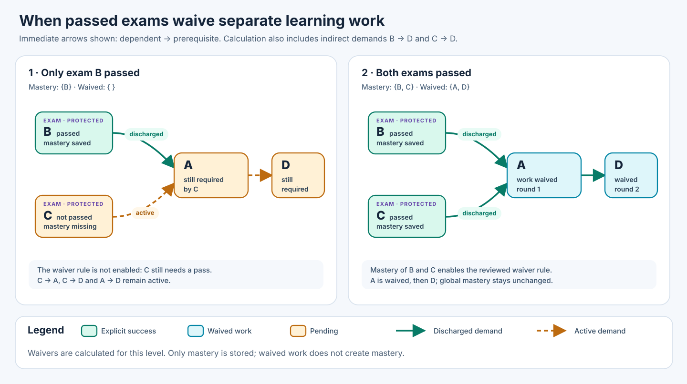

# Assessment-Gated Completion and Prerequisite Discharge

**Binding product decision, 31 October 2026, corrected 1 November 2026.** SkillPilot derives whether
learning work is still needed from the skill graph and the existing binary
mastery state. The following three rules replace the earlier pilot's manually
reviewed waiver profiles:

1. When **any** goal is mastered, it no longer demands its own `requires`
   prerequisites. The source or age of that valid mastery does not matter.
2. An unmastered goal which no still-needed unfinished goal needs is **implicitly
   completed**, unless it is a final assessment or memory goal. Its own prerequisite demand
   then also disappears. Repeat until stable.
3. Every final assessment in the applicable learning scope is directly
   addressable. Missing prerequisite mastery does not prevent an intentional
   assessment attempt. Choosing useful assessments from the complete set is a
   discovery and interaction problem, not another eligibility rule.

Mastery remains the **only persisted outcome per atomic goal**:
`mastery ∈ {0,1}`. Implicit completion is calculated, never written as mastery,
never accepted as a second pass, and never stored in an outcome registry.
The [implementation document](../../dev/assessment-gated-completion-pilot.md)
separates local implementation, verification and deployment evidence.

## Generalisation without manual waiver profiles

There is no per-assessment profile, `waivableGoalIds` list, coverage grant,
additional qualifying result or "preparation only" flag in the general
contract. In particular, a passed assessment is **not** needed to enable
implicit completion: mastery of an ordinary goal also ends its preparation
need. Task quality and the ordinary grading contract still determine when
mastery may be saved; they do not introduce a second acceptance test.

The earlier model combined preparation discharge with certification of every
prerequisite competence. That was the conceptual error. Implicit completion
states that separate work is no longer needed in the specified scope; it does
not certify each competence. Historical pilot profiles and their reviews may
remain as immutable evidence, but are not runtime prerequisites for this rule.

## 1. Decisions and learner experience

The Cockpit distinguishes explicit mastery, implicit completion and remaining
work without creating three stored goal results. Its compact tree icon explains
**"Für diesen Abschnitt nicht mehr erforderlich"** in a tooltip. It must not
claim "passed examination" when an ordinary mastered goal ended the need.
The tree's completion bars show explicit mastery in green, implicit completion
in blue, and remaining work in grey. Their tooltip distinguishes the counts.
A count explicitly labelled as mastery still includes only mastered goals.

The calculation runs without selecting a special profile or starting a coach
session. The demand context is always the complete committed Personal Curriculum.
Choosing a structural section masks the targets shown and counted from that
same result; it does not remove downstream consumers. Opening or collapsing
tree nodes does not change either calculation. Learners may still study implicitly completed
goals voluntarily under their ordinary mastery contract.

Selected final assessments and memory goals remain open until mastered, even
if they have no consumers. Protected prerequisites outside the selected targets
remain unmastered until explicitly completed; their classification does not
create an additional independent completion obligation. Memory mastery still comes exclusively from the existing
verified-recall resolver; an examination success cannot supply it. Orientation
and ordinary goals follow rule 2. Their **explicit** mastery workflows remain
unchanged; implicit orientation does not fabricate a motivational interaction.

The graph must support this calculation. In each complete authoritative
curriculum and supported projection, **every target must be reachable from a
selected assessment or memory target at zero mastery**, following the direct prerequisite
edges. An ordinary unneeded endpoint, or a nonempty curriculum without any
protected goal, is an authoring defect. Deterministic tests must report it;
the mathematically empty demand must not be advertised as valid curriculum
completion. Repair the didactic route or missing reviewed assessment rather
than inventing mastery, suppressing the finding, or reclassifying an ordinary
goal without its corresponding goal-type contract. An assessment-free
curriculum can be valid when memory goals genuinely anchor all its targets.

## 2. Resolve the scope and direct requirements

Fix the curriculum generation and committed Personal Curriculum. Let $T$ be
its unique applicable atomic targets. An explicitly selected authoritative
program/composition subtree supplies a display mask $S\subseteq T$, not a new
demand context. Resolve authored elective choices and projection roles;
neither a display filter nor a temporary Level-3 focus silently changes $T$.

Canonical goal identities remain stable. Expand required clusters into their
atomic obligations and inherit cluster requirements according to the existing
[graph definition](graph-definition.md). Apply the authoritative composition
semantics, including direct atomic goal entries. Include the prerequisite
closure, with hidden and cross-landscape support, without promoting supporting
goals to targets. Write $V_H$ for this complete atomic context.

Let

$$
F_H=\{(u,v)\mid u\text{ directly requires }v
      \text{ after atomic expansion and inheritance}\}.
$$

An arrow points **from consumer to prerequisite**. Reject missing references,
identity conflicts, containment cycles, raw requirement cycles and cycles in
the reachable expanded atomic graph. An invalid calculation is unavailable,
not an empty scope or a completed curriculum.

**Do not replace $F_H$ by its static transitive closure.** In
$C\to B\to A$, mastery of B stops demand at B. The additional authored edge
$C\to A$ would preserve a separate direct demand for A while C is open.
These graphs therefore have different work-discharge semantics. Neither
transitive closure nor transitive reduction is a neutral rewrite here.
Indirect demand exists only along paths through still-needed, unmastered goals.

Let $Q_H\subseteq V_H$ be the authoritative final-assessment goals. The current
runtime uses the existing exam/assessment classification (`exam`, assessment
semantic kinds and compatible `examData` encoding), never title matching or
`coveredGoalIds`. A practice task which is merely an alternative form must not
silently become another required goal. Authoring and scope selection decide
which goal identities participate; runtime does not invent a new selector.
Let $K_H\subseteq V_H$ be the existing authoritative memory goals, including
compatible memorisation and deck encodings. Define the protected classification
$P_H=Q_H\cup K_H$ and the independent completion obligations
$R_H=P_H\cap T$. These are different sets. A supporting protected goal is never
implicitly completed, but only carries preparation demand while an unfinished
selected obligation still needs it. It does not become an extra target or an
independent obligation merely by belonging to the prerequisite closure.
Memory goals do not become assessments, enter examination counts,
or acquire direct examination-start actions.

Curricular membership and assessment execution are separate roles. A reviewed
whole assessment may be the execution form of an existing atomic curricular
goal. Its ID, curricular quality checks and existing prerequisite relationships
remain; its assessment role protects it from implicit completion. This does
not create a second compulsory goal or remove the competence from curricular
coverage checks. Alternative execution forms do not create separate mastery.

## 3. Mastery and active demand

Let $M$ be the current mastered atomic goals and $E=M\cap V_H$ their
restriction to the context. This uses the ordinary authoritative goal outcomes,
including the normal verified-recall resolver for card goals. Existing mastery
counts immediately, including mastery obtained before this scope was chosen.

An assessment uses its normal overall scoring rules. `coveredGoalIds` records
the assessed task content, not separate pass decisions for its prerequisites.
The demand calculation uses mastery alone; it does not inspect point
distributions or individual demonstrations of prerequisite goals. Task-specific
score caps remain part of the normal assessment rubric.

Completing a goal removes its **outgoing demand**. A mastered B does not forward
an incoming demand from C to B's former preparation A. A separate open consumer
of A still keeps A necessary. No authored graph edge is deleted in storage.

## 4. Derive remaining demand with a least fixed point

Compute the active demand from the selected protected obligations, rather than
treating every protected support goal as an independent root:

$$
\begin{aligned}
N_0&=R_H\setminus E,\\
N_{n+1}&=N_n\cup\{v\in V_H\setminus E\mid
                       \exists u\in N_n:(u,v)\in F_H\},\\
N_*&=\bigcup_{n\ge0}N_n,\\
I_H&=V_H\setminus(E\cup N_*\cup P_H).
\end{aligned}
$$

The operator is monotone and inflationary on a finite set, so iteration reaches
its least fixed point. Mastered goals are never added to $N_*$, so they stop
traversal and do not forward demand to their own preparation. Ordinary goals
outside the remaining demand are implicitly complete. In a complete authoritative
curriculum, an ordinary target outside the zero-mastery reachability of $R_H$
is an authoring defect, not accepted progress. Conversely
$I_H\cap P_H=\varnothing$: neither an assessment nor a memory goal is implicitly
mastered. An unused protected support goal belongs to neither $N_*$ nor $I_H$;
it remains unmastered without blocking the selected targets. Mastery and $I_H$
are disjoint by definition.

An equivalent linear algorithm starts at all **unmastered protected targets** and
visits their direct prerequisites, stopping whenever it reaches a mastered goal:

```text
needed = empty set
pending = selected assessment and memory targets without mastery
while pending is not empty:
    goal = pop(pending)
    if goal is mastered or already in needed: continue
    add goal to needed
    push its direct expanded prerequisites
implicit = context goals minus mastered minus needed minus protected goals
```

On a valid DAG this is exactly the fixed point above and costs
$O(|V_H|+|F_H|)$ time and memory. It does not materialise all transitive pairs.
An implementation can retain a deterministic open-protected-goal witness for each
needed goal. An implicit explanation says that no active preparation demand
remains; it must not fabricate a passed-assessment witness.

## 5. Worked examples and level completion

| Graph and mastery | Result |
| --- | --- |
| Assessment C requires B, B requires A; none mastered | C, B and A remain needed. |
| Same graph, ordinary B mastered | C remains open; A is implicitly complete. |
| Same graph plus direct C → A; B mastered | A remains needed directly by C. |
| Assessments B and C both require A; only B mastered | C still needs A. |
| Same graph, both assessments mastered | A becomes implicit; its unused preparation can follow. |
| Ordinary terminal Z with no consumer and no mastery | Mathematically implicit; a zero-mastery target route defect in a complete curriculum. |
| Assessment Q with no consumer and no mastery | Q remains open and can be started directly. |
| Selected memory K with no consumer and no mastery | K remains open until verified recall supplies mastery. |
| Q mastered; selected memory K also requires A and remains open | K and A remain needed, even if Q also requires A. |
| Selected Q requires hidden memory K; Q mastered, K unmastered | Q is complete; K remains unmastered, is not implicit and creates no independent completion obligation. |
| Nonempty complete curriculum contains no protected goal | Authoring validation fails; empty demand is not curriculum acceptance. |



The completion condition is

$$
Complete(H)\iff T\subseteq E\cup I_H.
$$

For this finite DAG contract, mastery of all protected obligations is also
sufficient on a structurally valid curriculum: without open selected protected
roots, every remaining ordinary target becomes implicit. Mastering every
selected assessment alone does not suffice while a selected memory target is
open. Hidden support goals do not enter the completion denominator or enlarge
the selected completion contract.

A displayed section is complete exactly when $S\subseteq E\cup I_H$ using
the full Personal Curriculum result. A preparation-only section does not become
implicit merely because its assessment lies outside the mask. An independently
chosen stage is a Level-2 Personal Curriculum change and therefore creates a
different authoritative context. The UI names the displayed section and
recomputes when authoritative inputs change. A focus change may reorder
suggestions, but does not change demand or section completion.

## 6. Assessment access, discovery and continuation

Every applicable assessment is directly selectable without prerequisite mastery,
including outside the old pilot. The start is deliberate and retains the
existing authentication, learner revision, session ownership, task availability
and grading checks. A failed attempt writes no negative pass record and does
not remove existing mastery. Detailed AI grading, scores, deductions and
feedback remain part of the conversation under the ordinary exam workflow.

Discovery and starting are separate. Read-only discovery writes no workflow,
focus or mastery. An accepted selection binds the exact assessment to the
current learner and supported coach session. Unsupported providers cannot
borrow that binding. A display limit may bound a page or a coach suggestion
batch, **not permanently remove assessments from the accessible set**.

The Cockpit provides search and paginated rendering over the complete offered
set. Recommendations can prefer the active goal's structural section and the
current focus, while the authoritative calculation stays on the complete
chosen scope. The coach uses backend-published choices; intelligent ranking
and navigation through a large offer can be improved independently of the
three completion rules. A single Skalarprodukt example is no longer a valid
substitute for this general offer.

Normal required-work recommendations omit implicitly completed goals. Raw
prerequisite availability remains separate for deliberate voluntary learning;
a derived status never writes mastery to satisfy an access check. The Cockpit
preference `useAssessmentShortcuts` controls direct assessment offers, not the
truth of implicit completion or already valid plan credit.

## 7. Recalculation and adoption requirements

All consumers use one backend calculation: Cockpit, coach, plan status and
continuation. A request reads consistent mastery and structural inputs.
Recompute after mastery, scope or curriculum changes. Increasing mastery cannot
reopen work for unchanged graph/scope; corrected or removed mastery can.
Never feed yesterday's implicit set back as today's mastery input.

Only immutable structural compilation is cached, bounded by context, node and
edge budgets. Keys include curriculum generation, authoritative projection,
scope targets and semantics revision. No learner-result cache becomes an
additional source of truth. Before evaluating implicit work, validate target
coverage from selected protected targets at zero mastery. A failed check makes
implicit evaluation unavailable: publish no implicit credit or success based
on inferred completion. Explicit mastery remains true: when every known
selected target is explicitly mastered, that explicit completion remains
recognisable alongside the graph-quality warning. An invalid scope definition
does not supply a known target set and cannot use this exception. Ordinary learning, stored mastery and structurally
valid direct examination discovery/start remain available under their existing
authorization and grading checks. This validation is separate from structural
compilation and examination binding. Discovery does not compile every possible section
on each request; selected/default contexts share prepared or bounded cached
normalisation. Configuration and input errors remain visible. The current
global suppression of implicit credit in a defective mixed-subject curriculum
is a conservative intermediate limit, not proof of independent automatic
availability per subject. A later finer degradation must retain foreign
consumers and only credit independently proven implicit completions.

### Repairing an incomplete assessment route

An uncovered ordinary target is an authoring defect. Repair its actual route;
do not hide a valid target, manufacture a prerequisite, or relabel it as an
assessment merely to satisfy the structural check.

A final-assessment task authored by SkillPilot can be justified by the whole, unchanged learning
contracts already selected in a Personal Curriculum. Its complete task and
rubric must genuinely match those contracts and its additional demands must
fit the accepted program and entry basis. This repairs an assessment route;
it does not assert that an authority prescribes that task or add official
source coverage. A missing direct single-goal mapping alone therefore does
not confine the task to the first jurisdiction reviewed. Known incorrect
target assignments, incompatible task demands and missing genuine preparation
remain unresolved until corrected.

Authoring still selects the assessment identity through the reviewed program
and composition structure. Explicit `applicabilityFromRequires` may derive a
local assessment's applicability from its real preparation; this is
applicability evidence, not source-coverage evidence or an automatic promotion
of support to targets. Do not turn alternative task forms into several
independent obligations. Verify the intended new assessment occurrences in
every actual offered configuration, preserve all other valid targets and
compare the complete remaining-demand and projection results.

### Plan integration

For fixed, deduplicated plan baseline $G$, default plan IST is

$$
I_{plan}=|G\cap(M\cup I_H)|.
$$

For automatic plan credit, $H$ is the **complete Personal Curriculum**, not
merely G or the current dated plan. A plan is a temporal selection, not a new
completion contract: a preparation-only plan must not become completed while
an assessment elsewhere in the Personal Curriculum still needs it. First
compute $I_H$ over all authoritative Level-2 targets and their requirements,
then intersect with G. Multiple plans still deduplicate each counted goal.
Real cross-subject prerequisite demand is preserved; quotas and balance remain
separate by subject. A deliberately chosen smaller section displays only a
mask of that same implicit set and does not redefine plan credit. Supporting goals
outside G do not increase IST.

The Cockpit setting **"Nur explizit erreichte Lernziele zählen"** defaults to
off. When selected, IST is $|G\cap M|$. G, scheduled quotas and dates stay fixed;
implicit work does not become compulsory again merely because counting changes.
Actual completion events and the current-period H input still describe only
reliably dated explicit outcomes, never fabricated dates of implicit completion.
Under the confirmed 1 November 2026 period rule, the fulfilled daily/weekly
quota is `min(P,H)` and the remaining quota is `max(0,P-H)`. Implicit credit
and earlier advance work affect overall plan balance, never the current-period
counter. An open quota neither fabricates repeat completions nor turns implicit
work into compulsory learning.
If implicit evaluation is unavailable, explicit counts remain visible with the
existing unavailable-calculation notice; affected automatic plan continuations
remain paused. Explicit counts alone must not claim the missing implicit result.
See the [shared plan contract](../didactic/unified-learning-plan-status.md#34-implizite-erledigung-und-optionale-explizit-zahlung).

### Acceptance evidence

Tests must cover the mastered-intermediate stop, a separate direct edge,
shared prerequisites, every compatible memory encoding, protected hidden
support, separate examination counts, memory-only contexts, and revocation.
Authoring tests must reject uncovered target routes at zero mastery in complete
curricula and supported projections. Test ordinary terminals as defects and
assessment/memory terminals as protected, plus projection and scope boundaries and direct
non-pilot exam starts. Verify no writes during discovery/evaluation, no forged
or stale start, preserved session ownership, complete discovery beyond one
page, plan deduplication, opt-out and signed preference export/import.
Machine tests establish these contracts; they do not establish assessment
quality, human usability or learning effectiveness. Deployment and real-coach
acceptance remain separate from local test results.
