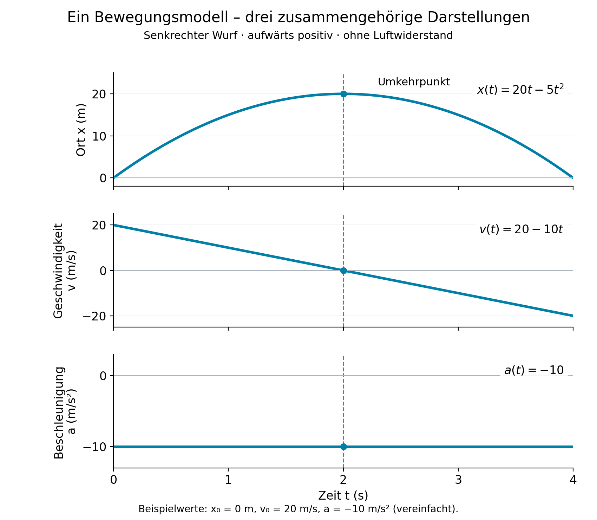

# Lerneinheiten sinnvoll abgrenzen und prüfen

Dieses Dokument konkretisiert den didaktischen Zweck der
[Lerneinheiten](learning-units.md). Es erläutert die Gestaltungskriterien für
den [neuen Mathematik-/Physikplan](../../dev/mathematics-physics-learning-units-plan.md).
Die Beispiele sind **Konzeptkandidaten**, keine
begutachteten Prüfungsverträge und keine fertige Gliederung offizieller Lehrpläne.
Sie ändern weder Lernziele noch Graphkanten, Prüfungen oder Zugriffsregeln.

## 1. Eine tragfähige Grundlage schaffen

Eine Lerneinheit bündelt einen zusammenhängenden Erkenntnisschritt: Lernende
verstehen ein Modell oder einen Sachzusammenhang und können damit selbstständig
handeln. Die Motivation erklärt, welche Frage damit beantwortbar wird und
weshalb sich die Anstrengung lohnt. Eine Einheit darf einem vertrauten Thema
entsprechen; sie kann ebenso ein neues, mehrere Themen verbindendes Denkmodell
erschließen. Ihr Umfang folgt diesem Lernversprechen.
Auch eine abschließende Anwendung oder Synthese kann eine Einheit bilden;
ihre Berechtigung verlangt keine weitere darauf folgende Einheit.

Die Prüfung oder die zusammengehörigen Prüfungen zeigen, ob diese Grundlage
tatsächlich trägt. Im regulären Lernverlauf wird darauf aufbauender Stoff erst
entwickelt, wenn die dafür erforderliche Grundlage nachgewiesen ist. Andernfalls
wird eine Lücke sichtbar gemacht, gezielt bearbeitet und erneut geprüft. Ein
ehrlich festgestelltes Defizit ist hilfreicher als ein Bestehen, auf dessen
scheinbarer Sicherheit der weitere Lernweg scheitert.

Das verlangt keine fehlerlose Leistung. Eine isolierte Rechenungenauigkeit ist
anders zu beurteilen als ein fehlendes zentrales Verständnis. Die normale
Bewertung muss diesen Unterschied verlässlich abbilden: Eine grundsätzlich
fehlende zugesagte Kompetenz darf nicht durch zufällige Punkte an anderer
Stelle ausgeglichen werden. Dafür entsteht kein zweites Bestehensurteil.

## 2. Woran eine sinnvolle Grenze erkennbar wird

Für eine Grenze sprechen ein verständliches gemeinsames Lernversprechen und
eine eigenständige Anwendung, die den gesamten behaupteten Erkenntnisschritt
prüfen kann. Ein erkennbarer Übergang zu späteren Anforderungen ist ein weiterer
wichtiger Grund; eine abschließende Einheit benötigt keinen Nachfolger. Fachliche Nähe und
starke Voraussetzungenverbindungen sind Hinweise, aber kein automatischer
Zuschnitt. Auch eine sparsame, transitiv minimale Kette kann eng zusammenhängen.
Gemeinsame Grundlagen wie Gleichungen oder Zahlverständnis verbinden viele
Themen, ohne daraus eine einzige riesige Einheit zu machen.

Ungeeignet sind insbesondere folgende Begründungen:

- „Es gibt bereits eine Prüfung“: Die Prüfung muss aus dem Lernversprechen
  entstehen; ihr bisheriger Umfang legt die Einheit nicht fest.
- „Die Gruppe braucht mindestens einige Ziele“: Es gibt keine Mindestzahl.
  Ein einzelnes Ziel kann hinreichend umfassend sein, viele Ziele bloß lose.
- „Die Überschrift sieht ordentlich aus“: Eine zusätzliche Elternüberschrift
  schafft weder Zusammenhang noch einen neuen Lernabschluss.
- „Dann passen alle Kanten“: Voraussetzungen werden weder erfunden noch
  entfernt, um eine gewünschte Einteilung nachträglich passend zu machen.

Eine fachlich ungünstige Kante ist ein eigener Befund. Ihre Prüfung darf nicht
durch stilles Verkürzen der beteiligten Zielbedeutungen ersetzt werden. Auch
eine atomar azyklische Folge kann durch schlechte Gruppierung einen Widerspruch
zwischen ganzen Blöcken erzeugen; dann sind Grenze oder Verschachtelung zu prüfen.

## 3. Lernen, nachweisen und gezielt weiterlernen

Der Verlauf beginnt mit einer bedeutungsvollen Frage und einem klaren Ausblick:
Was kann ich anschließend, und wofür brauche ich es? Benötigte Vorkenntnisse
werden konkret benannt. Es folgen Erarbeitung und Übung mit Rückmeldung. Dabei
darf der Coach erklären, strukturieren und bei Schwierigkeiten unterstützen.

Der anschließende Nachweis verlangt die beanspruchte selbstständige Anwendung.
Eine kleinschrittige Hilfe, die gerade die entscheidende Modellwahl oder
Begründung vorgibt, kann Übung sein, belegt aber diese Selbstständigkeit nicht.
Aufgabenvarianten müssen das gleiche Lernversprechen tragen und dürfen nicht
nur die eingeübte Oberfläche wiederholen.

Bei fehlendem Nachweis wird die konkrete Lücke erklärt, etwa die Verwechslung
zweier Größen. Es folgen passende weitere Erarbeitung und Übung sowie eine
frische, inhaltlich gleichwertige Prüfungsvariante. Eine Wiederholung darf das
Problem nicht durch identisches Auswendiglernen umgehen. Bereits gültige,
anderweitige Kompetenznachweise werden dadurch nicht gelöscht.

Der didaktische Grundsatz ist damit festgelegt. Ob daraus technische Sperren
für Starts entstehen und ob eine direkte diagnostische Prüfungsroute offen
bleibt, ist weiterhin eine eigene Entscheidung. Ein direkter Versuch würde
für sich genommen weder einen Nachweis noch ein Bestehen erzeugen; siehe
[Fortschritt und Zugang](learning-unit-progression.md).

## 4. Hauptbeispiel Physik Oberstufe: Bewegung mit konstanter Beschleunigung

### Lernversprechen und Zusammenhang

**Kandidat:** „Ich kann eine eindimensionale Bewegung mit konstanter
Beschleunigung selbstständig modellieren, berechnen und erklären.“ Lernende
wählen Achse und Vorzeichen, berücksichtigen Anfangsort und Anfangsgeschwindigkeit
und verbinden Ort, Geschwindigkeit und Beschleunigung in Formeln und Diagrammen.

Die Leitfrage kann lauten: „Wie beschreibe ich einen geworfenen Ball vom
Loslassen bis zum Aufprall mit einem einzigen Modell?“ Freier Fall aus der Ruhe
und senkrechter Wurf sind hier Fälle desselben Modells. Sie werden nicht allein
wegen unterschiedlicher Bezeichnungen zu zwei Einzieleinheiten zerlegt.
Unterschiedliche Anfangsbedingungen machen den gemeinsamen Zusammenhang sichtbar.

Für die Zeit ab dem gewählten Anfang gilt bei konstanter Beschleunigung:

$$
x(t)=x_0+v_0t+\tfrac12at^2,\qquad v(t)=v_0+at,\qquad a(t)=a.
$$

In einem Kurs mit bereits verfügbaren Ableitungskenntnissen können Lernende
die Beziehungen von $x$ zu $v$ und von $v$ zu $a$ dadurch überprüfen und
physikalisch deuten. Das ist keine pauschale Annahme über alle Einstiegskurse.
Die quadratische Bewegungsgleichung kann ohne Integralrechnung entwickelt
oder als Modellgleichung bereitgestellt werden. Der hier beschriebene Einstieg
setzt keine formale Integralrechnung voraus.

Die Abbildung zeigt vereinfachte Beispielwerte ohne Luftwiderstand bis zur
Rückkehr auf Abwurfhöhe. Sie veranschaulicht den Zusammenhang für die
Konzeptprüfung und ist keine freigegebene Prüfungsaufgabe.

### Eintritt und Anschluss

Benötigt werden die für diese Aufgaben tatsächlich nötigen mathematischen
Fähigkeiten: Terme und Einheiten verwenden und Gleichungen einschließlich der
auftretenden quadratischen Gleichungen lösen. Fordert die gewählte Aufgabe
Ableitungen, müssen auch diese vorher verfügbar sein. Eine in der Physikaufgabe
sichtbare Anwendung belegt nicht pauschal
die vollständigen zugehörigen Mathematiklernziele. Dafür zählen deren eigene
Bedeutung und gültige Nachweise.

Gleichförmige Bewegung kann einen sinnvollen fachlichen Einstieg bilden,
etwa zur Abgrenzung zwischen Geschwindigkeit und Beschleunigung. Daraus folgt
keine Pflicht, zuerst jede zeitlich frühere Physikeinheit abzuschließen.

Anschließen können tatsächlich darauf aufbauende Kraft-Bewegungs-Aufgaben
oder spätere Anwendungen mit Energie und Bewegungsverläufen. Kräfte und Energie
sind dabei neue Begriffe und nicht bereits durch diesen Kinematiknachweis
beherrscht. Der Kandidat behauptet weder eine überall verbindliche offizielle
Reihenfolge noch eine Sperre für alle übrigen Physikthemen.

### Was ein unabhängiger Nachweis sichtbar machen muss

Eine mögliche Aufgabe beschreibt einen Ball, der von einer erhöhten Plattform
senkrecht nach oben geworfen wird. Ohne vorgegebenen Lösungsfahrplan sollen die
Lernenden das Modell aufstellen, den höchsten Punkt und einen späteren Aufprall
bestimmen und passende Orts-, Geschwindigkeits- und Beschleunigungsdiagramme
erklären. Luftwiderstand wird ausdrücklich vernachlässigt; der betrachtete
Zeitabschnitt endet beim ersten Aufprall.

Eine ergänzende Variante verändert die Abwurfhöhe oder gibt die positive Achse
nach unten vor. Zu prüfen ist, ob Anfangsbedingungen und Vorzeichen aus der
Situation hervorgehen, statt aus einer vertrauten Zahlenfolge übernommen zu
werden. Nicht jede Einzelaufgabe muss alle Aspekte wiederholen; die relevante
Aufgabengruppe muss das vollständig beanspruchte Lernversprechen abdecken.

| Beobachtung | Bedeutung für den beanspruchten Nachweis |
| --- | --- |
| „Am höchsten Punkt ist $v=0$, also auch $a=0$.“ | Die zentrale Unterscheidung fehlt; das vollständige Bewegungsmodell ist damit noch nicht nachgewiesen. |
| Ein korrekt aufgestelltes Modell enthält einen einzelnen Rechenfehler mit nachvollziehbarer Folgerechnung. | Kein automatischer Gegenbeleg für das Modellverständnis; nach der passenden normalen Bewertungsregel beurteilen. |
| Nach einem Achsenwechsel ändern sich Vorzeichen, aber der vorhergesagte Aufprall bleibt physikalisch konsistent. | Hinweis auf übertragbares Verständnis statt bloßer Formelanwendung. |

Eine normale Bestehensregel, bei der die erste Fehlvorstellung durch andere
Punkte vollständig kompensierbar wäre, passt nicht zum behaupteten Nachweis.
Umgekehrt folgt aus dieser Anforderung keine Fehlerlosigkeitspflicht. Die
Anforderung muss in der normalen Aufgabe und Rubrik umgesetzt werden, ohne
eine versteckte zusätzliche Bestehensbedingung. Trägt die vorhandene
Gesamtpunktewertung den Anspruch nicht, sind Prüfung oder Anerkennungsumfang
vor einer Freigabe zu überarbeiten. Die
Aufgabenskizzen und Gegenbeispiele ersetzen noch keine ausgearbeitete und
unabhängig geprüfte Produktionsrubrik.

Bei der Fehlvorstellung am höchsten Punkt wird genau daran weitergelernt:
etwa durch den Vergleich der Geschwindigkeit unmittelbar davor und danach,
passende Diagramme und die Unterscheidung von Momentanwert und Änderungsrate.
Danach prüft eine frische Situation dieselbe Unterscheidung selbstständig.

### Größerer Kandidat: Kinematik einschließlich Superpositionsprinzip

Die eindimensionale Bewegung ist nicht bereits als endgültige Einheitengrenze
festgelegt. Eine größere Einheit könnte das Versprechen tragen:
**„Ich kann die Bewegungen dieses Einstiegskurses beschreiben, geeignete
Bewegungsmodelle auswählen und Bewegungen aus Komponenten zusammensetzen.“**
Der Übergang von einer Dimension zu zwei Dimensionen wäre dann ein innerer
Erkenntnisschritt bis zu einem gemeinsamen thematischen Abschluss.

Ein möglicher Lernverlauf führt von Orts-, Geschwindigkeits- und
Beschleunigungsdarstellungen über gleichförmige und gleichmäßig beschleunigte
Bewegungen zu unabhängigen Komponenten und deren Zusammensetzung. Beim
idealisierten Wurf ohne Luftwiderstand werden horizontale und vertikale Bewegung
in einem festen Bezugssystem getrennt beschrieben und zur **gleichen Zeit**
wieder zusammengesetzt. Unabhängigkeit folgt aus diesem Modell; sie gilt nicht
pauschal für beliebige überlagerte Bewegungen.

Eine eigene Prüfungsskizze könnte eine Flugbahn und zwei widersprüchliche
Erklärungen zu ihren Komponenten anbieten. Lernende beurteilen sie, begründen
die Zeitzuordnung und stellen eine eigene konsistente Beschreibung auf. Beim
schiefen Wurf mit nichtverschwindender horizontaler Geschwindigkeit ist am
höchsten Punkt nur die vertikale Geschwindigkeitskomponente null. Wer die
Aussage des senkrechten Wurfs ungeprüft auf den gesamten Geschwindigkeitsvektor
überträgt, hat den erweiterten Zusammenhang noch nicht nachgewiesen. Die
mathematischen Eingangskompetenzen sind für Komponenten, Vektoren und
gegebenenfalls trigonometrische Zerlegung entsprechend zu ergänzen.

**Eine größere Einheit verschiebt die Rückmeldung nicht ausschließlich ans
Ende.** Bevor der Lernverlauf auf dem eindimensionalen Modell aufbaut, muss
dessen entscheidendes Verständnis geprüft sein. Dafür kann die größere Einheit
eine eigene erforderliche Zwischenprüfung enthalten. Diese bleibt ein normales
Prüfungslernziel mit binärem Ergebnis; sie erfordert nicht automatisch eine
Unterlerneinheit oder einen zusätzlichen gespeicherten Status. Ein Gespräch mit
entscheidenden Lösungshinweisen erfüllt den unabhängigen Nachweis nicht.

Damit sind drei Zuschnitte zu vergleichen:

| Kandidat | Begründung und Prüfpunkt |
| --- | --- |
| Eigenständige Einheit zur eindimensionalen Bewegung | Trägt das erste neue Modell bereits einen brauchbaren eigenen Abschluss? |
| Größere Kinematikeinheit mit Lernabschnitten und mehreren Prüfungen | Ergibt erst die Übertragung auf Komponenten das gewünschte Gesamtverständnis, ohne frühe Lücken zu verdecken? |
| Kinematik mit echten Untereinheiten und eigener Synthese | Haben die Untereinheiten jeweils eigenständige Lernversprechen und Abschlüsse, die diese zusätzliche Hierarchie rechtfertigen? |

Die Lernabschnitte der zweiten Variante sind noch keine Untereinheiten. Bei der
dritten gelten die bestehenden eigenständigen Kindpflichten weiter; eine
Synthese ersetzt deren Prüfungen nicht. Auch „gesamte Kinematik“ braucht einen
bestimmten Umfang: Ob beispielsweise Kreisbewegung, relative Bewegung oder
veränderliche Beschleunigung dazugehören, ist am konkreten Kurs und dessen
Lernzielen zu entscheiden. Die beiden Dimensionen allein belegen keine
Vollständigkeit des Kinematikthemas.

**Anerkennung nach der Konzeptkorrektur vom 6. November:** Eine von mehreren
Prüfungen einer Einheit kann die von ihr vollständig nachgewiesenen gewöhnlichen
Kompetenzen sofort global anerkennen. Eine spätere offene Prüfung hält diesen
gültigen Nachweis nicht zurück. Die größere Einheit ist dennoch erst nach
allen erforderlichen eigenen Prüfungen, Karten und Kinderabschlüssen fertig.
Es entsteht kein neuer Prüfungstyp. Erwerbszuständigkeit, Nachweis und
Einheitsabschluss bleiben unterscheidbar; Aufgaben und normale Bewertung
müssen die behauptete vollständige Anwendung wirklich tragen. Der fachliche
Zuschnitt muss nicht verkleinert werden, um eine Restbedarfsregel zu bedienen.
Das ist der neue [Sollvertrag](assessment-gated-completion.md), keine Aussage
über die bereits implementierte Runtime oder aktuelle Prüfungsqualität.

### Was Lehrbuchstrukturen dazu zeigen

Wir untersuchen an Lehrwerken die Begründung von Zusammenhang, Vorwissen,
innerer Reihenfolge und Abschlüssen. Daraus entstehen eigene Entwürfe; Aufgaben,
Texte oder Kapitelgliederungen werden nicht als Vorlage übernommen.
Die folgenden ersten Beobachtungen wurden am 6. November 2026 geprüft:

- Die veröffentlichte Zuordnung von **Impulse Physik Oberstufe** zu Hessen
  (Klett, 2022, PDF-Seiten 2–3) führt innerhalb des ersten Buchkapitels von
  geradlinigen Bewegungen über Fall und zweidimensionale Bewegungen zu Würfen
  und Kreisbewegung. Kräfte folgen im zweiten Kapitel. Das zeigt eine größere
  thematische Klammer mit inneren Lernschritten. [Verlagsdokument](https://asset.klett.de/assets/1fe831bc/Stoffverteilungsplan_Impulse_Physik_Oberstufe_HE.pdf)
- **OpenStax Physics**, Kapitel 5, erklärt seine Reihenfolge ausdrücklich:
  Vektoroperationen bereiten mehrere zweidimensionale Anwendungen vor. Der
  Zusammenhang ist damit eine gemeinsame Methode. Das Kapitel schließt auch
  andere Anwendungen ein; seine Grenze ist nicht einfach unsere vorgeschlagene
  Kinematikgrenze. [Kapiteleinführung](https://openstax.org/books/physics/pages/5-introduction)
- Im Abschnitt über Wurfbewegungen stehen Komponentenzerlegung und gemeinsame
  Zeit im Mittelpunkt. Lehrhinweise verbinden Verständnisfragen mit gezielter
  Rückkehr zu Schwierigkeiten. Das ist ein Anhaltspunkt für innere
  Verständniskontrollen. [Abschnitt 5.3](https://openstax.org/books/physics/pages/5-3-projectile-motion)

**Unsere Schlussfolgerung:** Ein Thema kann eine größere Einheit bilden und
zugleich wichtige innere Nachweisstellen brauchen. Ein Buchkapitel liefert
einen begründbaren Kandidaten, aber noch keinen Beleg für einen vollständigen
SkillPilot-Anwendungsnachweis. Die genannten Quellen belegen weder die
Wirksamkeit unseres Zuschnitts noch einen aktuellen verbindlichen Lehrplan.

####  verschiedene Ordnungsprinzipien  

Zusätzlich liegt der vom Product Owner bereitgestellte Auszug
 
Die folgenden Beobachtungen beziehen sich auf diesen Auszug, nicht auf den
vollständigen Lehrtext oder auf die Qualität seiner Aufgaben und Bewertungen.
Das Vorwort erlaubt ausdrücklich andere Unterrichtsreihenfolgen und eine
Auswahl aus dem Buchumfang. Eine lineare Lesereihenfolge ist daher kein
Voraussetzungsgraph.

Schon die Mechanik zeigt mehrere sinnvolle Größenordnungen. Kinematik beginnt
auf S. 10 und umfasst vor dem Dynamikbeginn auf S. 38 neben eindimensionaler
Bewegung auch Vektoren, Überlagerung und Würfe. Kreisbewegung steht dagegen
in der Dynamik ab S. 52; Energie und Impuls bilden ab S. 62 einen weiteren
Zugang. Das unterscheidet sich vom oben genannten Klett-Zuschnitt. Weder die
Kapitelnummer noch der große Mechanik-Wissenstest auf S. 86 legt deshalb die
einzig sinnvolle Grenze unserer Einheiten und Zwischenprüfungen fest.

Über die anderen Buchbereiche hinweg lassen sich folgende **Gestaltungsmuster**
prüfen. Es sind eigene Deutungen der sichtbaren Struktur, keine Übernahme der
Kapitelgliederung als SkillPilot-Plan:

| Muster und betrachtete Bereiche | Folgerung für eigene Einheitskandidaten |
| --- | --- |
| Mehrere Sichtweisen auf Bewegung: Mechanik und Gravitation | Beschreibung, Ursachen und Erhaltungssätze beantworten verschiedene Fragen. Gravitation verbindet ein Kraft-/Feldmodell mit Bahnen; eine Anwendung braucht nur die tatsächlich benutzten vorherigen Kompetenzen. Rotation oder sämtliche Erhaltungssätze werden dadurch nicht automatisch allgemeine Eingangspflichten. |
| Vom örtlichen Schwingen zur Ausbreitung: mechanische und elektromagnetische Schwingungen/Wellen | Schwingung, Überlagerung und räumliche Ausbreitung markieren unterscheidbare Erkenntnisschritte. Die spätere Wiederkehr im elektromagnetischen Kontext ist Anlass, gemeinsame Kompetenz zu prüfen. Erst gleichwertige Zielbedeutung rechtfertigt Wiederverwendung; ein vertrautes Wort belegt noch keinen vollständigen Transfer. |
| Prinzip, Anwendung und System: elektrische Felder, bewegte Ladungen und Netzwerke | Feldbeschreibung, Bewegung eines Teilchens und Verhalten einer Schaltung haben jeweils eigene Erklärungsaufgaben. Eine Anwendung kann den Übergang verbinden, ohne dass jede vorherige Spezialanwendung Voraussetzung aller späteren Systeme wird. |
| Wechsel zwischen makroskopischer und mikroskopischer Erklärung: Thermodynamik | Zustandsgrößen und Teilchenmodell ergänzen einander; Energieübertragung und Entropie eröffnen weitere Fragen. Maschinen können diese Sichtweisen verbinden. Ob sie einen Abschluss oder einen inneren Anwendungsschritt bilden, hängt vom eigenen Lernversprechen ab. |
| Ein neues Modell aus mehreren Befunden: Einführung in die Quantenphysik | Verschiedene Beobachtungen führen zu einer gegenüber klassischen Vorstellungen veränderten Beschreibung. Ein tragfähiger Abschluss müsste die neue Erklärung selbstständig nutzbar machen, statt nur isolierte Versuchsnamen abzufragen. |
| Entwicklung, aktuelle Erklärung und Anwendung: Atomphysik sowie Festkörper/Elektronik | Die Geschichte von Atommodellen ist nicht automatisch eine Kette sämtlicher Pflichtvoraussetzungen. In der Festkörpergliederung stehen Bauelemente sogar vor dem quantenphysikalischen Modell. Ein brauchbarer Zugang zu einem Gerät und seine vertiefte Erklärung sind damit unterscheidbare Lernversprechen. |

Auch die übrigen Blöcke geben unterschiedliche Hinweise: **Chaos** behandelt
Vorhersagbarkeit in dynamischen Systemen; **Relativität** verändert die
Beschreibung von Raum, Zeit und Dynamik. Dass Kapitel 8 vor Kapitel 9 steht,
belegt keine Voraussetzung von Chaos für Relativität. Daraus folgt ebenso wenig,
dass die beiden Bereiche keinerlei gemeinsame Voraussetzungen besitzen.

**Kernphysik** verbindet Umwandlungsmodelle, Messung, Wechselwirkung und Nutzung.
Das legt einen Vergleich zwischen erklärender Grundlage, Messkompetenz und
begründeter Anwendungsbeurteilung nahe. **Elementarteilchenphysik** ordnet
Materie und Wechselwirkungen in einem weiteren Modell; der technische Kontext
großer Anlagen muss nicht selbst vollständige Eingangskompetenz sein.
**Astrophysik** verbindet Beobachtungszugänge und Größenbestimmung mit Modellen
von Sternen und Kosmos. Benötigte Physik kann dort angewendet werden, ohne ihre
Erstaneignung doppelt zuzuordnen. **Wissenschaftstheorie** reflektiert schließlich
Begriffe und Erkenntniswege. Ihre Platzierung am Buchende beweist weder, dass
diese Reflexion erst am Ende sinnvoll wäre, noch dass sie vorher überall als
abgeschlossene Einheit vorausgesetzt werden müsste.

#### Mathematische Methoden müssen rechtzeitig verfügbar sein

Der Auszug nennt auf S. 28 eine Methode zu Flächen unter Zeit-Geschwindigkeits-
Graphen. Daraus ist nicht erkennbar, ob der Lehrtext formale Integralrechnung
verlangt. Die berichtete Erfahrung mit zu spät verfügbaren mathematischen
Methoden bleibt ein konkreter Gestaltungsauftrag; der Auszug entkräftet sie nicht.

Für unseren beschriebenen Einstieg genügt ein fachlich sauberer Weg ohne
formale Integration: Bei linearer Geschwindigkeit ergeben Rechtecke und
Dreiecke die vorzeichenbehaftete Ortsänderung. Flächen unterhalb der Zeitachse
gehen negativ ein; beim Vorzeichenwechsel wird aufgeteilt. Die zurückgelegte
Weglänge ist davon zu unterscheiden. Für beliebige Geschwindigkeitsverläufe
behauptet dieser Zugang keine entsprechende vollständige Methode.

Auch Tangenten oder Ableitungen dürfen nur eingesetzt werden, wenn die dafür
nötigen Fähigkeiten vorher erworben oder hier ausdrücklich erarbeitet wurden.
„Im selben Schuljahr vorgesehen“ genügt nicht. Für jede abhängige Aktivität ist
zu klären, ob die Methode zu diesem Zeitpunkt tatsächlich verfügbar ist.
Mögliche Lösungen sind eine rechtzeitige gemeinsame Fachplanung, die explizite
Erarbeitung der fehlenden Methode oder ein passender anderer Zugang mit
unverändertem Kompetenzanspruch. Das schreibt weder stillschweigend Mathematik-
Beherrschung gut noch verändert es bestehende Voraussetzungen oder Zielumfänge.

## 5. Vorläufiger Vergleich: Zahlverständnis in Mathematik Klasse 5

Im [kanonischen Mathematikgraphen](https://github.com/enpasos/skillpilot/blob/main/curricula/DE/Gymnasium/canonical/DE_DEU_S_GYM_CANONICAL_MATHEMATIK.de.json)
stehen die folgenden fünf Ziele; sie sind auch in der hessischen G9-Sicht
enthalten. Diese Bestandsaufnahme ist keine Einteilung der gesamten Jahrgangsstufe.

| Bestehendes Ziel | Vollständig zu erhaltende Bedeutung |
| --- | --- |
| Stellenwertsystem erklären und vergleichen | Dezimales Stellenwertsystem erklären, Zahlen zerlegen und mit einem gegebenen anderen Zahlensystem vergleichen. |
| Natürliche Zahlen darstellen | Natürliche Zahlen in Ziffern und Worten sowie begründet am skalierten Zahlenstrahl darstellen. |
| Natürliche Zahlen ordnen und vergleichen | Natürliche Zahlen begründet vergleichen, ordnen und Relationszeichen verwenden. |
| Natürliche Zahlen runden | Auf eine vorgegebene oder sachlich passende Stelle runden und den Näherungswert erläutern. |
| Unbegrenztheit der natürlichen Zahlen begründen | Mit dem verallgemeinerten Nachfolgerprinzip begründen, dass es keine größte natürliche Zahl gibt. |

Für den Abgleich mit dem Graphen lauten die stabilen IDs in dieser Reihenfolge:
`624764d6-becd-5f9b-ada3-0d4f9d143073`, `cf474eab-1379-4877-907e-58b0892ce734`,
`9ef6c4fa-b97a-5d7a-86c1-96690f02d916`, `fe07241a-b779-5f35-a82d-7aa51ae74f42`
und `1a25ef44-f310-4c23-9ba8-44baec60d3b0`.

Ein mögliches Versprechen lautet: „Ich verstehe die Struktur natürlicher Zahlen,
kann zwischen Darstellungen wechseln und Größenordnungen begründet einschätzen.“
Die fünf Ziele verbindet damit ein Thema. Die vorhandenen fachlichen Pfade
sind jedoch sparsam: Darstellung führt zu Ordnen; Stellenwert führt zu Runden
und zur Unbegrenztheit. Darstellung und Stellenwert benötigen zusätzlich den
vorhandenen gemeinsamen Orientierungseinstieg, der kein fachlicher Nachweis ist.
Die fünf Ziele erhalten dadurch keine zusätzlichen geerbten Fachvoraussetzungen.

Noch offen ist, ob dies eine eigenständig tragfähige Einheit „Zahlverständnis“
bildet oder ob eine Verbindung mit dem Rechnen mit natürlichen Zahlen den
besseren Erkenntnisschritt ergibt. Zu vergleichen sind selbstständige Anwendungen,
der tatsächliche spätere Bedarf und die Begründbarkeit der Grenze. Die Anzahl
fünf entscheidet diese Frage ebenso wenig wie die Existenz zweier Zweige.

Ein Einkaufskontext mit Zählen und Überschlagen kann passende Anwendungen liefern.
Er belegt aber nicht allein den Vergleich von Zahlensystemen oder das allgemeine
Nachfolgerargument. Diese Teile dürfen nicht stillschweigend entfallen, um eine
bequeme Abschlussaufgabe als vollständigen Nachweis auszugeben.

Die vorhandene Kante vom Ziel „Multiplikation und ganzzahlige Division als
Umkehroperationen nutzen“ (`cafd6520-c4af-4109-9863-cc49ba6fad4d`) zur Unbegrenztheit
ist ein Anlass zur fachlichen Prüfung ihrer Notwendigkeit, keine bereits
beschlossene Korrektur. Das Rechenziel umfasst ausdrücklich natürliche **und
ganze** Zahlen, Vorzeichen und Bedingungen der zulässigen Division. Sein Umfang
darf für den Vergleich mit einer Einheit natürlicher Zahlen nicht verkürzt werden.

## 6. Vereinbarkeit mit dem festgelegten Kompetenzmodell

Gespeichert bleibt das binäre explizite Ergebnis je atomarem Ziel. Zu expliziter
Beherrschung $M$ kommt gültig abgeleitete Anerkennung $I$ aus den festen
Verträgen der direkt verantwortlichen Einheit: $M_{\mathrm{eff}}=M\cup I$.
Diese Kompetenz gilt global, auch in einem anderen Fokus oder Personal Curriculum.
Es entstehen weder zusätzliche gespeicherte Beherrschungsstufen noch ein
verstecktes zweites Qualifikationsurteil.

Prüfungen und erforderliche Karten brauchen ihre eigenen expliziten Ergebnisse.
Die explizite Beherrschung eines gewöhnlichen Ziels besteht nicht automatisch
die separat erforderliche Einheitsprüfung. Umgekehrt fordert eine einzelne
atomare Voraussetzung nicht automatisch den Abschluss der ganzen fremden
Einheit; dafür braucht es eine fachlich begründete Ganz-Einheits-Voraussetzung.
Ein Elternabschluss ersetzt keine offene Kindprüfung; abgeschlossene Kinder
bestehen keine zusätzliche Elternprüfung. Gültig anerkannte Einzelkompetenz
bleibt bestehen, während andere Pflichten der Einheit noch offen sind.

Alle wirksamen Voraussetzungen bleiben einschließlich Vererbung, Clustern und
vollständiger transitiver Pfade maßgeblich. Ein bereits beherrschtes Zwischenziel
darf den Bedarf einer noch offenen lokalen Prüfung nicht verdecken. Die
transitive Minimalität bleibt erhalten. Verbindlich sind
[Anerkennung](assessment-gated-completion.md), [Lerneinheiten](learning-units.md)
und die getrennte [Zugangsentscheidung](learning-unit-progression.md).

## 7. Kurzer Entwurfsbogen und nächste Konzeptentscheidung

Für jeden Kandidaten wird vor einer Umsetzungsplanung beantwortet:

1. Was können Lernende anschließend selbstständig, und weshalb ist das bedeutsam?
2. Welche konkreten Eingangskompetenzen werden benötigt, und sind sie auch
   fachübergreifend vor der ersten davon abhängigen Aktivität verfügbar?
3. Welche vorhandenen Ziele gehören direkt dazu, welche erforderlichen Untereinheiten?
4. Was ist der zentrale Erkenntnisschritt, und was baut tatsächlich darauf auf?
5. Welche Aufgaben und normalen Bewertungsregeln belegen das ganze Versprechen?
6. Könnte jemand trotz einer fehlenden wesentlichen Kompetenz bestehen?
7. Welche gezielte weitere Lernarbeit und frische Prüfung folgen bei dieser Lücke?
8. Welche Quellen und vollständigen Zielbedeutungen begründen Umfang und Grenze?

Vor dem erneuten Planen soll an den Beispielen nachvollziehbar sein, warum die
Grenzen fachlich tragen, die Nachweise nichts Wesentliches übersehen und ein
Misserfolg zu sinnvoller weiterer Lernarbeit führt. Eine alternative Abgrenzung
muss anhand derselben Fragen vergleichbar sein. Dies ist die nächste
Konzeptentscheidung; daraus folgt noch keine freigegebene Umsetzung, vollständige
Jahrgangszuordnung oder technische Zugangssperre.
