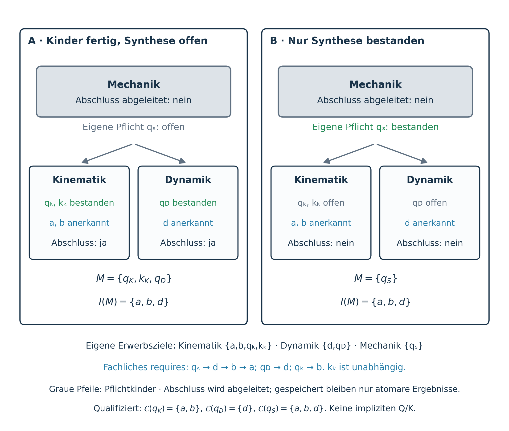

# Learning Units

A **learning unit** (German: **Lerneinheit**; conceptual technical name:
`LearningUnit`) makes a recognisable learning promise. It explains why the
outcome matters, organises learning goals or smaller units, and declares the
assessment and recall obligations belonging to its own promise.

**Purpose clarified on 6 November 2026.** A unit establishes a dependable
foundation for subsequent learning. Its assessments must demonstrate solid,
independent application before the planned course builds on that foundation.
An exposed conceptual gap calls for focused learning and reassessment; a false
positive completion must not send learners onward with an unstable foundation.
This is a didactic requirement, not an activation of technical access locks.

The German [design criteria and worked examples](learning-unit-design-and-examples.md)
explain this purpose through one-dimensional accelerated motion and an initial
Class 5 number-understanding candidate. The examples are proposals for review,
not approved curriculum partitions or assessment contracts.

The structure applies recursively: a course can contain topic units, a topic
smaller units, and a small unit atomic goals. Completion is derived from actual
goal outcomes and required children. No unit mastery or additional learner
qualification is stored.

**Concept status, 6 November 2026.** This is the accepted recursive target
design; implementation and migration remain pending. The updated
[global recognition contract](assessment-gated-completion.md) supersedes local
remaining-demand recognition: valid passed-Q proof acts globally immediately.
Binary goal results and [graph semantics](graph-definition.md) remain the
foundation. No new access lock is introduced.

## 1. Learning promise and authoritative placement

A boundary needs a meaningful transition: what coherent understanding and
application must be secure before something new depends on it? A theme, dense
prerequisite neighbourhood or existing assessment is an indicator, not a
sufficient definition. Review prerequisite meaning first. Sparse minimal chains
can form strong units; shared elementary prerequisites do not force every later
application into one giant unit. Do not change edges to justify a desired cut.
No fixed number of targets establishes a good unit, and collecting single-exam
wrappers under a new parent does not supply the missing didactic boundary.
A terminal unit or synthesis can also establish a meaningful independent
application; a later consumer is not required to justify its existence.

A unit identifies an outcome learners can understand, for example interpreting
and predicting a transition process. Its motivation explains the purpose of
the work. An appropriate existing orientation goal may supply this entry;
every heading or nesting depth does not require a new motivation atom or exam.

Use existing program units, goal placements and reviewed composition references
to assign the unit role in a resolved, versioned educational context. Do not
copy goal definitions into another curriculum tree. A cluster is not
automatically a unit, and a temporary focus or expanded UI branch cannot create
a new recognition contract.

Years and semesters place work in time. A year may contain several units and
a unit may span calendar periods. Calendar labels alone establish neither a
learning promise nor assessment coverage. Personalization Levels 1–4, QA
maturity and goal-difficulty `level` keep their existing meanings.

## 2. Recursive targets and direct acquisition ownership

For an authoritative unit U, resolve `Children(U)`, its required child units
after authored choices; `Own(U)`, its directly assigned actual atomic targets;
and the deduplicated recursive scope

$$
T(U)=Own(U)\cup\bigcup_{V\in Children(U)}T(V).
$$

Own may contain subject, orientation, assessment and memorization goals.
Synthetic composition markers are not atomic targets merely because they
appear in the tree. Resolve direct entries, applicable choices, subtree
references and projection roles before computing membership.
Every valid unit has a nonempty resolved T(U). A pure aggregate needs actual
required children; an empty or unresolved structure is not a completed unit.

Within one resolved acquisition path each atom has one direct home: the
smallest authoritative unit that actually teaches or assesses its outcome.
A parent includes child targets through T(V); it does not claim them again in
Own(U). Later application and another subject can require the same competence
without assigning another first acquisition. Another resolved curriculum may
place it differently without changing its canonical identity or global mastery.

Hidden `prerequisiteOnly` support remains in prerequisite validation. A reference
does not promote it into Own/T, increase the progress denominator or award
mastery. Missing support or ambiguous acquisition ownership is an authoring
finding, not an empty completed unit.

## 3. Assessments at the appropriate scale

Assessments follow the unit's application promise. They must distinguish
independent modelling, explanation and suitable transfer from reproducing a
coached solution. State essential concepts, permitted aids and expected entry
competence. An essential misconception must not be compensated by points for
incidental work. At the same time, a single arithmetic slip with sound reasoning
does not automatically negate the whole competence. Express these distinctions
in the ordinary, published task/rubric and grading contract; do not add a hidden
second pass rule or another stored qualification. If current total-score grading
cannot support the intended claim, redesign the assessment or narrow the claim
before authorising recognition. If published core criteria beyond the current
total-score rule are needed, change the shared normal grading contract and
test its adapters; do not introduce a coach-only pass condition.

On an unsuccessful attempt, explain the specific gap, offer focused learning
and use a suitable fresh application for reassessment. This does not revoke
unrelated valid achievements or require repeating every completed child.

For every released acquisition unit and each resolved permitted assessment
alternative, the actually required own Q must prove all own ordinary targets:

$$
Own(U)\cap O\ \subseteq\ \bigcup_{q\in RequiredOwnQ(U)}C(q).
$$

Here C(q) is the qualified full-goal coverage defined in the recognition
contract. Direct ordinary understanding or foreign evidence does not replace
these mandatory own application assessments. This is static content quality,
not a second learner result. Own memory goals retain verified recall, and all
required own Q/K stay explicit. Alternative Q are not all automatically required.

Required recall belongs with the unit that first acquires the corresponding
knowledge. A broad existing memory goal spanning proposed children must not be
moved to the parent merely to make those children complete without their real
card duties. Retain a fitting larger completion boundary, or review a genuine
goal/card-selection split with stable identities and explicit evidence migration.
Support references cannot stand in for missing required recall. A parent's
additional own obligations must not hide obligations belonging to its children.

| Unit role | Own assessment responsibility |
| --- | --- |
| Acquisition unit | Every permitted required-own-Q alternative proves the complete own ordinary promise. |
| Integrative parent | May require its own synthesis assessment combining child competencies, even without a new ordinary target. |
| Pure aggregate | May have no own assessment; it aggregates required children and any genuine own targets. |

A synthesis assessment is an explicit atomic goal of the parent. Its pass
does not pass child exams or verify child cards. It may recognize a child's
ordinary target only through its own complete qualified C(q), never through
blanket coverage of the descendant union. A new integrative subject
competence, if authored, belongs to Own(U) and needs its own reviewed coverage.
An ordinary navigation heading does not itself demand an extra assessment.

Cards alone are not evidence of independent application. Naming a card
collection a unit does not establish application competence. Displaying a
separate recall block changes neither its explicit recall duty nor this limit.

## 4. Qualified assessment proof, durable global effect

Let M be explicit mastery, O ordinary subject atoms, Q assessments and K
memorization atoms. For fully qualified immutable atomic coverage C(q),

$$
C(q)\subseteq O,\qquad
I(M)=\left(\bigcup_{q\in M\cap Q}C(q)\right)\setminus M,\qquad
M_{\mathrm{eff}}=M\cup I(M).
$$

Only explicit passed Q produce proof. `examData.coveredGoalIds` is the one
maintained authoring list after qualification; unreviewed or historically
uncertain Q have C(q) = ∅. A published/released marker alone does not qualify
coverage. A qualified set has fixed full atomic meanings, never dynamic
expansion through later cluster changes. Stronger or uncertain Q meanings need
new IDs; old results do not pass them. Equivalent variants may retain the ID.

Acquisition location and proof location differ. A parent or foreign Q can
prove an ordinary goal fully while the owning unit's required Q/K remain open.
One of several Q in a unit may therefore recognize A while another still needs
A. That valid recognition acts globally immediately, including after scope
changes. Unit completion still needs all required own and child obligations.
There is no new intermediate-assessment goal type or additional learner status.

Full inherited/cluster-expanded R reach continues through mastered and outside
intermediates before focus restriction. Qualified C(q) must be within the full
atomic Reach_R⁺({q}); that path is consistency evidence, never proof by itself.
Missing paths require subject review, not automatic or redundant direct edges.
Keep transitive minimality. Implicit results never seed new proof. Neither Q,
K nor motivation is implicitly completed by C(q).

For experiment and analysis, the default is one suitable multipart Q with one
normal binary result. Supplied-data analysis does not prove a required own
experiment; separately passed incomplete Q do not automatically prove the full
goal. No generic proof-combination language is introduced. Retain valid
historical coverage for global recognition after curriculum/focus changes.

## 5. Derived recursive completion

$$
Complete(U)\iff Own(U)\subseteq M_{\mathrm{eff}}
\ \land\ \bigwedge_{V\in Children(U)}Complete(V).
$$

Assessments and memory goals never receive implicit mastery. Every own Q/K
therefore needs its explicit positive outcome, and each required child must
complete its own contract. Parent synthesis alone cannot close an unfinished
child; child completion cannot pass the parent's synthesis. A pure aggregate
can complete solely through its required children.

Report progress over deduplicated T(U). Do not add child percentages to a
parent's atom count or store cluster mastery. A view that omits a required
child cannot establish parent completion. Unresolved membership or contract
validity is unavailable, not complete. Completion does not itself decide entry;
see [Learning-Unit Progression and Access Policy](learning-unit-progression.md).

**Illustrative cases.** Completed children do not pass an own parent synthesis.
A parent synthesis pass does not complete open child exams or cards. Unit
completion is recursive; valid recognition of child competencies stays global.

## 6. Prerequisites and feasible unit boundaries

The atomic graph retains acyclicity, inherited and expanded requirements and
transitive minimality. Grouping does not rewrite these facts. A whole-unit
prerequisite is a deliberate authored claim about complete promises: one
atomic dependency on a small part of a module does not justify making the
whole module compulsory. Dependency summaries are diagnostics, not new gates.

A course presented as complete ordered blocks must admit an acyclic projected
block order and valid internal atomic traversal. Atomic acyclicity alone is
insufficient: acquisition order a → b → c cannot place a,c in one indivisible
block and b in another without a block-order conflict. Revise the boundary or
explicitly permit interleaving. Technical locks and direct assessment access
are not activated by nesting. This work retains direct assessment attempts and
introduces no new lock; any future gated mode requires a separate decision.

## 7. Optional calendar and workload profiles

A reference plan can place units or activities in years, semesters or dated
periods. It declares entry assumptions and checks every prerequisite, including
hidden and cross-subject support. Entry assumptions write no mastery. Same-period
dependencies need a teachable internal order; an unplanned prerequisite is a gap.

Workload is a separate claim: state reference learners, entry basis, activities,
effort model, uncertainty, time capacity and reserve. Count shared acquisition
once and extra practice explicitly. Goal weight/count is not a time estimate;
cross-subject budgets need a common calibration and binding subject/resource
limits as well as a total. A valid recognition contract needs no completed
time-budget claim, and a feasible timetable does not prove application.

Formal profiles are in [Graph Definition §12](graph-definition.md#12-learning-units-and-optional-planning-profiles)
and the [time-axis contract](../didactic/curriculum-time-axis-and-pacing.md).

## 8. Evidence and implementation boundaries

Review the promise, source scope, stable placement, Own/child membership,
Q/K and card ownership, normalized prerequisites and own task/rubric meaning.
Check each qualified Q and allowed variant against every full competence in
C(q): can a learner pass while entirely lacking an essential claimed competence?
Such a counterexample invalidates the contract. Also check that secure
understanding with an incidental calculation error can pass normally.

Source fidelity, independent content reviews, applicable strict QA gates,
reproducibility and truthful acceptance remain required. Existing curricula are
not declared reviewed for recursive units by this concept. Machine validation
or a technical preview proves neither real-host acceptance nor usability or
learning effectiveness.
