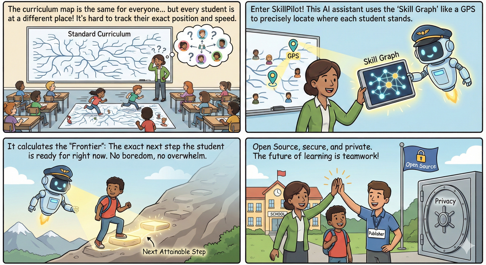
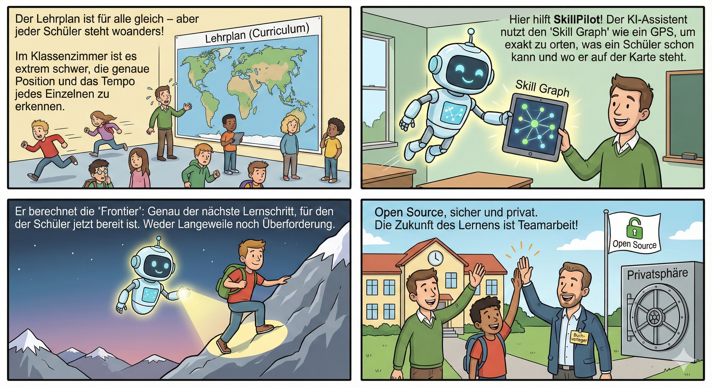

# SkillPilot – Your Personal Learning Navigator

SkillPilot navigates you through complex skill landscapes, modeling curricula as a skill graph to provide personalized learning paths and track your mastery.

This project is an invitation to the community to jointly build and bring to life a secure platform for skill landscapes—a shared home where learners, educators, curriculum institutions, and supporting AIs alike can thrive.

## Choose your path

### Learners & teachers
- [Quickstart](quickstart/story.en.md)
- [Live app](https://skillpilot.com)
- [Coach setup: Claude, ChatGPT Desktop (Beta) and Gemini (Beta)](https://skillpilot.com/plugins)

Gemini uses an imported coaching Skill and a connected Custom App in Gemini Web. The controlled test with one privately configured operator account confirmed saved learning progress and continuation in a new chat. Public onboarding, additional accounts, mobile and voice still require acceptance; learning-goal images currently have a tested direct-link route. See the [Gemini setup guide](https://skillpilot.com/plugins#gemini) and [integration runbook](deploy/gemini-integration.md). Deployment and activation are separate steps.

### Curriculum champions
- [Curricula & Champions](https://skillpilot.com/curricula)
- [Champion guide](qa-ci/champion-guide.md)
- [Four-level QA model](qa-ci/four-level-champion-model.md)
- [QA/CI documentation](qa-ci/index.md)
- [Canonical Gymnasium Math rollout status](dev/canonical-gymnasium-math-bundeslaender-status.md)
- [Canonical Gymnasium Physics rollout status](dev/canonical-gymnasium-physics-bundeslaender-status.md)

### High-level overview
- [Whitepaper](whitepaper/whitepaper.en.md)
- [Levels of personalization](concept/levels-of-personalization.md)

### AI learning coaches (Claude, ChatGPT & Gemini / MCP)
- [Coach product topology](concept/runtime-workflows/skillpilot-owned-coach-architecture.en.md)
- [Provider-neutral coach communication contract](concept/runtime-workflows/provider-neutral-coach-boundary.en.md)
- [SkillPilot in Gemini: integration runbook (DE)](deploy/gemini-integration.md)
- [OpenAI plugin versioning and lifecycle](concept/runtime-workflows/openai-plugin-versioning-and-lifecycle.en.md)
- [OpenAI MCP OAuth app binding and 24h learning sessions](concept/runtime-workflows/openai-mcp-oauth-learner-session-architecture.en.md)
- [OpenAI MCP authorized client binding](security/openai-mcp-client-binding.en.md)
- [Release, rollback, and retirement of SkillPilot Coach v1 (DE)](deploy/openai-plugin-v1-release.md)
- [OpenAI review: rejection, lifted freeze, and historical evidence (DE)](deploy/openai-plugin-v1-review-freeze.md)
- [OpenAI submission dossier for SkillPilot Coach v1 (DE)](deploy/openai-plugin-v1-submission.md)
- [Rollback: ChatGPT Visible Session](concept/runtime-workflows/chatgpt-visible-session-flow.md)

### Programme status
- [Canonical Gymnasium implementation plan](dev/canonical-gymnasium-implementation-plan.md)
- [Dual curriculum package implementation status](dev/dual-curriculum-package-implementation-status.md)
- [Current curriculum quality status](qa-ci/status/curriculum-quality-status.md)

## Inside this documentation

The docs here are organized by intent: concept-level foundations (skill graph and didactics), then runtime workflows, followed by operational topics like pipelines, QA/CI, deployment, developer references, and security.

- [Glossary of core SkillPilot terms](concept/glossary.md)
- [Documentation guidelines](dev/documentation-guidelines.md)
- [Quickstart documentation index](quickstart/index.md)
- [Whitepaper documentation index](whitepaper/index.md)
- [Concept documentation index](concept/index.md)
- [Production pipelines index](production-pipelines/index.md)
- [Developer documentation index](dev/index.md)
- [QA/CI documentation index](qa-ci/index.md)
- [Deployment documentation index](deploy/index.md)
- [Legal and AI transparency evidence](legal/index.md)
- [Security documentation index](security/index.md)

## Contribute

- **Curriculum Champions:** Start with the Curricula & Champions entry above.
- **Developers & designers:** Open Issues/PRs at [github.com/enpasos/skillpilot/issues](https://github.com/enpasos/skillpilot/issues)

# SkillPilot – Dein persönlicher Lern-Navigator

SkillPilot navigiert dich durch komplexe Skill-Landschaften, modelliert Curricula als Skill-Graph, berechnet personalisierte Lernpfade und macht deinen Lernfortschritt nachvollziehbar.

Dieses Projekt ist eine Einladung an die Community, gemeinsam eine sichere Plattform für Skill-Landschaften aufzubauen – ein gemeinsames Zuhause für Lernende, Lehrkräfte, Curriculum-Institutionen und unterstützende KI-Systeme.

## Wähle deinen Einstieg

### Lernende & Lehrkräfte
- [Schnellstart](quickstart/story.de.md)
- [Live-App](https://skillpilot.com)
- [Coach-Einrichtung: Claude, ChatGPT Desktop (Beta) und Gemini (Beta)](https://skillpilot.com/plugins)

Gemini nutzt einen importierten Coaching-Skill und eine verbundene Custom App in Gemini Web. Der kontrollierte Test mit einem privat konfigurierten Betreiberkonto hat gespeicherten Lernfortschritt und die Fortsetzung in einem neuen Chat bestätigt. Öffentliches Onboarding, weitere Konten, Mobile und Sprache erfordern weiterhin eine eigene Abnahme; Lernzielbilder verfügen aktuell über einen getesteten Direktlink-Weg. Siehe die [Gemini-Einrichtungsanleitung](https://skillpilot.com/plugins#gemini) und das [Integrations-Runbook](deploy/gemini-integration.md). Deployment und Aktivierung bleiben getrennte Schritte.

### Curriculum-Champions
- [Curricula & Champions](https://skillpilot.com/curricula)
- [Champion-Leitfaden](qa-ci/champion-guide.de.md)
- [Vier-Stufen-QS-Modell](qa-ci/four-level-champion-model.de.md)
- [Qualitäts- und CI-Dokumentation](qa-ci/index.md)
- [Kanonisches Gymnasium Mathematik: Bundesländer-Status (EN)](dev/canonical-gymnasium-math-bundeslaender-status.md)
- [Kanonisches Gymnasium Physik: Bundesländer-Status (EN)](dev/canonical-gymnasium-physics-bundeslaender-status.md)

### Gesamtüberblick
- [Whitepaper](whitepaper/whitepaper.de.md)
- [Ebenen der Personalisierung](concept/levels-of-personalization.de.md)

### KI-Lerncoaches (Claude, ChatGPT & Gemini / MCP)
- [SkillPilot-Lerncoach: Produkt- und Providerarchitektur](concept/runtime-workflows/skillpilot-owned-coach-architecture.md)
- [Kommunikationsvertrag zwischen ChatClient und SkillPilot-Backend](concept/runtime-workflows/provider-neutral-coach-boundary.md)
- [SkillPilot in Gemini: Integrations-Runbook](deploy/gemini-integration.md)
- [OpenAI-Plugin: Versionierung und Lebenszyklus](concept/runtime-workflows/openai-plugin-versioning-and-lifecycle.md)
- [OpenAI-MCP-App: OAuth-Appbindung und 24h-Lernsession](concept/runtime-workflows/openai-mcp-oauth-learner-session-architecture.md)
- [OpenAI-MCP: Bindung an den zugelassenen Client](security/openai-mcp-client-binding.md)
- [SkillPilot Coach v1: Release, Rollback und Stilllegung](deploy/openai-plugin-v1-release.md)
- [OpenAI-Review: Ablehnung, aufgehobener Freeze und historische Nachweise](deploy/openai-plugin-v1-review-freeze.md)
- [SkillPilot Coach v1: OpenAI-Submission-Dossier](deploy/openai-plugin-v1-submission.md)
- [Rollback: ChatGPT Visible Session (EN)](concept/runtime-workflows/chatgpt-visible-session-flow.md)

### Programmstatus
- [Kanonisches Gymnasium: Umsetzungsplan (EN)](dev/canonical-gymnasium-implementation-plan.md)
- [Duale Curriculum-Pakete: Umsetzungsstand (EN)](dev/dual-curriculum-package-implementation-status.md)
- [Aktueller Curriculum-Qualitätsstatus](qa-ci/status/curriculum-quality-status.md)

## Aufbau dieser Dokumentation

Die Dokumentation ist nach Aufgabenbereichen gegliedert: konzeptionelle Grundlagen (Skill-Graph und Didaktik), Laufzeit- und Coach-Abläufe sowie operative Themen wie Produktions-Pipelines, Qualität & CI, Betrieb & Rollout, Entwicklung und Datenschutz.

- [Glossar zentraler SkillPilot-Begriffe](concept/glossary.de.md)
- [Dokumentationsrichtlinien](dev/documentation-guidelines.de.md)
- [Schnellstart-Übersicht](quickstart/index.md)
- [Whitepaper-Übersicht](whitepaper/index.md)
- [Konzept-Übersicht](concept/index.md)
- [Produktions-Pipelines-Übersicht](production-pipelines/index.md)
- [Entwicklungs-Übersicht](dev/index.md)
- [Qualitäts- und CI-Übersicht](qa-ci/index.md)
- [Betriebs- und Rollout-Übersicht](deploy/index.md)
- [Rechtliches und KI-Transparenznachweise](legal/index.md)
- [Sicherheits- und Datenschutz-Übersicht](security/index.md)

## Mitwirken

- **Curriculum-Champions:** Einstieg über Curricula & Champions oben.
- **Entwicklung & Design:** Issues und Pull Requests unter [github.com/enpasos/skillpilot/issues](https://github.com/enpasos/skillpilot/issues)

