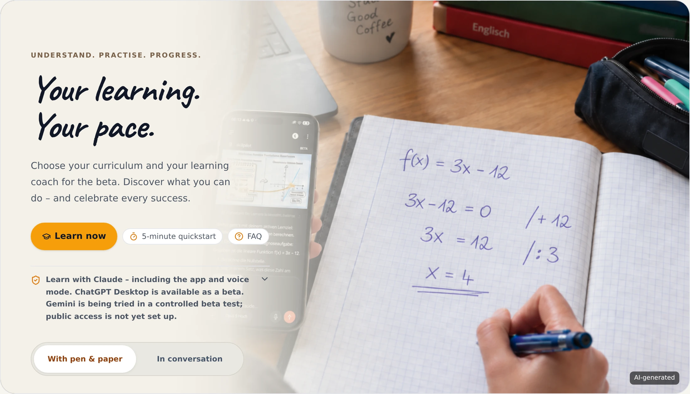
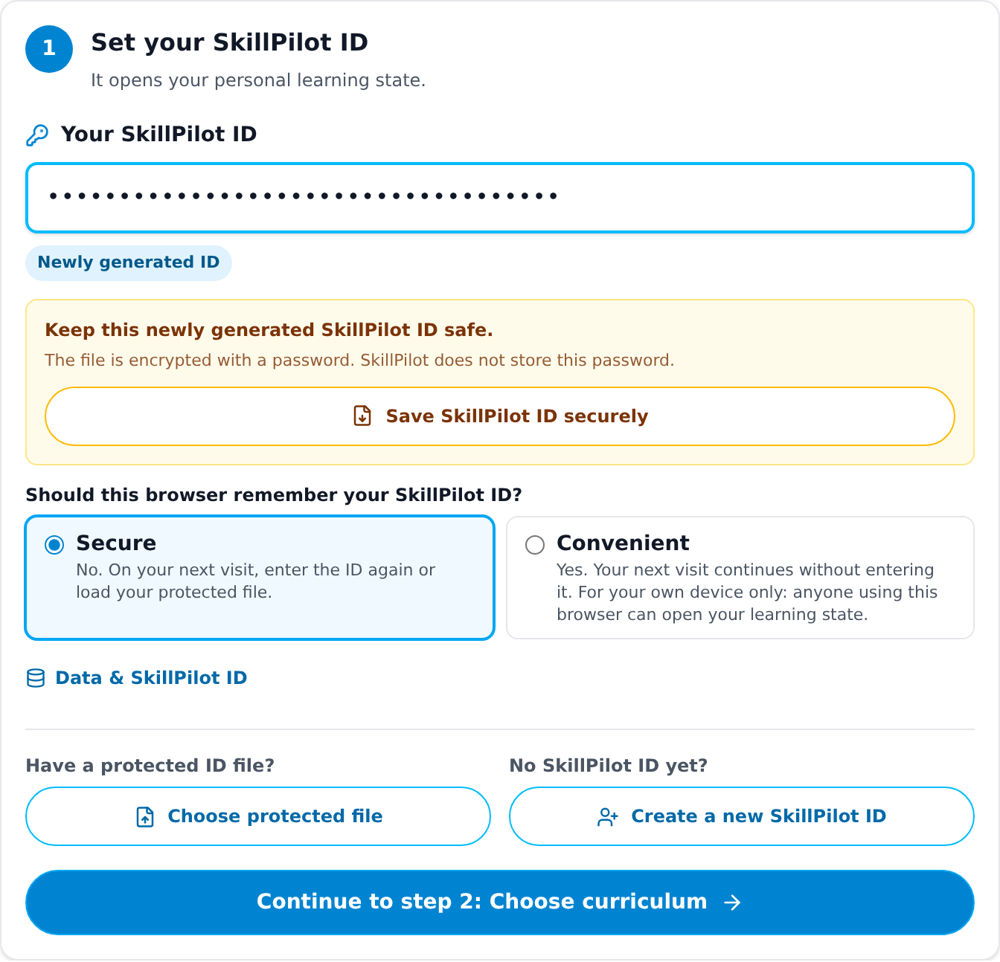
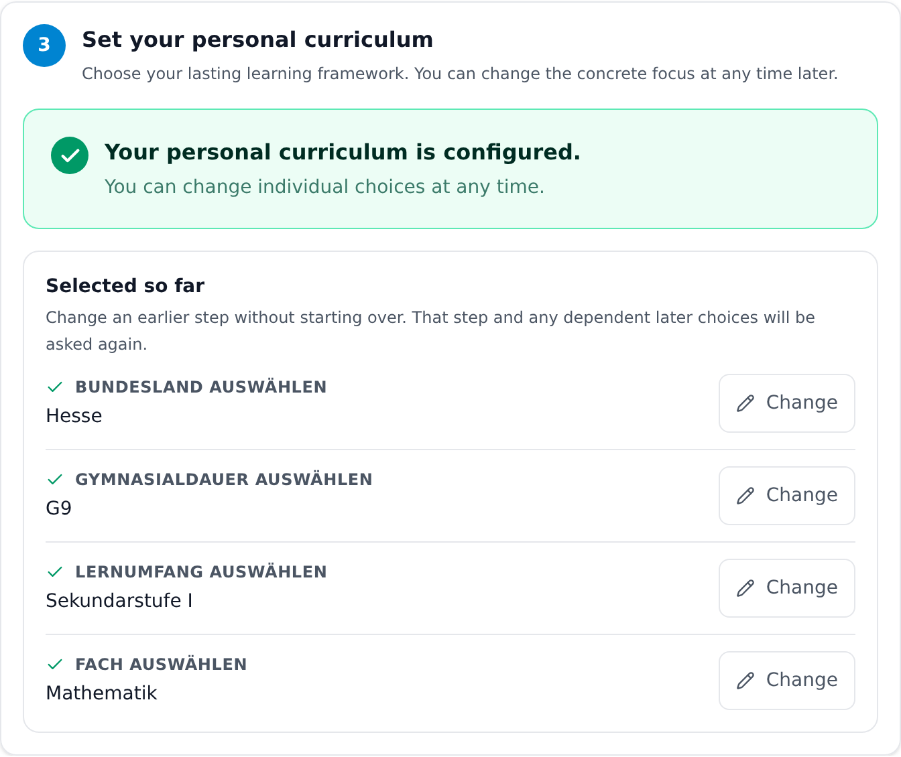
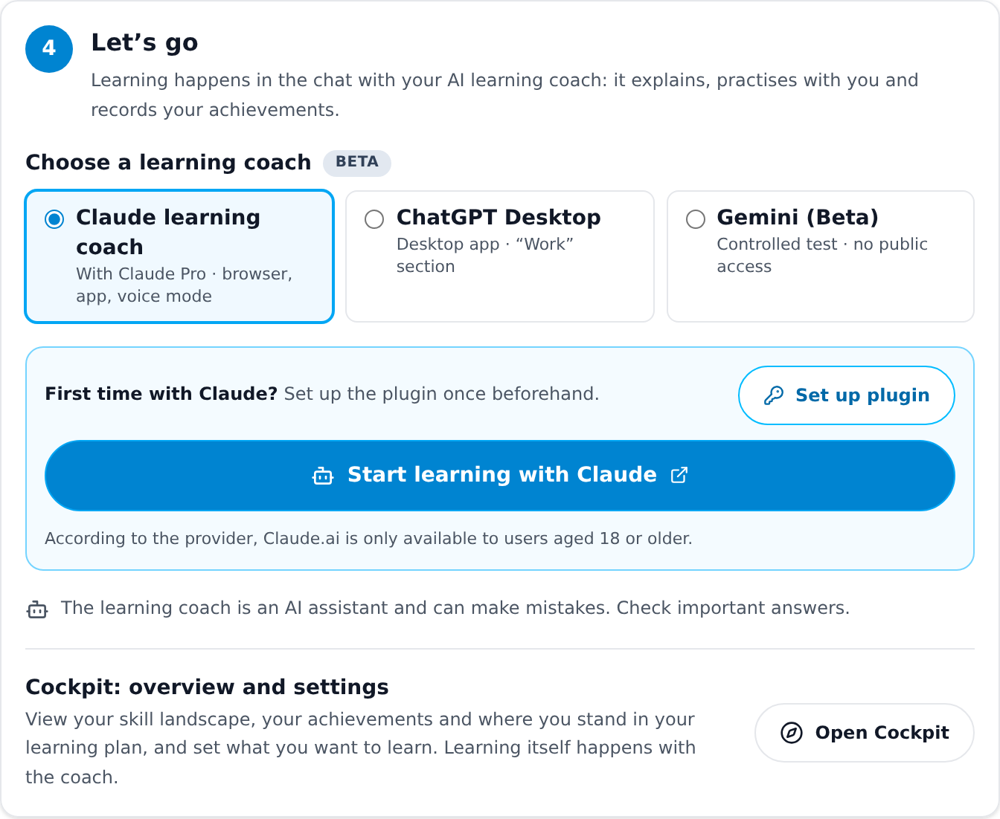
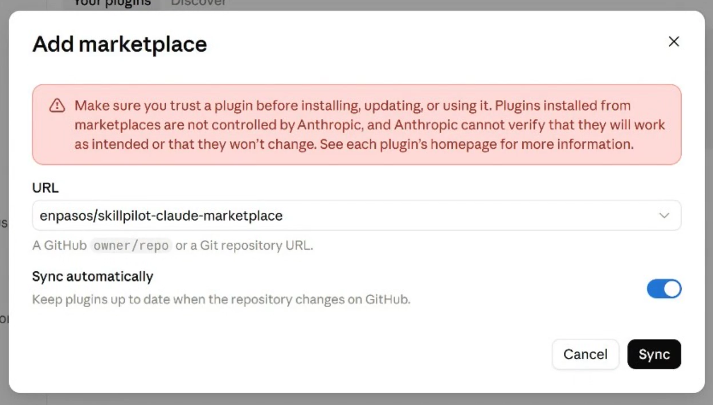
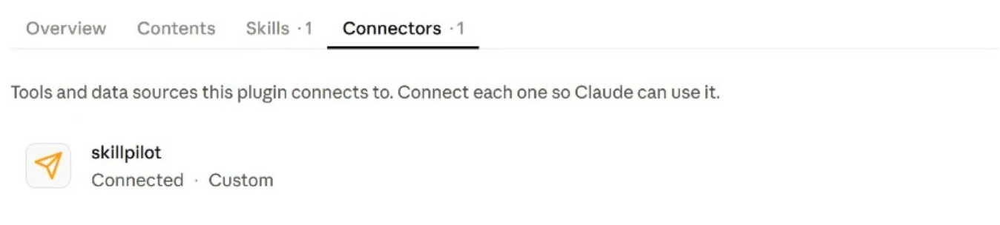
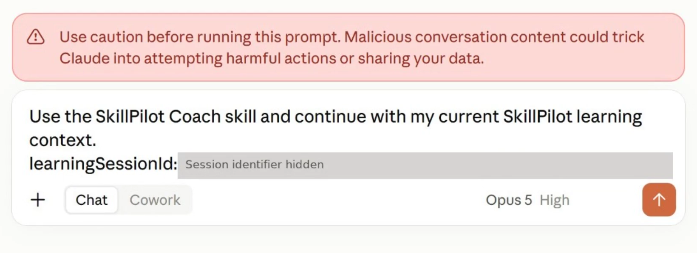
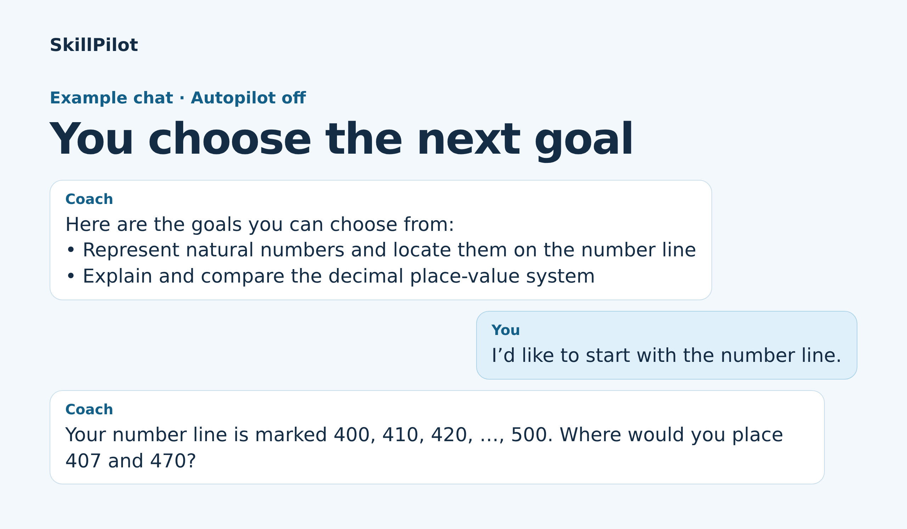

# From “Learn now” to your first problem

You start on the SkillPilot website and learn in your coach’s chat. This example takes you to your first maths problem with Claude. You’ll need a Claude Pro account and must be at least 18.

[Watch the walkthrough](https://skillpilot.com/quickstart/en#video)

## 1. Start on the home page

Open [skillpilot.com](https://skillpilot.com/) and select **Learn now**. Read and accept the terms of use.

Select **Create a new SkillPilot ID**. Your ID gives you access to your learning record. Select **Save SkillPilot ID securely** to download a password-protected copy. Already have an ID? Enter it or load your protected file.

**Secure** remembers your ID only in the open tab. **Convenient** remembers it for your next visit. Use **Convenient** only on your own device, since anyone using that browser can open your learning record.

## 2. Choose what you want to learn

Select **Continue to step 2: Choose curriculum**. For this example, choose **Gymnasium (DE)**, the German secondary school curriculum. Under **Set your personal curriculum**, choose **Hesse → G9 → Sekundarstufe I → Mathematik**, then **Finish this selection**. The last two labels are German for lower secondary and mathematics. Your choices are saved for your next visit with the same ID.

## 3. Install the coach in Claude once

Under **Let’s go**, select **Claude learning coach**, then **Set up plugin**. The setup guide opens in a new tab. Keep the SkillPilot learning setup open. If your coach is already installed and connected, go straight to step 4.

1. **Open the marketplace menu.** Sign in to Claude in your browser and open **Settings → Plugins**. The **Open plugins in Claude** button on the SkillPilot setup page takes you there directly. From the **Add** menu at the top right, choose **Add marketplace → Add from a repository**.
2. **Enter the address.** Copy this address into the repository field, leave **Sync automatically** on and select **Sync**.

    `https://github.com/enpasos/skillpilot-claude-marketplace`

    *Claude Web, September 13, 2026. The URL field also accepts the shorter repository name shown here.*

    

3. **Add the plugin.** Under **Discover**, find **SkillPilot Coach v1** from **skillpilot-claude-marketplace**. Compare the version with the one shown in the **SkillPilot plugins** tab, then select **Add**. You should now see the coach enabled under **Your plugins**.
4. **Connect it.** In the installed plugin, open **Connectors → skillpilot**. If needed, select **Connect**, sign in and approve access. Once you see **Connected**, you’re ready to start learning.

*Claude Web, September 13, 2026.*

If the marketplace is missing or offers an older version, download the current `.plugin` file from the SkillPilot setup page. In Claude, select the file under **Plugins → Add → Upload plugin**, then connect it as described above. [SkillPilot setup page](https://skillpilot.com/plugins#claude-plugin)

## 4. Try your first problem in the chat

Go back to the SkillPilot learning setup and select **Start learning with Claude**. A new Claude chat opens with your start message filled in. Claude may show a warning because the message came from another site. Review the text, then send it using the arrow at the bottom right. Keep the start message private.

*Claude Web, September 13, 2026. The session ID is hidden in the image.*

Your coach knows your curriculum. After the introduction, you choose from the goals you’re ready for if Autopilot is off. With Autopilot on, SkillPilot suggests one of those goals. In this example, you choose the **number line**.

Now it’s your turn. Describe where you would place **407 and 470** on a number line marked in tens. If you get stuck, try asking **“How do I find a number between two marks?”** You can then try another problem. If your coach offers flashcards or an assessment, you can start those in the chat too.

Take a break whenever you need one. If your session has expired when you return, start a new one with the same ID. Your saved progress carries over. To see your progress on the learning map, select **Open Cockpit**.

## Join the ChatGPT desktop beta test

You need **Work** in ChatGPT Desktop. Open **Plugins → Add → Add marketplace**. Paste the GitHub address from the installation guide into **Source** and leave **Git ref** and **Sparse paths** blank. When the marketplace offers **SkillPilot Coach** version **1.2.0** or later, install or update the coach and check the installed version. Follow the sign-in steps if ChatGPT asks to connect it. [Installation guide](https://skillpilot.com/plugins#chatgpt-desktop)

In SkillPilot, select **ChatGPT Desktop** and **Prepare learning with ChatGPT**. Open a fresh conversation in **Work** with **SkillPilot Coach** selected. Replace any prefilled example question with the prepared start message and send it. Keep the plugin selected and keep the start message private.

Gemini is available for accounts set up for the controlled test. [Access requirements by provider](https://skillpilot.com/faq/coach-setup)
