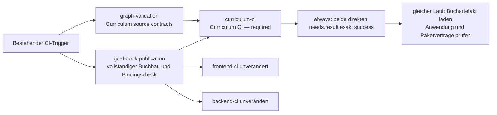

# Früher Curriculum-Vertragscheck mit unveränderter finaler Integration

Der konkrete Vorschlag ist `ci.proposed.yml`; `ci.proposed.patch` zeigt ausschließlich die Aufteilung des bisherigen `graph-validation`-Jobs. Die aktive Workflowdatei bleibt unverändert. Eingang: SHA-256 `2920020ba64bad08ecfee400ee41ef13ac94c09884cfb86dc490e5517349b975`.

Die vorhandene Job-ID `graph-validation` heißt künftig **Curriculum source contracts** und startet ohne `needs` parallel zum Buchbau. Ein neuer Job `curriculum-ci` trägt als einziger den bestehenden Pflichtkontext **Curriculum CI**. Er wartet auf beide Jobs, läuft mit `if: ${{ always() }}` und lehnt vor Checkout/Download jeden anderen Upstreamwert als zweimal `success` ab. Anschließend führt er die unveränderten Integrationsschritte aus. Frontend, Backend, Buchbau, andere Jobs, Events, Pfadfilter, Berechtigungen und Workflow-Concurrency bleiben bytegleich.

## Exakte Schrittaufteilung

Die Nummern beziehen sich auf die vollständig erfassten 85 bisherigen Schritte in `step-allocation.json`. Jeder alte Schrittblock bleibt einschließlich `run`, `env`, `working-directory`, Actionsversion, Optionen und Timeout unverändert. Es entfallen keine Prüfungen. Nur die nötigen zehn Setup-Schritte werden auf zwei unabhängigen Runnern wiederholt; hinzu kommt genau ein harter Statusguard.

| Alte Schritte | Ziel | Tatsächliche Abhängigkeit |
|---|---|---|
| 1–8: Disk, Checkout, Node/npm, APT, bwrap/strace und Isolation | Beide Jobs | Eigenständige Runner benötigen diese Voraussetzungen. Core benötigt bwrap für die unveränderten Source-A-Tests; Integration behält es für die bisherige Paketprüfung. |
| 9–11: gepinnte Fixtures, Source-A-Metadaten, 19 isolierte Vorbereitungs-/Capturekontrollen | Core | Diese Schritte stehen schon heute vor dem Buchdownload. Commit, Fetch, Testkommando, Anzahl und Skipverbot bleiben gleich. Keine neuen Source-A-Probes. |
| 12–13: PDF-/Fonttools und gepinnter Chromium | Integration | Notwendig für den bestehenden `build:application`-Weg mit Buchvalidierung bzw. zulässigem Cachemiss. |
| 14: Buchartefakt restaurieren | Integration, unmittelbar vor altem Schritt 66 | Exakt `goal-book-publication-${{ github.sha }}` und `app/public/lernzielbuch/`, Download aus demselben Workflowlauf. Kein frühes unvollständiges Katalogartefakt. |
| 15–59: Graph, Aufgaben/Scopes, Wording, Views, Registry, Source/Rationale, Dokumentation, Karten, QA, Readiness und Floor | Core | Repositoryquellen, konfigurierte Views, vorhandene öffentliche Quelldaten und QA-/Reviewbelege; keine generierte Buchpublikation als Eingang. Die bisherige Reihenfolge bleibt unverändert. Der vollständige Statusgenerator, Floor und beide Statusdatei-Driftprüfungen bleiben zusammen. |
| 60–64: Runtime-Assets erzeugen und Visualisierungsassets/QA/Abdeckung prüfen | Integration | Kein Buchread erforderlich, aber die lokale Erzeuger-/Verbraucherkette bleibt zusammen. Es wird weder ein neues Asset-Transferartefakt noch ein zweiter Datenvertrag eingeführt. |
| 65: vollständiger Standalone-Package-Builder-Test | Integration | Eigene temporäre Fixture-Repository; kein Read der aktuellen Buchpublikation. Bleibt bewusst bei der Paketkette, um diese nicht weiter aufzuspalten. |
| 66: integrierten Anwendungsbuild erstellen | Integration | **Erster direkter Buchverbrauch:** `build:goal-books && check:goal-book-publication && tsc -b && vite build`. Vite übernimmt den öffentlichen Baum in den Anwendungsbuild. |
| 67: Package-only-Frontend | Integration | `prebuild:package-consumer` prüft Buchisolierung; der Builder verwendet `publicDir: false`. Dieser Consumer muss öffentliche Repositoryinhalte ausschließen. Keine Buchabhängigkeit vortäuschen; unverändert bei den Integrationsverträgen belassen. |
| 68: Source-Rationale-Buildartefakt prüfen | Integration | Benötigt tatsächlich die zuvor erzeugten `backend/src/main/resources/static/assets`, öffentlichen Datenkopien und `sw.js`. Darf nicht allein in Core wandern. |
| 69 und 72: Python 3.10 und gepinntes jsonschema installieren | Beide Jobs | Frühe Schemaprüfung benötigt dieselbe Python-Vorbereitung; die bisherige Paketprüfung behält sie. |
| 70–71 und 73–74: exaktes Corretto, Shellsyntax, Paketverträge und Release-Model-Konformität | Integration | Zusammenhängender bisheriger Paketweg. `SKILLPILOT_SOURCE_PDF_MODE: committed-bindings` und `SKILLPILOT_FULL_PACKAGE_CONFORMANCE=false` bleiben exakt. Die vorhandenen Selftests werden nicht nachträglich als volle Paket-/Hostakzeptanz bezeichnet. |
| 75–85: Symlinks, Schemas, UUID-CLI/-Validierung, Archivpfade/-referenzen und Chemie-Exam-Pipeline | Core, nach 59 und eigener Python-Vorbereitung | `curricula`, Quell-/Schemaspezifikationen und Repo-Pfade. Keine gebaute Anwendung und keine `app/public/lernzielbuch`-Publikation erforderlich. Test/Produktivcheck-Paare behalten ihre Reihenfolge. |

Damit hat Core 69 Schritte und der finale Job 27. Bibliotheksnamen allein begründen keine PDF-Abhängigkeit: etwa `goalBookModel` und Atlas-Konfigurationen liefern Quell-/Schema-/Projektionsfunktionen. Ihre Verwendung in einem Quelltest bedeutet keinen Read des erzeugten PDF-/Model-Katalogs. Hier wurde Quellcode gelesen; ein vorgezogener Voll-CI-Lauf wird nicht behauptet.

## Pflichtstatus und Artefaktbindung

GitHub überspringt abhängige Jobs normalerweise nach fehlgeschlagenen/übersprungenen Vorläufern; ein übersprungener Job kann einen Pflichtcheck erfüllen. Deshalb genügt `needs` allein nicht. GitHub empfiehlt für einen abhängigen Pflichtcheck `always()` zusammen mit `needs`. [Offizielle Dokumentation zu Pflichtchecks](https://docs.github.com/en/pull-requests/how-tos/merge-and-close-pull-requests/troubleshooting-required-status-checks#handling-skipped-but-required-checks), [Job-Abhängigkeiten](https://docs.github.com/en/actions/reference/workflows-and-actions/workflow-syntax#jobsjob_idneeds).

Der erste Schritt des finalen Jobs läuft ebenfalls mit `always()` in `${{ runner.temp }}`, da `app/` vor Checkout noch nicht existiert. `needs.graph-validation.result` und `needs.goal-book-publication.result` werden als Umgebungswerte übergeben und in Bash auf exaktes `success` geprüft. `failure`, `cancelled`, `skipped`, leer, fehlend oder unbekannt führen zu Exit 1. Beide Jobs müssen direkte `needs` sein: der Kontext umfasst keine beliebigen transitiven Vorläufer. [Offizielle needs-Semantik](https://docs.github.com/en/actions/reference/workflows-and-actions/contexts#needs-context).

Nur dieser begrenzte Guard läuft immer; die folgenden Checkout-/Installations-/Integrationsschritte bekommen kein `always`, kein `continue-on-error` und kein Skip-/Warnargument. Nach seinem Fehler bleiben sie durch die normale Schritt-Erfolgsbedingung aus. Bei Workflow-/Runnerabbruch kann Actions die Ausführung insgesamt beenden; dann darf der finale Check nie als erfolgreiche Freigabe gelten. `always()` garantiert keine Ausführung nach einem harten Runnerverlust. [Offizielle Statusfunktionen und Abbruchhinweise](https://docs.github.com/en/actions/reference/workflows-and-actions/expressions#status-check-functions).

Die Buchproduktionskette bleibt vollständig: `--force`-Bau, Publikations-Bindingscheck, Upload einschließlich versteckter Cachedatei, Download mit unverändertem Namen aus demselben Lauf, anschließend der bestehende Anwendungsbuild mit eigener Prüfung. Kein `run-id`, Repositorytoken, Fremdlaufdownload, Katalogersatz oder Cache-Bypass kommt hinzu. Der bestehende Builder übernimmt PDFs bei passenden Eingangs-/Ausgangshashes; bei Cachemiss darf er wie bisher neu bauen und prüfen. Der Vorschlag ändert dieses bestehende Verhalten nicht und behauptet keine ungeprüfte Bytegleichheit nach einem solchen Neubau.

## Konkrete Regressionserweiterung

`workflow-test-additions.mjs` ist ein einfügbarer Vorschlag für **zusätzliche** Tests in `scripts/plugin_ci_workflows.test.mjs`. Die vorhandenen `graph-validation`-Extraktoren und Source-A-/HE-Math-Hardgate-Tests bleiben inhaltlich bestehen. Sie prüfen weiterhin den echten Core. Die Ergänzung prüft zusätzlich die tatsächliche finale Kette: eindeutiger Pflichtname, direkte Abhängigkeiten, beide `always`-Bedingungen, Guard vor Checkout, exakte needs-Bindungen, unveränderten Artefaktdownload, Readiness/Floor im Core und harte Integrationsschritte im finalen Job.

Die Guardprüfung führt den **aus dem vorgeschlagenen YAML extrahierten Bashcode** für alle 49 Kombinationen aus sieben Werten je Vorläufer aus: exakt ein Erfolg, 48 Ablehnungen. Neunzehn Workflowmutationen prüfen unter anderem fehlendes `always`, `success()`/`!cancelled()` statt `always()`, entfernte Abhängigkeit, fehlenden/späten Guard, falschen Pflichtnamen, entfernte/bedingte/weiche Integration und fehlenden/fremden Katalogdownload. Die tatsächliche Buchbau-/Bindingscheck-/Upload-Reihenfolge und die versteckte Cachedatei werden ebenfalls geprüft; fehlende/weiche Publikationsprüfung, vorzeitiger Upload und ausgelassene Cachedatei werden abgewiesen. Die Änderungen sind auf den finalen Job begrenzt, damit die gleich benannte Frontend-Downloadzeile nicht versehentlich statt des Gatepfads mutiert wird.

Lokal tatsächlich geprüft: YAML lesbar, alle 85 alten Schrittblöcke vollständig erhalten, alle übrigen Jobs und äußeren Workflowteile identisch; sieben gezielt ausgewählte statische Workflowtests bestehen (vier bestehende plus drei neue), null Fehler. Neun fachfremde Workflowtests waren explizit nicht ausgewählt. Keine eigentlichen Source-A-, Graph-, Readiness-, Floor-, PDF- oder Anwendungsbefehle wurden ausgeführt. Der aktuelle aktive Workflow wurde nachgehasht und ist unverändert.

Vor Übernahme durch Sol: den Patch gegen den dann aktuellen Workflow erneut abgleichen, die Testergänzung in die bestehende Datei aufnehmen, deren normale Tests prüfen und die tatsächlichen CI-Kontexte an einem frischen regulären PR-Lauf beobachten. Besonders prüfen: Core beginnt ohne Buchabhängigkeit; der finale Pflichtcheck ist bei jedem negativen Upstreamstatus rot; bei Erfolg wurde genau der vollständige Same-run-Upload vor der Integration geladen. Keine Änderung der Branchregeln oder Trigger gehört zu diesem Vorschlag.

## Grenzen und erwartete Wirkung

Der Core kann sofort mit Checkout/Setup beginnen und Quellvertragsfehler vor Abschluss des Buchbaus melden. Der Pflichtjob wartet bewusst weiterhin auf beide Vorläufer. Ein zusätzlicher vollständiger Checkout und Runner-Setup können die Gesamtlaufzeit verlängern; Runnerkapazität und Queuezeiten beeinflussen den Nutzen. Kein gemessener Beschleunigungsfaktor wird behauptet.

Die von Root berichteten Zeiten des Vorgängerlaufs (Runtime-Assets 09:57:13, Buchbau 09:58:23–10:05:33, Bindingscheck bis 10:06:10) sind Kontext, keine in diesem Review erneut erhobene Messung. Hier werden keine laufenden CI-Jobs abgebrochen, kein Frontend-/Backend-Frühstart und kein verfrühter Katalogexport vorgeschlagen. Fachliche Gates, Informatikdefinitionen, Math132, Schemas, Scope und Source-A-Policy bleiben unberührt.
